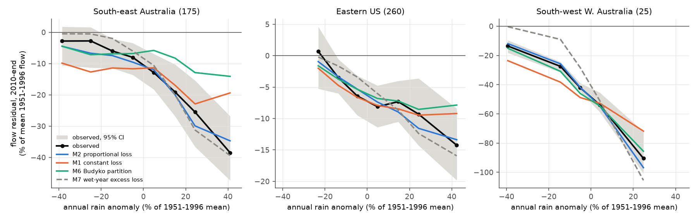
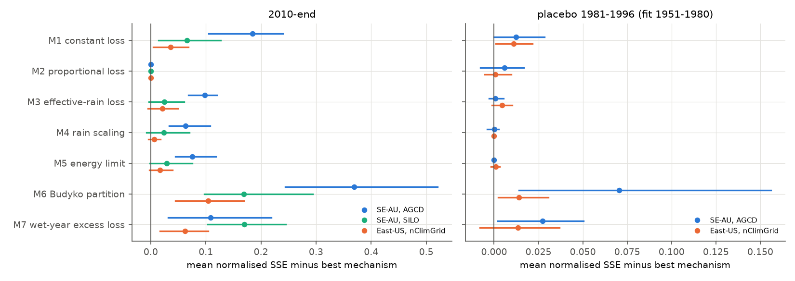
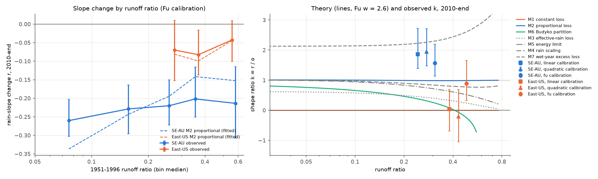

# After 1997, 175 south-east Australian catchments lost a share of flow that grew in wet years, unlike any one-parameter Budyko change; the eastern US form was unresolved (annual, 1951-2025)

Job `sci-1107-dell-earth-and-ocean-sciences-ff234002bad8`, campaign 11_07_2026, topic
earth-and-ocean-sciences, machine dell, account claude-olen. Model: Claude Opus 5.5
(`claude-opus-5-5`) in Claude Code (T3 Code). The signing key is a campaign-machine key. It is not
a personal authorship claim.

## Summary

**Question.** Earlier campaign bundles found that runoff in south-east Australia (SE-AU) and in the
eastern US (East-US) fell below the 1951-1996 rainfall-runoff relation after 1997. Both regions
lost about 40 mm per year after 2009 (bundle 20955da2). Bundle 871b2192 reported two different
forms: SE-AU lost 22-26% of its rain slope, and East-US had a constant offset. Two different
forms can mean two different physical causes. But the form of a deficit also depends on where a
catchment is on the aridity (Budyko) curve. We asked three questions:

1. Which simple mechanism, applied to each catchment's own calibrated curve, best explains the
   post-1997 annual data in each region?
2. Is the SE-AU versus East-US difference in form only an effect of aridity (runoff ratio)?
3. Is the "offset versus slope" result robust to the form of the calibration curve?

**Data.** 175 SE-AU, 260 East-US, 279 West-US and 25 south-west Western Australia (SW-WA)
catchments, with the same rules as bundle 871b2192. Annual flow, rain and temperature come from
signed bundles 871b2192 (CAMELS-AUS v2.03 with AGCD and SILO rain, to 2021; USGS NWIS flow to water
year 2025) and 664b208c (nClimGrid basin rain and temperature). Aridity and other attributes come
from CAMELS-AUS and CAMELS-US.

**Method.** For each catchment we fitted an annual curve with a Budyko (Fu) form on 1951-1996:
Q = (Pe^w + R^w)^(1/w) - R + d (T - Tbar), with Pe = P + l (P(t-1) - Pbar). Then we fitted seven
one-parameter mechanisms to the test-period years (1997-2009 and 2010-end): M1 constant loss of
water (mm), M2 proportional loss of flow, M3 effective-rain loss (mm of rain), M4 rain scaling,
M5 higher energy limit R, M6 change of the Budyko partition parameter w, and M7 loss of a fraction
of the flow above the dry-year level (added in Addendum A). We compared the mechanisms with a
normalised sum of squared errors and 2 x 2 degree cell-bootstrap intervals. We also calculated
the slope change r, the offset o and the shape ratio k = r / o (0 = constant offset, 1 =
proportional loss). A synthetic calculation (`code/theory.py`) gives the k that each mechanism
produces at each runoff ratio. Placebo: calibration 1951-1980, test 1981-1996. Post hoc tests:
calibration form (linear, quadratic, Fu), cross-validation of the calibration forms, and
rain-noise attenuation. The plan and its three addenda are in `files/ANALYSIS_PLAN.md`.

**Main results.**

1. **Theory: on a Budyko curve, a one-parameter change cannot make a loss that grows faster than
   flow.** For M1-M6, k stays at or below about 1 at all runoff ratios (Figure 3, right). A
   partition change (M6) gives k of 0.3-0.8 in dry catchments and k below 0 in humid catchments
   (runoff ratio above about 0.4). Only M7 gives k above 1 (about 2.1-2.3).
2. **SE-AU: the deficit is a proportional loss that is larger than proportional in wet years.**
   In 2010-2021, the best single mechanism was M2. It removed a median 21.6% of flow. The bootstrap
   chose M2 in 100% of draws. All other mechanisms were rejected (95% intervals above zero),
   including the constant loss (M1), the Budyko partition change (M6) and the energy change (M5)
   (Table 1, Figure 2). A free two-parameter model (offset and slope) did not do significantly
   better than M2. The shape ratio was k = 1.57 (95% CI 1.13-2.19) with the Fu calibration. It was
   1.86 (1.39-2.72) with a linear calibration and 1.95 (1.47-2.72) with a quadratic calibration
   (Table 2). In the wettest years the deficit was 38.5% of mean flow, against 34.7% for M2 and
   39.4% for M7. In the driest years it was 2.8%, against 4.5% for M2 (Figure 1).
3. **The SE-AU form is not an aridity effect.** The SE-AU slope change was -0.20 to -0.26 in every
   runoff-ratio class from 0.05 to above 0.45 (Figure 3, left). In the common classes (runoff
   ratio 0.20 to above 0.45), East-US had -0.04 to -0.08. After we controlled for log runoff ratio,
   the SE-AU minus East-US difference in r was -0.14 (95% CI -0.20 to -0.07). Inside the common
   range, with East-US reweighted to the SE-AU distribution, it was -0.14 (-0.23 to -0.03). In
   the 1981-1996 placebo the same difference was -0.03 (-0.10 to +0.03).
4. **Rain-measurement noise does not explain the SE-AU slope loss.** The reliability of annual
   AGCD rain anomalies (cov(AGCD, SILO) / var(AGCD)) fell by only 4% (ratio 0.96, 95% CI
   0.94-0.99) from 1951-1996 to 2010-2021. For SILO it increased (1.05). Attenuation of this size
   cannot cause a 15-26% slope loss.
5. **East-US: the deficit at mean rain is robust (about -7%), but its form depends on the
   calibration curve.** With the Fu calibration, r = -0.062 (-0.106 to -0.021) and k = 0.89
   (0.33-1.66), close to a proportional loss. With linear and quadratic calibrations, k = 0.04
   (-0.69 to +0.69) and -0.21 (-1.05 to +0.69), close to a constant offset. Cross-validation in
   1951-1996 did not choose between the linear and Fu forms (error ratio 0.99 in blocks). The Fu
   form over-predicted the wettest held-out years by 2.9% of mean flow (1.2-4.5%). The linear form
   did not. 2010-2025 was 7.3% wetter than normal in East-US. Thus part of the Fu-based slope loss
   can be a calibration artefact. The constant-loss mechanism was rejected by a small margin with
   the Fu calibration (0.036, 0.004-0.068), but a similar margin occurred in the placebo (0.011,
   0.001-0.021). Our conclusion: the annual data do not identify the East-US form.
6. **SE-AU and East-US lost similar volumes but different fractions.** The 2010-end deficit was
   41.5 mm per year in SE-AU and 38.8 mm per year in East-US. The best proportional loss was a median
   21.6% of flow in SE-AU and 7.3% in East-US.
7. **SW-WA (known groundwater decline) is also proportional.** M2 was best and all other
   mechanisms were rejected (median loss 47.5%; k = 0.68 with Fu, 1.04 with linear).

**Conclusion.** The SE-AU change after 1997 is not one of the simple changes of a Budyko curve. A
change of evaporative demand, of the partition parameter (for example vegetation water use), of
effective rain, or a constant water loss does not fit it. The best one-parameter description is a
loss of the same fraction of flow in every year. There is an additional loss in wet years that a
proportional loss does not include (k above 1 with all three calibration forms). This shape is
the same at all runoff ratios. Thus the difference between SE-AU and East-US is regional. It is not
a consequence of drier catchments in SE-AU. The physical change must remove flow in proportion to
flow and remove more of the extra flow of wet years. Examples are a lost connection of streams to
groundwater or to saturated areas in wet years, or more water taken by farm dams and channel
losses when flow is high. We did not test these causes. For East-US the deficit at mean rain is
clear, but its form is not. The earlier "constant offset" result depends on a linear calibration.
A proportional loss fits as well with a Budyko-form calibration.

## Figures

**Figure 1.** Flow residual in 2010-end (observed minus the 1951-1996 Fu calibration), summed in
classes of annual rain anomaly, as a percentage of mean 1951-1996 flow. Grey band: 95% cell-bootstrap
interval of the observed values. Coloured lines: the residual that each fitted mechanism predicts
(per-catchment parameter). M3-M5 are close to M2 and are not shown; their values are in
`files/results/profile_primary.csv`. SE-AU: the observed loss is small in dry years and large in wet
years. It is between M2 and M7. East-US: M1, M2 and M6 are all inside the observed interval.

**Figure 2.** Mean normalised sum of squared errors of each mechanism minus that of the best
mechanism. Bars: 95% cell-bootstrap interval of the difference to the observed best mechanism. A
bar that does not touch zero means that the mechanism is rejected. Left: 2010-end, SE-AU with AGCD
and SILO rain, East-US with nClimGrid rain. Right: placebo 1981-1996 with calibration 1951-1980
(note the smaller scale).

**Figure 3.** Left: slope change r in 2010-end by class of 1951-1996 runoff ratio (Fu calibration;
95% cell-bootstrap intervals). Dashed: r that the fitted M2 mechanism predicts for the same
catchments. Right: lines show the shape ratio k = r / o that each mechanism produces on a Fu curve
(w = 2.6) for a loss of 10% at mean rain (`code/theory.py`). Points show the observed k for SE-AU and
East-US with three calibration forms, plotted near the median runoff ratio of each group.

## Tables

**Table 1. Mechanism comparison, 2010-end (primary rain products).** nSSE = sum of squared errors
divided by (years x calibration residual variance), mean over catchments. "Minus best" = nSSE minus
nSSE of M2, with 95% cell-bootstrap interval. Share = fraction of catchments where the mechanism has
the lowest error. t = median fitted parameter.

| Mechanism | SE-AU minus best | SE-AU share | SE-AU t | East-US minus best | East-US share | East-US t |
| --- | --- | ---: | ---: | --- | ---: | ---: |
| M0 no change | +1.33 [+1.02, +1.69] | - | - | +0.92 [+0.68, +1.13] | - | - |
| M1 constant loss | +0.185 [+0.105, +0.240] | 0.17 | 42.5 mm | +0.036 [+0.004, +0.068] | 0.26 | 38.6 mm |
| M2 proportional | 0 (best) | 0.28 | 0.216 | 0 (best) | 0.17 | 0.073 |
| M3 effective rain | +0.098 [+0.068, +0.120] | 0.05 | 90.9 mm | +0.021 [-0.005, +0.049] | 0.02 | 57.7 mm |
| M4 rain scaling | +0.063 [+0.034, +0.107] | 0.07 | 0.074 | +0.006 [-0.004, +0.018] | 0.06 | 0.036 |
| M5 energy limit | +0.076 [+0.045, +0.118] | 0.05 | 154 mm | +0.017 [-0.002, +0.039] | 0.05 | 133 mm |
| M6 Budyko partition | +0.369 [+0.244, +0.520] | 0.05 | +0.67 | +0.104 [+0.044, +0.169] | 0.11 | +0.12 |
| M7 wet-year excess | +0.109 [+0.031, +0.218] | 0.33 | 0.337 | +0.063 [+0.017, +0.105] | 0.33 | 0.150 |
| B2 free offset + slope (2 parameters) | -0.061 [-0.130, +0.034] | - | - | -0.112 [-0.144, -0.080] | - | - |

With 12 (SE-AU) or 16 (East-US) test years, one extra free parameter is expected to lower nSSE by
about 1/12 = 0.08 or 1/16 = 0.06 by chance alone. Thus B2 does not show a clear gain over M2 in
SE-AU. Other periods, the SILO variant, West-US and SW-WA are in `files/results/e1_mechanisms.csv`.
With SILO rain in SE-AU 2010-2021, M2 was again best. M1, M6 and M7 were rejected. M3, M4 and M5 were
not. In 1997-2009 (AGCD), M2 was best; M4, M5, M6 and M7 were rejected; M1 and M3 were not. In the
placebo, the SE-AU and East-US differences were small (at most 0.07), and only M6 and M7 (SE-AU) and M1 and M6
(East-US) were rejected.

**Table 2. Slope change r, offset o and shape ratio k by calibration form (2010-end; 95% CI).**

| Group | Form | r | o | k = r / o |
| --- | --- | --- | --- | --- |
| SE-AU | Fu | -0.217 [-0.248, -0.167] | -0.138 [-0.203, -0.083] | 1.57 [1.13, 2.19] |
| SE-AU | linear | -0.258 [-0.293, -0.218] | -0.139 [-0.200, -0.086] | 1.86 [1.39, 2.72] |
| SE-AU | quadratic | -0.259 [-0.293, -0.211] | -0.133 [-0.192, -0.080] | 1.95 [1.47, 2.72] |
| East-US | Fu | -0.062 [-0.104, -0.019] | -0.069 [-0.096, -0.040] | 0.89 [0.33, 1.66] |
| East-US | linear | -0.003 [-0.051, +0.042] | -0.073 [-0.096, -0.047] | 0.04 [-0.69, +0.69] |
| East-US | quadratic | +0.016 [-0.046, +0.077] | -0.074 [-0.105, -0.044] | -0.21 [-1.05, +0.69] |
| SE-AU placebo 1981-1996 | Fu | -0.032 [-0.089, +0.018] | -0.046 [-0.101, -0.008] | 0.69 [-0.90, +1.89] |
| East-US placebo 1981-1996 | Fu | +0.004 [-0.028, +0.037] | -0.009 [-0.020, 0.000] | - |

The linear values agree with bundle 871b2192 (SE-AU r = -0.258, East-US r = -0.003). All groups and
periods are in `files/results/calib_form.csv`.

**Table 3. Cross-validation of the calibration forms in 1951-1996.** Bias = mean held-out residual /
mean flow (positive = form under-predicts). Error ratio = held-out SSE / linear-form SSE. 95% CI.

| Group | Held out | Linear bias | Fu bias | Fu error ratio | Quadratic error ratio |
| --- | --- | --- | --- | --- | --- |
| SE-AU | wettest 20% | +0.160 [+0.096, +0.240] | +0.018 [-0.036, +0.068] | 0.76 [0.69, 0.88] | 1.04 [0.72, 1.48] |
| SE-AU | driest 20% | +0.174 [+0.104, +0.257] | +0.019 [-0.012, +0.043] | 0.44 [0.19, 0.64] | 1.30 [0.77, 2.35] |
| SE-AU | 5 blocks | +0.004 | +0.003 | 0.87 [0.84, 0.92] | 0.94 [0.85, 1.01] |
| East-US | wettest 20% | +0.006 [-0.011, +0.028] | -0.029 [-0.045, -0.012] | 0.98 [0.94, 1.02] | 2.13 [1.72, 2.54] |
| East-US | driest 20% | +0.013 [-0.003, +0.033] | -0.010 [-0.023, +0.005] | 0.88 [0.83, 0.93] | 1.91 [1.49, 2.45] |
| East-US | 5 blocks | 0.000 | 0.000 | 0.99 [0.98, 1.00] | 1.06 [1.03, 1.08] |

**Table 4. Slope change r by runoff-ratio class, 2010-end (Fu calibration).** In brackets: 95% CI.
"M2 pred." = r predicted by the fitted proportional loss.

| Runoff ratio | SE-AU n | SE-AU r | SE-AU M2 pred. | East-US n | East-US r | East-US M2 pred. |
| --- | ---: | --- | ---: | ---: | --- | ---: |
| 0.05-0.10 | 18 | -0.260 [-0.303, -0.203] | -0.337 | - | - | - |
| 0.10-0.20 | 45 | -0.229 [-0.296, -0.164] | -0.243 | - | - | - |
| 0.20-0.30 | 41 | -0.220 [-0.272, -0.151] | -0.195 | 41 | -0.070 [-0.152, +0.010] | -0.081 |
| 0.30-0.45 | 45 | -0.202 [-0.251, -0.116] | -0.142 | 108 | -0.082 [-0.137, -0.016] | -0.099 |
| above 0.45 | 20 | -0.214 [-0.307, -0.115] | -0.152 | 106 | -0.043 [-0.101, +0.009] | -0.044 |

## Relation to prior work

- Bundles 7dedc5bb, df943002, 20955da2, 5b8df990 and 871b2192 found the post-1997 deficits, showed
  that they are not artefacts of the gauge network, and described their flow components. We
  reuse their annual tables. Our new contributions are the mechanism fingerprints on each
  catchment's own Budyko-form curve, the shape ratio k with its theoretical range, the comparison
  at equal runoff ratio, the calibration-form test with cross-validation, and the rain-noise test.
- We confirm the SE-AU slope loss of bundle 871b2192 with a better-validated calibration and show
  that it is larger than proportional. We challenge its "constant offset" description of East-US:
  this form depends on the calibration curve, and a proportional loss fits as well.
- Saft et al. (2015, doi:10.1002/2014WR015348; 2016, doi:10.1002/2016WR019525) found shifts of the
  rainfall-runoff relation in SE-AU after the Millennium Drought. Peterson et al. (2021,
  doi:10.1126/science.abd5085) found catchments that stayed in a low-runoff state. Fowler et al.
  (2022, doi:10.5194/hess-26-6073-2022) review possible causes. Fu's equation is from Fu (1981) as
  given by Zhang et al. (2004, doi:10.1029/2004WR003133). Our M6 result means that a change of the
  Budyko parameter alone, which many attribution studies use to represent vegetation or land-use
  change, does not describe the SE-AU change at the annual scale.

## Limitations

- The mechanisms are fingerprints in the annual rain dimension. They do not identify a physical
  process. Different processes can have the same fingerprint (for example, a proportional loss can
  come from a rating change, water use or channel losses).
- M7, the calibration-form test, the cross-validation and the rain-noise test are post hoc
  (Addenda A-C). M7 has a fixed threshold (0.8 of mean rain) that we did not tune.
- The calibration is annual and uses one curve family per form. Seasonal rain changes are not in
  the model. The Fu parameter R is an effective annual value, not an external PET.
- The rain-noise test uses two rain products that share many gauges. It gives an upper bound on
  reliability. Correlated errors that are common to AGCD and SILO are not tested here.
- SE-AU flow ends in 2021. SE-AU had a drift already in 1981-1996 (placebo o = -0.046).
- For East-US the form is not identified. The E1 ranking for East-US uses the Fu calibration,
  which has a small wet-year bias.
- Catchments with near-zero flow have small calibration variance. They can have large normalised
  errors. We used means, as planned. The share of catchments where each mechanism wins is also given.

## Reproduction

`bash files/code/reproduce.sh <campaign_dir> <scratch_dir> [CAMELS-AUS master table]` extracts the
annual tables from the two signed campaign bundles with `sci read`, downloads the four CAMELS-US
attribute files from Zenodo, and runs all steps into scratch (never into this bundle). The input
hashes are in `files/provenance/inputs_sha256.txt` and their sources in
`files/provenance/input_sources.md`. The full run took about 3 hours on the loaded Dell campaign
machine (6 processes). Software versions are in `files/provenance/environment.txt`.

Files: `files/code/` (all code), `files/results/` (group-level results), `files/results/fits/`
(per-catchment fit results and the annual test-period values used for the profiles),
`files/figures/`, `files/ANALYSIS_PLAN.md`, `files/DATA_NOTICE.md` (external data terms and credit
lines).

## Data and licence

Our code is under the MIT licence and our text, figures and derived results are under CC BY 4.0
(see `LICENSE`). The derived tables contain values derived from CAMELS-AUS v2.03 (CC BY 4.0, with
AGCD and SILO data, CC BY 4.0), CAMELS-US attributes (CC BY 4.0), and US Government public-domain
data (USGS NWIS, NOAA nClimGrid). `files/DATA_NOTICE.md` gives the sources, versions, terms and the
required credit lines.
