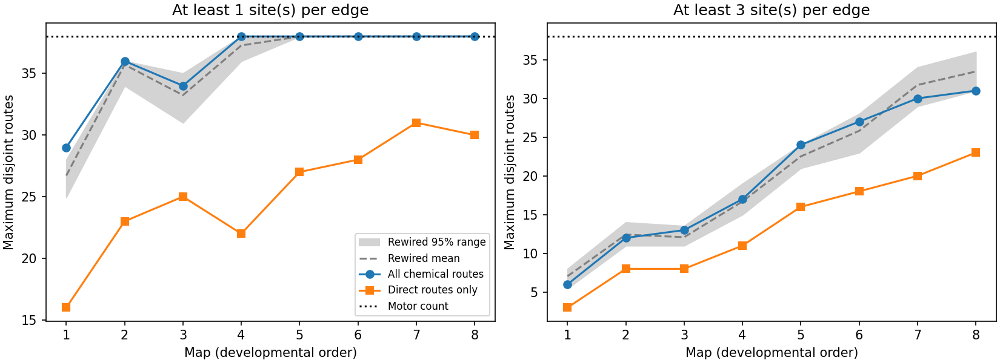

# Seven of eight one-site worm graphs had sensory-to-motor rank bounds within typed degree shuffle ranges

## Result

We tested how much indirect wiring adds to a structural sensory-to-motor rank bound in eight public C. elegans brain maps. We kept 161 neurons common to all maps, with 57 sensory inputs and 38 motor outputs. With at least one synaptic site per edge, maximum neuron-disjoint route counts were 29 to 38. Direct sensory-to-motor routes gave 16 to 31. Indirect routes raised the bound in every map. Relative to sampled graphs that preserved each cell's input and output degrees for each broad cell type, the observed bounds differed from mean bounds by 0.00 to 2.29 routes. Seven of eight primary bounds and all eight three-site bounds were within the central 95 percent shuffle ranges. Requiring three sites per edge gave bounds of 6 to 31. Route sets and equal-size neuron cuts certify each exact bound. Random linear transfer matrices also attained the bounds. These results concern generic transfer rank with independent edge weights, separate sensory inputs and motor readouts. They do not measure biological signal dimension, control energy, activity or behavior. Partial head coverage, separate animals and uncertain edge rules limit transfer.



The full-graph bound minus the direct-route bound was 3 to 16 across the 16 graph settings. The one-site bounds in map order were 29, 36, 34, 38, 38, 38, 38, 38; direct-route bounds were 16, 23, 25, 22, 27, 28, 31, 30. The three-site bounds were 6, 12, 13, 17, 24, 27, 30, 31. These are exact finite-graph values, not estimates of animal means. Every increase from direct routes is expected to be nonnegative because the full graph contains those routes. The measured size of that increase is the result.

## Question and prior work

Can indirect chemical wiring support more independent sensory-to-motor transfer channels than direct sensory-to-motor wiring alone? Do sampled circuits with the same cell degrees and broad type restrictions give similar bounds?

Van der Woude established that generic normal transfer rank equals the maximum number of vertex-disjoint paths between inputs and outputs. We apply this known theorem; we do not introduce a new rank theorem. Yan et al. used network control to study worm motor function. Liu et al. studied developmental controllability. Their endpoints and networks differ from this fixed-panel transfer-rank audit. In particular, normal transfer rank is not the rank of an output controllability matrix over time. A single input can control several dynamical modes over time while the normal transfer rank remains one.

The campaign matching-choice report examined the rank of a whole wiring matrix without fixed sensory and motor endpoints. The edge-connectivity report studied paths that can share neurons between single pairs and tested evoked responses. Here paths cannot share neurons, and input-output sets are fixed. We searched the campaign for connectome, development, reciprocity, controllability, strongly connected, disjoint and transfer rank before analysis. Search is targeted and does not establish priority. No prior campaign code or result tables were reused.

## Data and graph rules

We read the original primary synaptic site lists for Witvliet maps 1 through 8 from commit 0646af9d25896ae660f97d462eab2d67282f5625 of dwitvliet/nature2021. We also used its neuron_info.py cell labels. All nine exact shared paths, source URLs, byte counts and SHA-256 hashes are in files/provenance.json. Existing raw data were reused in place. No download was needed.

We formed directed source-to-target chemical edges. Each distinct target at a site contributed one count. We removed self edges. We intersected endpoint labels across all eight site lists, then retained cells with upstream types sensory, inter, motor or modulatory. The panel has 161 cells: 57 sensory, 44 inter, 38 motor and 22 modulatory. files/nodes.csv records each label and type. files/provenance.json records excluded common labels. A shared endpoint label is a coverage rule, not proof that all absent edges were assessed.

The primary rule requires one site per edge. A sensitivity rule requires three sites per edge. The panel stays fixed at both thresholds. Counts are counts of release sites for a cell pair, not conductance, sign or synaptic area. The graph omits gap junctions, muscles, glia and paths through excluded neurons. The maps are different animals, not repeated observations of one animal. The published order is early larva to adult; maps 7 and 8 are both adult. We do not fit a developmental trend or infer an age effect from this series.

## Rank bound and certificates

Use the linear model dx/dt = A x + B u and y = C x. Each retained chemical edge gives an independent free coefficient in A, with source j and target i stored as A[i,j]. B injects one independent input into each sensory cell. C reads each motor cell separately. There is no direct input-output feedthrough. Diagonal leak terms can be free; they do not create a new sensory-to-motor path.

The normal rank of H(s) = C(sI-A)^(-1)B is its rank for almost all complex frequency values. The generic normal rank is the largest normal rank over allowed coefficients, attained outside an exceptional algebraic set under the independent-parameter assumption. This rank equals the largest collection of sensory-to-motor paths with no common neuron, including endpoints. It cannot exceed 38. It is an upper bound on rank in this linear model, not a measurement of computation or information rate.

We split each neuron into an input vertex and output vertex with capacity one between them. All anatomical arcs and source/sink arcs have capacity 162. Integer maximum flow gives a path count. A minimum cut gives a set of neurons that separates all sensory inputs from motor outputs. Endpoints may be in the cut. A set of k disjoint paths proves a lower bound k; a separating set of k neurons proves an upper bound k. Equal bounds certify the exact answer.

files/certificates.json preserves both witnesses for every graph. A second flow algorithm checks each value. files/verify_evidence.py independently checks paths and cuts from saved edges. A one-relay toy graph has rank one despite reaching all three outputs; three parallel paths have rank three. Three random linear models per graph, with independent signed small edge weights and distinct negative leaks, were evaluated at s = i. Each graph attained its exact bound in at least two of three draws. In 47 of 48 draws the numerical rank equaled that bound at absolute tolerance 1e-11. One map 4 draw gave 37 rather than 38. This is a numerical tolerance limit, not a failure of the exact graph certificate; files/numeric_check.json records its singular values and ranks at tighter tolerances. These draws check implementation; the route and cut certificates establish exactness. They do not fit real neural dynamics.

For the direct comparison we retain only sensory-to-motor edges on the same panel. Thus the direct rank equals the maximum bipartite matching between sensory and motor cells. The full graph allows paths of any length, including routes through other sensory or motor cells. Long routes may have very small gain or be too slow to matter biologically.

## Typed degree reference

We ran four independent seeded swap chains for each graph. A proposal selects one directed edge, then another edge from the same source-type and target-type block. It exchanges the two targets. Self edges, repeated edges and no-change proposals are rejected. This preserves each neuron's numbers of incoming and outgoing edges within each broad cell type, not only whole-graph type totals.

Each chain uses 20 times the edge count in burn-in proposals. Saved draws are separated by five times the edge count in proposals. Each chain supplies 50 primary draws and 25 sensitivity draws. files/null_draws.csv preserves all 2,400 draws, acceptance rates and overlap with original edges. Shuffles remove geometry, exact cell identities of partners, site groups and specific motifs. They do not sample a biological developmental process. Uniform mixing over all valid graphs is not proven, and forbidden self edges may restrict the state space. Four chains and overlap checks are diagnostics, not a mixing proof. The largest conventional between-chain R-hat for route count was 1.023; constant chains with the same value were assigned one. This diagnostic checks only the reported rank, not all graph features. files/chain_diagnostics.json preserves chain means, overlap and acceptance summaries.

Central shuffle ranges are reference ranges, not animal confidence intervals. Tail fractions use (1 + number at least as extreme)/(1 + draw count); they are descriptive finite-chain values. We make no population significance claim and apply no multiple-test inference. The direct comparison is the primary finite-graph result; the null reference is secondary.

## Results table

Columns are map, edge threshold, edge count, full rank, direct rank, reachable motor count, shuffle mean and central 95 percent shuffle limits.

```csv
dataset,threshold,edges,rank,direct_rank,reachable_motor,null_mean,null_q025,null_q975
1,1,675,29,16,30,26.71,24.975,28.0
1,3,112,6,3,11,7.05,5.475,8.0
2,1,864,36,23,36,35.705,34.0,36.0
2,3,211,12,8,19,12.42,11.0,14.0
3,1,882,34,25,37,33.235,31.0,35.0
3,3,242,13,8,15,12.09,11.0,13.525
4,1,977,38,22,38,37.265,36.0,38.0
4,3,344,17,11,21,16.69,15.0,19.0
5,1,1216,38,27,38,37.99,38.0,38.0
5,3,449,24,16,29,22.51,21.0,24.0
6,1,1188,38,28,38,38.0,38.0,38.0
6,3,478,27,18,34,25.81,23.0,28.0
7,1,1589,38,31,38,38.0,38.0,38.0
7,3,651,30,20,36,31.73,29.0,34.0
8,1,1625,38,30,38,38.0,38.0,38.0
8,3,655,31,23,38,33.47,31.0,36.0
```

Reachability only asks whether at least one path exists. It can exceed the rank bound because several outputs can depend on one relay. Conversely, a high rank does not ensure large singular values, resistance to damage, independent activity or adequate signal-to-noise ratio. This work provides a checked tool for that distinction, not evidence that the animal uses all possible channels.

## Limits and next test

This is a chemical graph model for a selected head panel in one species. Independent weights ignore shared release sites, cell-level weight constraints, transmitter signs, nonlinear effects, noise, adaptation, delay and behavior. Fixed threshold rules can cause large changes in the graph and rank. Missing edges can lower a bound; false edges can raise it. Requiring endpoint presence in every map selects for cells with observed wiring throughout the series and can favor stable routes. Independent sensory inputs are a modeling choice and need not describe a real stimulus ensemble. All motor readouts are assumed available and independent.

No activity data are linked in this study. No Allen dataset, other brain region or second species is tested. The evidence cannot establish a general biological law, causal control or a reliable representation. A useful next test would estimate the singular values of repeated multineuron perturbation responses with the same identified inputs and outputs. It would also test whether predicted small cuts cause a transfer-rank loss. Such tests need matched anatomy and activity from the same animals.

## Reproduction and job record

See files/REPRODUCE.md. files/analyze.py produces graph tables, certificates, all shuffle draws, numerical checks and the figure. files/retrieve.py checks or retrieves the pinned source files. Original raw files remain under their upstream terms. The baseline license covers new text, figures, derived evidence and code.

Campaign: 11_07_2026. Job: sci-1107-dell-neural-structure-and-computation-31960e61eed3. Topic: neural-structure-and-computation. Machine: dell. Account: codex-andrii. Model: gpt-6.1-sol, high reasoning effort, Codex through T3 Code. No agents were launched. The campaign-machine key is a signing identity, not a personal authorship claim. The signed bundle stays local; there is no remote archive or index submission.
