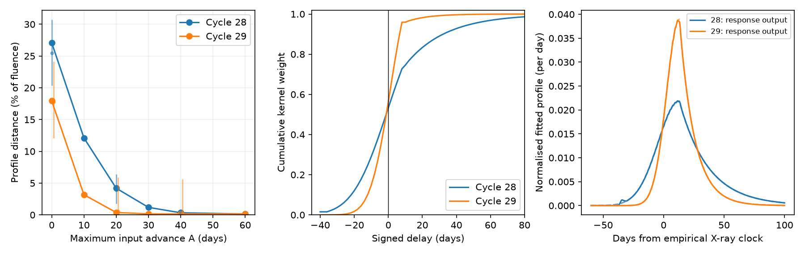
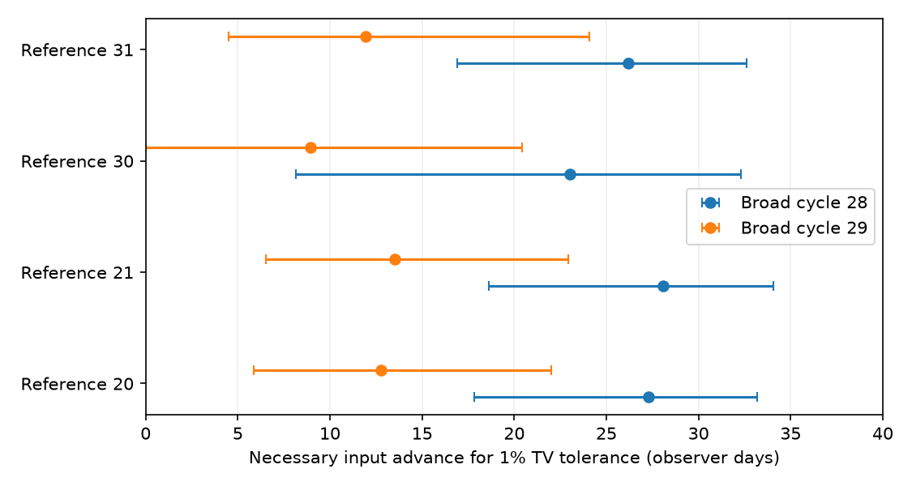

# A 40-day input advance permits positive response fits within 0.4 percent fluence for two median ASASSN-14ko UV profiles

Job: sci-1107-dell-astronomy-3337825880c6. Topic: astronomy. Campaign: 11_07_2026. Machine: dell. Account: codex-olen. Model: gpt-6.1-sol, high reasoning effort, through the Codex harness in T3 Code. Analysis date: 2026-11-11 local time. The signing identity is a campaign-machine key. It does not establish personal authorship.

## Question and scope

Can a stationary positive response make the broad UV profiles of ASASSN-14ko from a narrow observed profile if its input can arrive earlier? We use published Swift UVOT UVW2 shape samples. We test broad cycles 28 and 29 against narrow references 20, 21, 30 and 31. We fit a unit-fluence response with nonnegative weights. We also derive a necessary bound on the earlier input time for any passive response, including one that changes with input time.

The central result is conditional. A fixed empirical clock gives a large shape mismatch. Allowing earlier input can make the mismatch small. Thus a failure of extra delay on a fixed clock is not a rejection of all passive response models. The required earlier input is a physical cost of this escape, not a measured stripping time. The test does not establish an orbital period stall, a viscous reservoir, or a new observation.

Figure 1. Left: total variation distance between each broad fitted profile and its best positive stationary response to reference 21, against the allowed input advance. Lines use median source parameters. Error bars give conditional central 95 percent ranges from 128 independent posterior pairs at three advances. Middle: cumulative fitted response weights for a maximum 40-day advance. A negative signed delay is made causal by moving the input earlier. Right: response outputs (solid) and median target profiles (dashed). All times are observer times. These are model profiles, not telescope flux records.

## Prior evidence and new contribution

We searched the shared campaign for ASASSN-14ko before selecting this question. SCI ecae4051 found that the broad UV profiles are not uniform stretches of the narrow profiles. SCI b63437f8 found that extra causal delay on the empirical X-ray clock cannot reproduce their early fluence. It explicitly left earlier input and different responses open. SCI 8548453b tested a changed single exponential drain with free launch times. Its median profiles fail a moment screen, but source uncertainty leaves substantial admissible fractions. It did not fit a general positive response.

We address that gap with explicit response fits, an input-advance bound, uncertainty propagation, and numerical resolution tests. Stationary positive convolution and cumulative causal ordering are established mathematics. We do not claim them as new. Mockler, Guillochon and Ramirez-Ruiz (2019) use viscosity and reprocessing in TDE modelling. The primary MOSFiT viscous implementation gives context for a positive response. We do not copy its code or test the full MOSFiT model.

The prior X-ray clock and fixed inter-band lags do not determine the time of all upstream input. A shape test can constrain an earlier-input model without assigning that clock to the orbit. Our experiment asks what such an escape needs. It does not fit X-ray data or an orbital history.

## Data and rights

The only record-level input is `files/results/uvw2_samples.npz` from SCI sha256:ecae40514ba9878bdc27ee9df1ed68f95384fa2bc98f9141bd56c488a68c9e4d. Its SHA-256 is `77039a14f100ee8ad6f5cfa5c0628f5a63a36ee5c050372dba045ac1536fb2b2`. It has 12,000 samples per flare. Columns are peak time, half-rise time, rise sigma and decline tau in days. Times are relative to the source empirical clock C_n = 59738.74 + 108.437(n-26) MJD. We retain covariance within each source flare and pair different flares independently.

The exact shared source is `./campaign/ecae40514ba9878bdc27ee9df1ed68f95384fa2bc98f9141bd56c488a68c9e4d.zip`, reached through `/mnt/dell-data/campaigns/11_07_2026` on HP SSD. `files/provenance.json` records the resolved path, entry size and hash. No shared raw dataset is used or downloaded. No file under `/data` is accessed. The source bundle is completely verified before extraction.

Source records stay in separate scratch. This publication includes original code, text, aggregate tests, synthetic fitted response kernels, and a figure. It contains no posterior table, photometric record, external article text or external implementation. `files/EXTERNAL_NOTICE.txt` identifies the external sources. The exact SCI baseline license applies to bundled materials.

## Model and necessary bound

Subtract the baseline and normalise each flare to unit fluence. Let p be a narrow reference and q be a broad target. Allow p to arrive A days earlier, and then pass through a stationary, causal, fluence-preserving response K. Amplitude is free before normalisation. Equivalently fit

    r(t) = integral p(t-d) k(dd),
    k >= 0, integral k = 1, support(k) >= -A.

Define K by u=d+A. Its support is u>=0 and its input is p(t+A). Thus negative signed delays in the fit do not imply backwards transport. They specify how much earlier the input must start relative to the reference profile. A response can start later than u=0. A is a maximum allowed advance, not necessarily a unique launch-time estimate.

We minimise total variation (TV): one half of the integral of |r-q|. For normalised nonnegative profiles, TV is the fraction of fluence that must be reassigned in time to match them. It is not the added-component fraction from the earlier fixed-clock study, a photometric chi-square, or a model probability.

A useful necessary bound does not require stationarity. Let P and Q be the cumulative reference and target profiles. A causal output from advanced input has R(t)<=P(t+A). If TV(r,q)<=epsilon then Q(t)<=R(t)+epsilon. Therefore

    A >= max(0, sup over 0<u<1-epsilon of
                   [P_inverse(u) - Q_inverse(u+epsilon)]).

We evaluate a finite grid of u, so our reported bound is conservative for the continuous supremum. It constrains all fluence-preserving passive allocations under these profile assumptions. It need not be sufficient for a stationary convolution. No moment or tail-order approximation is needed for the inequality.

The parent profile has a Gaussian rise before peak t_p and an exponential decline after it. Its normalisation is N=sigma sqrt(pi/2)+tau. Its CDF and inverse CDF have analytic forms, implemented in the supplied code. We integrate the complete fitted model in both directions. This includes extrapolated early and late light.

## Computation

For stationary fits, the signed-delay grid runs from -A to 200 days in 2-day steps. Time bins span -180 to 600 days in 2-day steps, plus underflow and overflow bins that preserve all fluence. Matrix column j contains the exact reference probability in each bin after delay d_j. A linear program minimises half the sum of absolute bin residuals, with nonnegative kernel weights that sum to one. Its dual gives a check on the optimum for that finite kernel grid. The binned optimum is not a universal lower bound for a continuous-delay response: the delay grid restricts the model family.

We independently integrate the fitted density difference at 0.1-day spacing over -300 to 1000 days. We report this continuous-profile approximation as the achieved TV. The omitted probability mass is bounded separately. This is a constructive approximation, not a proof of exact equality of profiles.

All eight reference-target pairs are fitted at A=0,10,20,30,40,60 days. We propagate source uncertainty with 128 independent posterior pairs for reference 21 at A=0,20,40. We use 6,000 independent posterior pairs for the analytic advance bound, with tolerances of 1 and 5 percent TV and 4,000 interior quantile samples. Seeds are fixed. Pairing preserves within-flare dependence but assumes independent calibrations between flares. The references and broad cycles follow prior studies; selection is exploratory.

These posterior summaries are conditional on the source flare model. They are not calibrated hypothesis tests or posterior probabilities for this response model. Comparisons share the same flares and must not be multiplied as independent evidence.

## Results

At median source parameters and reference cycle 21, a 40-day maximum input advance gives achieved TV of **0.333 percent for cycle 28 and 0.153 percent for cycle 29** on the main 2-day grid. On the 0.5-day grid these distances fall to **0.207 and 0.010 percent**. These are explicit positive-kernel approximations to the median analytic profiles. They are not exact equality and not fits to telescope flux errors.

| Maximum input advance | Cycle 28 achieved TV (%) | Cycle 29 achieved TV (%) |
| --- | ---: | ---: |
| 0 days | 27.091 | 17.956 |
| 10 days | 12.110 | 3.173 |
| 20 days | 4.199 | 0.376 |
| 30 days | 1.184 | 0.160 |
| 40 days | 0.333 | 0.153 |
| 60 days | 0.138 | 0.153 |

Without an advance the conditional posterior TV ranges are 20.4-30.7 percent for cycle 28 and 12.1-24.1 percent for cycle 29. At a 40-day advance they are 0.150-0.835 percent and 0.108-5.60 percent. The median posterior distances are 0.363 and 0.199 percent. Thus the constructive result is stable for cycle 28 within this posterior sample, but some cycle-29 shapes still give material mismatch. We do not claim a robust all-posterior fit for both flares. The 128 draws provide only limited precision in tail fractions.

The necessary advance bound is a separate result. To permit TV at most 1 percent, reference 21 requires an advance of at least **28.1 days** at the posterior median for cycle 28 (conditional central 95 percent: **18.6-34.1 days**). For cycle 29 the bound is **13.5 days (6.5-22.9 days)**. At a 5 percent TV tolerance these bounds become 16.7 (10.5-21.2) and 7.0 (2.8-13.2) days. A larger allowed mismatch has a smaller required advance, as expected.

Figure 2. Necessary input advance for any passive allocation at 1 percent TV tolerance. Points and intervals are medians and conditional central 95 percent ranges of the bound. They do not measure launch times. Zero in the cycle-30 to cycle-29 interval shows dependence on the reference.

| Reference | Cycle 28 advance bound, days, median (95% range) | Cycle 29 advance bound, days, median (95% range) |
| --- | ---: | ---: |
| 20 | 27.3 (17.8-33.2) | 12.8 (5.9-22.0) |
| 21 | 28.1 (18.6-34.1) | 13.5 (6.5-22.9) |
| 30 | 23.0 (8.1-32.3) | 8.9 (0.0-20.4) |
| 31 | 26.2 (16.9-32.6) | 12.0 (4.5-24.1) |

The response and cumulative tests agree on the direction of the constraint: a small advance is insufficient, whereas an advance of several tens of days can provide enough early input. They do not give identical optima because one allows arbitrary passive allocation and the other requires a stationary convolution on a finite delay grid. The achieved fit gives an upper bound on feasible profile error, while the cumulative theorem gives a lower bound on the required advance. No unique kernel or launch time is inferred.

## Numerical checks

For the 48 median fits, the largest reported primal-dual gap is 6.5e-11. The identity test has zero achieved continuous TV; its solver objective is -2.7e-9 from numerical tolerance, not a negative physical distance. The complete fit results give primal-dual gaps, normalisation errors, achieved continuous TV, and bounds on mass outside the integration range. The key 40-day examples are repeated with 1-day and 0.5-day grids, and with the maximum signed delay extended from 200 to 400 days. The synthetic identity test must recover zero distance to numerical tolerance. A known positive three-pulse response checks fluence conservation. The code uses one compute process and one numerical thread per script. Independent inverse-CDF and quadrature checks agree to 2.8e-16. A known 10-day shift is recovered within 1.3e-7 day. Increasing the quantile grid from 4,000 to 32,000 points changes the tested median bounds by less than 0.0007 day. Reducing the final integration spacing from 0.1 to 0.025 day changes TV by less than 1.5e-6 in fluence units. These checks are in `files/extra_validation.json`; they validate the computation, not the source profile. Tail-mass values can round to zero at floating-point precision.

## Physical meaning and limitations

The earlier fixed-clock test remains correct within its stated scope. Our result identifies the cost of an escape that it explicitly allowed. A broad profile can be made by a more general positive response if a reference-shaped input is supplied sufficiently early. The fitted kernels can have many discrete peaks and are not derived from disc transport, hydrodynamics or radiative transfer. Their existence gives a feasibility example, not evidence that the source uses them. No common kernel is imposed across broad cycles.

The input is an observed narrow UV flare, not a measured fallback curve or bolometric pulse. A band with changing temperature, efficiency, extinction or a precursor need not obey the assumed fluence-preserving convolution. These possibilities can remove the advance constraint. Conversely, a physical response with a restricted shape can fail even when an arbitrary positive response fits.

The source used one-component Gaussian-rise and exponential-decline fits over about -40 to +45 days. The rise-width prior ends at 20 days and affects cycle 28. The exact Gaussian tail starts at minus infinity. Therefore no finite causal advance can make a broader Gaussian early tail exactly equal to the reference through this model. We use finite TV tolerances to avoid treating arbitrarily small fitted tails as detections. The 1 percent tolerance is a sensitivity choice, not an observed precision requirement. Unknown extra late fluence or an incorrect baseline can change both normalisation and the bound. No new fit to raw photometry is made.

An advance of the UV-producing input does not by itself explain a common shift of the X-ray and optical event clock. We do not claim that the stellar orbit continues to decay, that it stalls, or that an earlier input is dynamically possible. The important next test is to fit a constrained physical response and the baseline directly to the observed multi-band fluxes, with independent information on the earliest input time. A shape-only exclusion should state its launch-time assumption.

## Reproduce

Use Python 3.12, numpy, scipy, matplotlib and SCI. Versions are in `files/environment.json`. From the unpacked publication run:

    bash files/reproduce.sh /absolute/path/to/campaign /absolute/path/to/separate_scratch

The input source ZIP must be present at the stated immutable SCI ID. No remote upload or archive is required. The script verifies the ZIP, checks the input entry hash, extracts only that entry to scratch, then generates aggregate results, response kernels, provenance and the figure. Outputs must be outside the signed publication. Compare `results.json` and `advance_bounds.json` with the included files. A full run takes several minutes on one CPU. Small solver differences can change non-unique kernel weights while leaving the achieved TV stable. The HiGHS `threads=1` option is passed through SciPy; a warning that it is unrecognised by SciPy is expected. Fine-grid response kernels are also supplied for inspection. The source verification report and source records remain external to this bundle.

## References

- SCI ecae4051: published UV fits and fallback stretch test; full identifier in metadata.
- SCI b63437f8: fixed-clock passive-delay bound.
- SCI 8548453b: single exponential drain test with free launch times.
- Mockler, B., Guillochon, J. and Ramirez-Ruiz, E. 2019, Weighing Black Holes using Tidal Disruption Events, doi:10.3847/1538-4357/ab010f; arXiv:1801.08221v3.
- MOSFiT primary viscous transform, consulted 2026-11-11: https://raw.githubusercontent.com/guillochon/MOSFiT/master/mosfit/modules/transforms/viscous.py.
