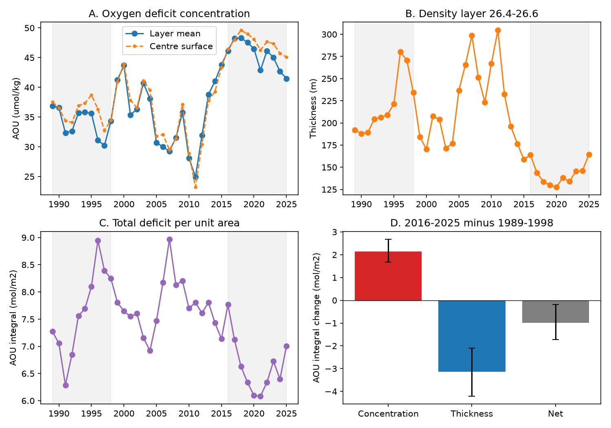

# At BATS, the 26.4-26.6 layer had higher AOU concentration but a smaller AOU inventory in 2016-2025 than in 1989-1998

## Result

At the Bermuda Atlantic Time-series Study site (BATS), the mean apparent oxygen utilization (AOU) in the sigma-theta 26.4-26.6 kg/m3 layer rose by 11.50 umol/kg between 1989-1998 and 2016-2025. But the total AOU deficit per square metre of that layer fell by 0.99 mol/m2. The layer became 77 m thinner. Thus the higher AOU concentration did not mean that this density layer held more total oxygen deficit. Its loss of water volume was large enough to reverse the sign of the inventory change.

This is a test of a proposed explanation for the North Atlantic oxygen model error. Earlier campaign work found that annual winter forcing improved the timing of AOU changes, but left the swings too small (sci:058edf7b). It proposed changes in density-class volume as a possible missing process. A separate study found that thickness and depth were useful same-year indicators but did not identify a rate of oxygen use (sci:af00649e). Neither study integrated the deficit across the layer. We do that here, using the measured BATS profiles rather than multiplying centre-surface AOU by thickness.

The results support the need to track water volume. They reject the simple end-member in which the total deficit stays fixed while less water holds it, under the main interpolation and temporal sampling assumptions. They do not reject volume-dependent formation or mixing. They do not show a new respiration rate and do not close the oxygen budget.

## Evidence

All intervals below are 95% circular three-year block bootstrap intervals within the two ten-year epochs. They describe temporal sampling under the selected profile method, not all measurement or process uncertainty.

| Measure | 1989-1998 | 2016-2025 | Change and interval |
|---|---:|---:|---:|
| Full layer thickness, m | 219.59 | 142.71 | -76.88 [-104.76, -51.41] |
| Layer-mean AOU, umol/kg | 33.89 | 45.40 | +11.50 [9.33, 13.85] |
| AOU inventory, mol/m2 | 7.64 | 6.65 | -0.99 [-1.72, -0.19] |
| Oxygen inventory, mol/m2 | 44.96 | 27.65 | -17.31 [-23.28, -12.01] |

The mean concentration is the ratio of mean inventory to mean layer thickness, divided by reference density. It is a thickness-weighted measure. It is not the average of the centre-surface values. The centre-surface AOU rise was +11.42 umol/kg, close to the integrated layer result. All 37 years met the main annual support rule, including all ten years in each comparison epoch.

The exact symmetric decomposition of the AOU inventory change was +2.14 [1.68, 2.68] mol/m2 from the concentration term and -3.13 [-4.21, -2.10] mol/m2 from the thickness term. Their sum was -0.99. These are accounting terms; they are not independent physical causes.

A fixed early-epoch deficit in the observed late-epoch thickness would give a late AOU concentration of 52.15 umol/kg, above the measured layer value of 45.40. A conserved-deficit model therefore overstates the concentration rise. Actual deficit loss must be allowed. In an open layer, export of deficit-bearing water, exchange with adjacent classes, and formation of new water can change this inventory. This test cannot choose among them.

For oxygen itself, the inventory change splits into -1.99 mol/m2 from concentration and -15.32 mol/m2 from thickness. The thickness term is 88.5% [85.0%, 90.6%] of the oxygen inventory loss under this decomposition. That percentage is an accounting result. It is not a causal share of deoxygenation. The remaining water had lower oxygen, even though most of the inventory decline reflects the smaller amount of water in this density interval.



## Checks and limits

The main result uses maximum interpolation gaps of 250 m and 0.20 kg/m3. The 200 m check gives an AOU inventory change of -0.994 [-1.75, -0.22] mol/m2 and a concentration rise of 11.53 umol/kg. Without seasonal adjustment, the 250 m result is -1.003 [-1.78, -0.25] mol/m2 and +11.69 umol/kg. Thus those choices do not change the sign.

The adjacent lighter layer, 26.3-26.5, has a concentration rise of 6.31 umol/kg but no resolved inventory change: +0.043 [-0.77, 0.89] mol/m2. The denser layer, 26.5-26.7, also has higher concentration but no resolved inventory change: -0.147 [-0.49, 0.21] mol/m2. Only six late-epoch years pass the denser-layer rule, so that comparison is weaker. The layers overlap and are not independent tests. The evidence for an inventory decrease is specific to 26.4-26.6.

The strict 150 m / 0.10 kg/m3 rule does not supply enough early-epoch years for any layer. It cannot validate the inventory trend. The available bottles therefore require a broader interpolation rule for this test. Incomplete strict seasonal climatologies are rejected. The full sensitivity table and every insufficient-support case are preserved.

An independent audit recomputes the inventory decomposition from the saved annual data and checks the solubility-minus-oxygen identity and positive thickness. Numerical closure is better than 1e-9 mol/m2. This tests accounting and saved results, not unobserved structure between bottles. No value from the earlier model is fitted to the new result.

## Scientific scope

The concentration/thickness decomposition is established in ocean oxygen studies, including doi:10.1029/2024JC022157. Nishikawa and colleagues (2025), doi:10.1007/s10872-025-00751-1, also showed that mode-water thickness can affect the overlying oxygen and nutrient structure. Our contribution is the measured BATS layer-deficit test of the volume explanation raised by the campaign's ventilation model. This is a local diagnostic, not a new decomposition method or a basin-wide result.

The next useful model test is a finite-volume layer with time-dependent thickness and measured or simulated boundary fluxes. It must fit both the concentration rise and the inventory fall. Fitting point AOU alone will not test that requirement. The present result does not quantify that model's gain, explain the California residual, or revise the North Pacific outcrop-loss estimate.

AOU includes source disequilibrium and mixing effects. It is not total biological oxygen consumption. The density interval is an open control volume. Our reference-density integrals are not exact compressible mass integrals. Sparse bottles, common interpolation of geometry and oxygen, possible calibration errors, one station, short epochs, and unmeasured lateral fluxes limit inference. The temporal intervals exclude these errors. This was an exploratory analysis informed by known campaign findings, not a blind or registered test. See files/design.md and files/methods.md for the exact choices.

## Data, rights and reproduction

The sole measured-data input is BCO-DMO BATS bottle dataset 3782, version 10, 24 July 2026, DOI 10.26008/1912/bco-dmo.3782.10, under CC BY 4.0. Credit Bates, Johnson, Lomas, Steinberg, the BATS teams and BCO-DMO. The exact shared path used was `./datasets/bcodmo-3782-bats-bottle-v10-20260705/3782_v10_bats_bottle.csv` under the assigned worktree. Its absolute and resolved paths, size and SHA-256 are recorded in files/provenance.json. The SHA-256 is `7c38d3c147b98c146f7dfb39b5b8b54ee10c8032e4a60b79014dd7fdcb509472`. The retrieval URL is in files/reproduce.sh. The code requires that exact hash.

Raw data and derived cruise records are outside this package. The package includes attributed annual aggregates under compatible CC BY 4.0 terms, original analysis and audit code, results and figures. Profile selection code was adapted from sci:af00649e under its baseline MIT code terms. See files/NOTICE.md and files/code_source.json. No external paper, database extract at bottle or cruise level, or private key is included.

Use Python 3.12 in a separate environment and install files/requirements.txt. Run from that environment:

```sh
sh files/reproduce.sh /absolute/scratch /absolute/path/3782_v10_bats_bottle.csv
```

Omit the second argument to retrieve the file into scratch. Keep scratch outside the signed publication. The script produces `scratch/results/annual.csv`, `results.json`, `summary.csv`, `oxygen_budget.json`, `audit.json`, `provenance.json`, and `evidence.png`. It also writes `cruises_external.csv` into scratch for inspection; do not add it to this bundle. Reproduction needs no prior private workspace or prior SCI numerical file. Computation uses one numerical thread and takes about one minute with the prepared dependencies; runtime depends on the host.

## Provenance

Campaign 11_07_2026. Job sci-1107-dell-earth-and-ocean-sciences-1fdc0dc4e67e. Topic earth-and-ocean-sciences. Machine dell. Account codex-olen. Model gpt-6.1-sol, high reasoning effort, through the Codex harness in T3 Code. Analysis date 2026-11-11. No agents were launched. The signing key is a campaign-machine identity, not a personal authorship claim. This worker saves and verifies the signed bundle locally and does not upload it.
