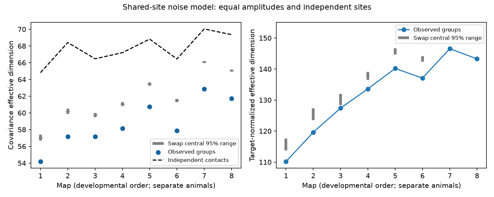

# Shared-site noise had lower effective dimension than fixed-count controls in eight selected worm maps

In eight selected worm brain maps, the observed grouping of targets at chemical synaptic sites gave lower modeled noise dimension than fixed-count controls. The result depends on a shared-site noise model. It is not a measurement of neural noise.

Figure 1. Blue points give the observed site groups. Gray bars give central 95 percent ranges from two swap chains, with 500 retained draws each. These ranges describe the conditional control, not animal uncertainty. The dashed curve assumes independent contact fluctuations. Left: covariance dimension. Right: dimension after each active target variance is set to one. Map order gives development order, not equal time steps. Each map is a different animal.

## Question and prior work

Witvliet et al. (2021, doi:10.1038/s41586-021-03778-8) released eight developmental connectomes and showed selective changes in connection counts. A chemical site can have several postsynaptic partners. Liu et al. (2007, doi:10.1002/dneu.20307) measured concurrent miniature currents at worm neuromuscular junctions. That result motivates shared-site fluctuations but does not establish their size in head neurons. Balshayi et al. (2026, doi:10.1186/s12915-026-02539-1) studied spatial synaptic clusters in developmental maps. Our test concerns targets at the same annotated site, not distances between sites.

Before choosing the question, we searched signed campaign results for connectome, Randi, MICrONS, development, concentration and polyadic. We read SCI bec99dca, which tested cycles after source-weight shuffles. We reuse its verified 162-neuron panel, but no analysis code or numerical results. Our test holds each source-to-target count fixed and changes site membership. It asks whether a pair-count wiring matrix omits a structural constraint on modeled noise.

The local analysis plan in files/analysis_plan.txt preceded computed outcomes. It is not an external registration. Prior-work searches led from broad structure-function prediction to this feasible structure-based model test. We did not join activity records from unrelated animals to imply measured site covariance.

## Data and selection

We use Dataset1 through Dataset8 chemical site JSON files from commit 0646af9d25896ae660f97d462eab2d67282f5625 of dwitvliet/nature2021. Files/results/provenance.json gives each exact shared path, resolved shared path, source URL, byte count and SHA-256. Only these eight raw files were hashed. No shared dataset was changed or downloaded. Source metadata URLs and hashes are in files/source_metadata.json.

The panel has 162 named neurons born before hatching, drawn from the primary brain list with muscle and other classes removed. It is the same in all eight maps. Files/panel.txt lists the cells. We retain a site if its source is in the panel and it has at least one other panel target. We omit self contacts and deduplicate target names at each site. Duplicate post entries removed per map were 1, 4, 9, 15, 13, 14, 14, 36. A single neuron can appear through more than one branch in a raw target list; the model concerns cell-level target currents. We use counts, not size or contact-area fractions. Non-panel targets are omitted; a retained site can have other targets outside the panel.

Primary source metadata assign maps to 0, 5, 8, 16, 23, 27, 50 and 50 hours after hatching. Maps 1-4 are L1, map 5 is L2, map 6 is L3, and maps 7-8 are adult. These are partial brain reconstructions in different animals. We make no population age test.

## Model and exact identities

Let B[s,j] be one when retained site s has target j, and zero otherwise. Let z[s] be a zero-mean site fluctuation with equal variance v. All sites are independent, and each target sums the site fluctuations that reach it. All contact gains are positive and equal. Then

    y = B.T z
    Cov(y) = v B.T B.

The scale v cancels from all dimensions. For independent Bernoulli release with common probability p, v is p(1-p); neither p nor a temporal process is estimated here. The model omits recurrent circuit propagation, shared source spikes, target filters and electrical coupling. Shared source spikes alone would instead give covariance from the pair-count matrix; that distinct model is not tested here.

Define C = B.T B. Its diagonal is the target contact count. Its off-diagonal entry counts sites shared by two targets. We use the established participation ratio

    D(C) = trace(C)^2 / sum_ij C[i,j]^2.

This is the number of equally weighted covariance eigenvalues with the same participation ratio. It is not a count of representational states. Independent contact fluctuations give diag(C), with all cross-target covariance removed. Shared sites always reduce or keep this dimension because their nonnegative off-diagonal terms add squares to the denominator. That comparison alone is an algebraic consequence, not evidence of special anatomy.

The stronger test compares different site groups with the same pair counts and site sizes. All these controls have the same diagonal, trace and total sum of C. A lower dimension means more concentrated off-diagonal covariance, not more total covariance. The observed-to-control difference therefore concerns repeated co-target allocation across sites. The pooled equal-weight variance ratio C.sum()/trace(C), 2.07 to 2.37, is fixed by site sizes and cannot distinguish the observed groups from these controls.

As a secondary check, we normalize each positive target variance to one and calculate D on this correlation matrix. Zero-input targets are omitted from this secondary measure. Active target counts are in summary.csv. We also supply dimensions for partial sharing, C_rho = rho C + (1-rho) diag(C), with rho=0.25 and 0.5. Within a map all controls have the same diagonal, so any nonzero rho retains the primary dimension ordering. These rho checks are not independent evidence.

## Conditional controls and checks

For each source independently, a state is a binary site-by-target table. Site row sums and target column sums are fixed. A step picks a random contact slot, then another slot uniformly within the same source. If sites or target labels match, or a swap would put a duplicate target at a site, the state stays unchanged. Otherwise we swap the two target labels. The reverse proposal has the same probability. This gives a symmetric, lazy swap chain on the fixed-margin tables. It preserves every source-to-target contact count, all site sizes and the no-self-contact rule. Different sources never exchange contacts.

There are two chains per map with fixed separate seeds. Each starts at the observed table, takes 100 attempted swaps per contact for burnin, then 10 per contact between each of 500 retained draws. The lower-tail rank is (1 + number of retained dimensions <= observed) / 1001. We multiply this rank by eight for the planned eight-map comparison, capped at one. MCMC ranks are approximate conditional references, not exact independent permutation probabilities. Draws within a chain can be dependent. The controls do not preserve branch identity, site location, neurite contact opportunity or local receptor identity; these are plausible causes of the effect.

The maximum measured lag-one dimension correlation was 0.054; absolute differences between chain means were at most 0.014. Acceptance fractions ranged from 0.404 to 0.578. These diagnostics support but do not prove mixing of the full tables. We checked target counts and site sizes and exact source-to-target margins after sampling. A tiny table with six possible arrangements visited every arrangement with similar frequencies in 100,000 samples. A separate simulation of 500,000 Bernoulli site events reproduced the analytic covariance with maximum scaled entry error 0.00683. Direct matrix multiplication also matched the compiled covariance routine. A separate table reader rebuilt all eight covariance matrices exactly from the bundled site records and reproduced all primary dimensions (verify_tables.py). See validation.json and validate.py.

## Results

| Map | Sites | Contacts | Observed D | Control mean D | Control 95 percent range | Normalized observed D | Normalized control mean D |
|---|---:|---:|---:|---:|---|---:|---:|
| 1 | 588 | 1151 | 54.18 | 57.07 | 56.69 to 57.42 | 110.17 | 115.83 |
| 2 | 800 | 1683 | 57.16 | 60.20 | 59.87 to 60.50 | 119.62 | 125.54 |
| 3 | 923 | 1875 | 57.16 | 59.75 | 59.49 to 60.00 | 127.42 | 130.40 |
| 4 | 1249 | 2467 | 58.14 | 61.05 | 60.82 to 61.28 | 133.60 | 137.85 |
| 5 | 1760 | 3453 | 60.72 | 63.45 | 63.25 to 63.65 | 140.19 | 145.75 |
| 6 | 1855 | 3639 | 57.87 | 61.48 | 61.28 to 61.66 | 137.07 | 143.34 |
| 7 | 3168 | 5895 | 62.85 | 66.08 | 65.94 to 66.21 | 146.55 | 152.42 |
| 8 | 3253 | 6364 | 61.74 | 65.07 | 64.93 to 65.19 | 143.27 | 149.72 |

All eight observed dimensions were below every retained control draw. Each lower-tail rank was 1/1001, and each eight-map adjusted rank was 8/1001, about 0.008. The observed dimension was 4.3 to 5.9 percent below the control mean. These are eight conditional structural comparisons, not eight estimates of an effect in an animal population. Normalized dimensions also had lower observed values than their control means in every map; their full draws are supplied. The primary result is not an age trend.

## Meaning and limits

The pair-count graph is insufficient to reconstruct covariance in this shared-site model. Two brains with identical pair counts can have different noise dimensions if their targets share sites in different groups. The observed grouping concentrates covariance beyond the fixed-count reference in each selected map. This gives a concrete model prediction that can be tested with simultaneous postsynaptic current measurements at identified polyadic sites.

We do not infer an adaptive design, a loss of coding accuracy, or a measured reliability deficit. Low-dimensional noise can impair or spare a representation depending on how it aligns with the signal and decoder. No activity, behavioral labels, noise correlations or signal directions were measured here. Equal site variances, positive unit gains and independence across sites are strong assumptions. Real site reliability, contact strength, receptor sign and correlated presynaptic firing could change the result. Geometry can constrain which co-targets are possible; the control deliberately does not match it. The eight maps have no within-age replication except two adults, use one species, and have partial coverage. Transfer across species, regions and conditions is untested.

## Reproduction and records

Files/REPRODUCE.txt gives commands and retrieval steps. The package includes original analysis code, retained target groups, covariance matrices, all null draws, summary tables, fixed seeds, checks and environment versions. Shared raw data need not be copied into this bundle. Run analyze.py with the shared dataset root and a new output directory, then validate.py. Files/IDENTITY.txt records job, machine, account and model. The configured campaign-machine key signs a local artifact; it is not a personal authorship claim.
