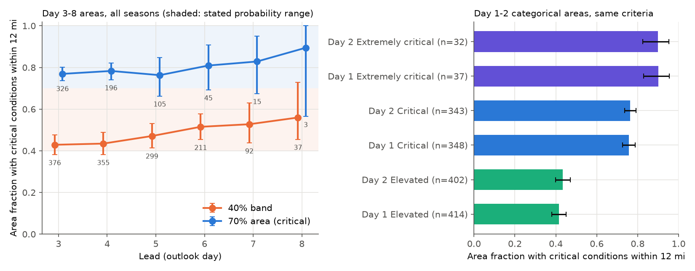
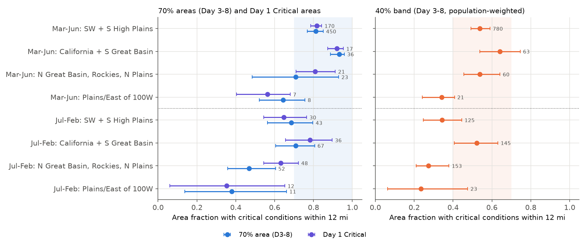
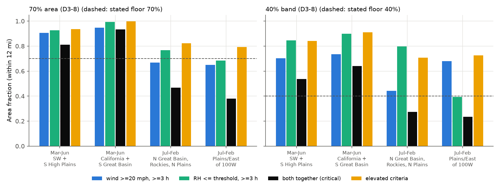

# SPC Day 3-8 fire weather areas met their stated 70% and 40% levels overall in 2021-2026, but July-February areas verified about 0.25 lower than March-June areas

**Job:** sci-1107-dell-earth-and-ocean-sciences-0514b3e476b0 · **Topic:** earth-and-ocean-sciences · **Machine:** dell · **Model:** Claude Opus 5.5 (`claude-opus-5-5`) · **Campaign:** 11_07_2026 · **Date:** 2026-11-11.
The signing key is a campaign-machine key. It is not a personal authorship claim.

## Summary

The NOAA Storm Prediction Center (SPC) issues probabilistic Day 3-8 fire weather outlooks. They became operational on 23 February 2021. Each area gives the probability of "strong winds, low RH, and warm temperatures concurrent for at least 3 hours with dry fuels within 12 miles of a point". A critical area is 70%. A marginal area is 40%. We found no public verification of these stated probabilities.

We verified all 690 Day 3-8 70% areas and 1,370 40%-band areas for valid days 1 March 2021 to 31 October 2026. The verifying data was the NOAA URMA 2.5 km analysis of record. We used the SPC critical criteria: sustained wind of 20 mph or more (15 mph in Florida), RH at or below the SPC regional threshold (15-35%), temperature above 50 F or 60 F, and a duration of 3 hours or more. We also verified the Day 1-2 categorical areas on the same days, and we checked URMA against 35,941 ASOS station-days.

1. **Overall, the stated levels held.** Critical conditions occurred within 12 miles over 0.78 (95% CI 0.74-0.81) of the 70% areas. They occurred over 0.46 (0.41-0.51) of the 40% band, which is the area between the 40% and 70% contours. Both values are in the stated ranges (at least 0.70, and 0.40-0.70). At every lead from Day 3 to Day 8, the 70% areas verified as well as the Day 1 Critical areas (0.76).
2. **The overall agreement hides a large seasonal difference.** In March-June, mostly in the Southwest and southern High Plains, 70% areas verified at 0.81 (0.77-0.85). In July-February they verified at 0.56 (0.48-0.65), and the 40% band at 0.33 (0.26-0.41). Both July-February values are below the stated floors. The northern Great Basin, Rockies and northern Plains in July-February (median month August) had the lowest values: 0.47 (0.36-0.62) for 70% areas and 0.27 (0.21-0.38) for the 40% band. Day 1 Critical areas showed the same seasonal difference (0.81 and 0.63), so the cause is not lead time.
3. **When the forecasts failed, wind failed more often than RH.** In the northern-West July-February areas, 20 mph wind for 3 hours occurred over 0.67 of the 70% areas. Low RH occurred over 0.77. Both together occurred over 0.47. Elevated-level conditions (15 mph, RH within 5 points of the threshold) occurred over 0.82. The forecasts found near-critical weather, but the critical wind often did not occur.
4. **Long-lead 40% areas without a later upgrade verified at about 0.3.** On dates that had a 70% area at some lead, Day 5-8 40% bands verified at 0.55-0.69. On a random sample of the other dates, they verified at 0.28-0.36.
5. **Most results are robust, but the July-February shortfall depends partly on the analysis.** URMA under-detects critical hours relative to ASOS (event rate 0.226 against 0.257). This makes all URMA values conservative. With a station-calibrated URMA, the seasonal difference stays (0.86 against 0.65 for 70% areas). But July-February 70% areas then reach 0.65 (0.57-0.73), and the 40% band 0.42 (0.35-0.51). Their intervals touch the stated floors. The July-February shortfall is largest in 2024-2026. ASOS stations alone confirm that the 2024-2026 drop is real: inside Day 3-5 70% areas in July-February, the station event rate fell from 0.40 (2021-2023) to 0.22 (2024-2026).

## 1. Question

Earlier campaign work found specific miscalibration in many public hazard products, for example SPC severe weather watch probabilities, WPC Excessive Rainfall Outlook "Marginal" areas, CPC Week-2 hazards and SWPC proton probabilities. Nobody had tested the SPC probabilistic fire weather outlooks. Fire agencies use them to move resources days before an event. Our questions were:

- Do the stated 70% and 40% probabilities agree with the observed frequency of critical fire weather within 12 miles?
- Does the agreement change with lead, region, season and area size?
- When a forecast fails, which ingredient fails: wind, RH, temperature or duration?

## 2. Data

| Data | Source and version | Use |
| --- | --- | --- |
| SPC fire weather outlook polygons, Day 1-8, 2021-2026 (9,190 records with areas) | Iowa Environmental Mesonet (IEM) archive of SPC products, `https://mesonet.agron.iastate.edu/cgi-bin/request/gis/outlooks.py?type=F`, downloaded 2026-11-11 | Day 3-8 critical (70%) areas; Day 1-2 Elevated, Critical, Extremely critical and dry-thunderstorm areas |
| SPC Day 3-8 probabilistic graphics `YYMMDD_dNfireprob.png` (3,312 images; 6 not in the archive) | `https://www.spc.noaa.gov/products/exper/fire_wx/YYYY/` | 40% contours (they are not in the text product) |
| SPC definitions | `Critical_Criteria_for_web.pdf`; `SPC_Fire_Probabilistic_Information.pdf`; NWS Service Change Notice 20-115 | Event definition, regional RH thresholds, 12-mile rule |
| URMA 2.5 km analyses: `2dvaranl_ndfd` (hourly 2 m TMP, 2 m DPT, 10 m WIND) and daily `minRH_ndfd` | NOAA Open Data Dissemination, `s3://noaa-urma-pds` (anonymous HTTPS byte ranges) | Verifying analysis, 18Z-01Z of each valid day |
| ASOS routine hourly observations (sknt, relh, tmpf) | IEM `https://mesonet.agron.iastate.edu/cgi-bin/request/asos.py` | Station check of URMA |
| gridMET energy release component (fuel model G), every 4th grid point (~16 km): 1991-2020 every 5th day, and each verification day | Northwest Knowledge Network THREDDS, `agg_met_erc_1979_CurrentYear_CONUS.nc` (Abatzoglou 2013) | Dry-fuel proxy: ERC at or above the 80th percentile of the same calendar window (+/-30 days) |

`files/provenance/input_manifest.csv` gives the SHA-256 of every input file (4,977 files). `files/provenance/urma_source_urls.csv` lists the 3,753 URMA objects.

## 3. Method

**Valid days.** An outlook day is 12Z to 12Z. The main sample is all 325 valid dates from 1 March 2021 to 31 October 2026 with at least one Day 3-8 critical area. It contains every 70% area. But it selects active days for 40% areas and Day 1-2 areas. To remove this selection, we added a random sample of 150 of the other 1,746 dates (seed 777). Of these, 92 had fire weather areas. In population estimates, each area on a random date has the weight 1,746/150 = 11.64.

**Areas.**
- *70% areas:* the SPC text-product polygons (`day38pts`) from IEM. On the URMA grid they match the red 70% contours of the graphics (median IoU 0.94 when the contour is closed). The two critical areas valid 19 June 2021 are dry-thunderstorm (40%) areas. We removed them. No other dry-thunderstorm critical area occurred.
- *40% areas:* digitised from the graphics. We fitted a Lambert conformal transformation (standard parallels 31.4 N and 46.8 N, central meridian 99.8 W, 1 pixel = 5.7 km) to the red contours and the text polygons. The mean distance was 0.15 pixel. A flood fill gives the interior of each contour. SPC draws 10-30% of contours open (with an arrow). We closed these by a morphological closing or, if that failed, by the convex hull. The *40% band* is the area inside the 40% contour and outside the 70% area. Its stated probability is 0.40-0.70.
- *Day 1-2 areas:* IEM polygons of the first issuance (Day 1 07Z cycle; Day 2 second cycle).

**Events.** A URMA cell has critical conditions when at least 3 of the 8 hourly analyses from 18Z to 01Z have:
- sustained 10 m wind of 20 mph or more (15 mph in Florida);
- RH at or below the SPC regional threshold. We digitised SPC Fig. 1: 15% in the interior Southwest, Great Basin and High Plains; 20% in the northern tier and the central US; 25-30% in the Pacific Northwest, Ohio Valley, Southeast and New England; 35% in peninsular Florida. RH comes from URMA temperature and dew point (Magnus formula);
- temperature above 60 F (April-September) or 50 F (October-March).

A cell in an area verifies if a cell with critical conditions is within 12 statute miles (19.3 km). The *verified fraction* of an area is the share of its cells that verify. If the forecasts are calibrated, it is at least 0.70 in 70% areas and 0.40-0.70 in the 40% band. We did not verify "dry fuels". We assume that forecasters drew areas only where fuels were dry.

**Statistics.** We give area-weighted means of the verified fraction. The 95% CIs come from a bootstrap of valid dates (1,000-2,000 resamples), because all areas on one day share one weather event. We defined the criteria and the 12-mile rule from the SPC documents before we looked at results. The season and region split is exploratory: we chose it after the first overall results. For this reason we tested it in two separate periods (Section 4.5).

**Checks.** We also calculated:
- point frequencies (no neighbourhood);
- 1-hour and 2-hour durations, and no temperature term;
- uniform RH thresholds of 15%, 20% and 25%;
- wind thresholds of -10% and +10%;
- an upper bound (hours of strong wind plus the daily URMA minimum RH, without concurrency);
- a station-calibrated URMA: wind threshold -0.65 m/s, and RH threshold +1.0 point before 2024 and +1.4 points from 2024. These values are the median URMA-minus-ASOS differences in daily maximum wind and minimum RH inside outlook areas;
- ASOS station event rates inside the areas;
- a split into 2021-2023 and 2024-2026;
- an outside ring (20-100 km beyond all same-day wind/RH areas), on all cells and on dry-fuel cells.

## 4. Results

### 4.1 Overall and by lead

| Area type | Areas | Verified fraction (95% CI) | Station-calibrated | Point frequency |
| --- | --- | --- | --- | --- |
| Day 3-8 70% areas | 690 | 0.78 (0.74-0.81) | 0.83 (0.79-0.86) | 0.58 |
| Day 3-8 40% band (population) | 1,370 | 0.46 (0.41-0.51) | 0.55 (0.50-0.59) | 0.24 |
| Day 1 Critical | 341 | 0.76 (0.73-0.79) | 0.82 (0.79-0.85) | 0.51 |
| Day 1 Elevated (critical criteria) | 406 | 0.42 (0.38-0.45) | 0.51 | 0.21 |
| Day 1 Extremely critical | 37 | 0.90 (0.83-0.95) | | 0.81 |

By lead, the 70% areas verified at 0.77, 0.78, 0.76, 0.81, 0.83 and 0.90 for Days 3-8 (3 areas on Day 8). The population 40% band verified at 0.43, 0.44, 0.47, 0.52, 0.53 and 0.56. Both stay in their stated ranges at all leads (Figure 1). The point frequency (the event at the cell itself) is about 0.2 lower than the 12-mile frequency. Users who read the numbers as point probabilities will find them too high: the point frequencies were 0.58 and 0.24.

The per-area values are skewed. For 70% areas the median verified fraction was 0.87, 60% of areas had more than 0.80, and 5% had less than 0.20 (near-complete misses).

### 4.2 Season and region

| Subset | 70% areas | 40% band | Day 1 Critical |
| --- | --- | --- | --- |
| March-June | 0.81 (0.77-0.85), n=517 | 0.54 (0.50-0.58), n=924 | 0.81 (0.79-0.84) |
| July-February | 0.56 (0.48-0.65), n=173 | 0.33 (0.26-0.41), n=446 | 0.63 (0.55-0.70) |
| July-February, N Great Basin/Rockies/N Plains | 0.47 (0.36-0.62), n=52 | 0.27 (0.21-0.38), n=153 | 0.63 (0.54-0.73) |
| Same, station-calibrated | 0.56 (0.46-0.70) | 0.36 (0.29-0.48) | 0.73 (0.64-0.80) |
| March-June, California + S Great Basin | 0.93 (0.89-0.96), n=36 | 0.64 (0.54-0.75) | 0.92 |
| March-June, Southwest + S High Plains | 0.81 (0.77-0.85), n=450 | 0.54 (0.49-0.59) | 0.82 |

Spring forecasts in the Southwest and California verified above the stated levels. At 70% they were under-confident. Summer and autumn forecasts in the northern West and in the Plains/East verified below the stated levels. Area size had no clear effect (70% areas: 0.74, 0.79 and 0.78 for the small, medium and large terciles).

### 4.3 Which ingredient failed

In March-June Southwest 70% areas, wind (0.91) and RH (0.93) each occurred over almost all of the area, and both together over 0.81. In July-February northern-West 70% areas, wind occurred over 0.67, RH over 0.77, and both together over only 0.47. In the 40% band of the same regime, wind occurred over 0.44 and RH over 0.80. Elevated criteria were met over 0.82 (70% areas) and 0.71 (40% band). So the summer areas usually had near-critical weather, but the sustained wind did not reach 20 mph for 3 hours, or strong wind and low RH occurred at different places or hours. In the few July-February Plains/East areas, RH failed more often than wind (40% band: wind 0.68, RH 0.39).

Figure 4 shows two Day 3 forecasts. On 25 April 2021 (a), critical conditions filled most of the Southwest 70% area. On 25 July 2026 (b-d), low RH covered most of the Northwest 70% area, but 20 mph wind for 3 hours occurred only in patches. The verified fraction was 0.33.

### 4.4 40% areas at long lead

| Lead | 40% band on dates with a 70% area | 40% band on random other dates |
| --- | --- | --- |
| Day 3 | 0.45 (0.42-0.48), n=324 | 0.41 (0.32-0.51), n=52 |
| Day 4 | 0.50 (0.47-0.54), n=321 | 0.34 (0.25-0.44), n=34 |
| Day 5 | 0.55 (0.52-0.59), n=283 | 0.28 (0.19-0.39), n=16 |
| Day 6 | 0.59 (0.55-0.64), n=200 | 0.31 (0.17-0.44), n=11 |
| Day 7-8 | 0.61-0.69 | 0.33-0.36 (n=7) |

A 40% area that was later upgraded to 70% (at any lead) verified well. A 40% area without an upgrade verified at about 0.3 at Days 5-6, below the stated level. The random-date samples at Days 6-8 are small. A user cannot know at issue time whether an upgrade will follow. The population values (Section 4.1) include both groups.

### 4.5 Robustness

- **Station check.** At 35,941 station-days (2,172 ASOS stations inside any outlook area on the 325 main dates), the ASOS event rate in 18Z-01Z was 0.257 and the URMA rate at the station cell was 0.226. URMA daily maximum wind was 0.64 m/s lower and minimum RH 1.1 points higher than ASOS (medians). The 18Z-01Z window missed a small part of the events (ASOS full-day rate 0.277). Thus the URMA values are conservative.
- **Thresholds.** The March-June against July-February difference stays in every variant: RH 15/20/25% everywhere, wind -10% or +10%, 1-2 hour duration, no temperature term, upper bound, station-calibrated (Figure 5). The July-February 70% areas stay below 0.70 in all variants of Figure 5 except "1 hour or more" (0.73) and "RH 25% everywhere" (0.70).
- **Periods.** 70% areas, March-June: 0.86 (2021-2023) and 0.78 (2024-2026). July-February: 0.70 (2021-2023) and 0.48 (2024-2026); station-calibrated 0.77 and 0.58 (0.48-0.69). Northern-West July-February: 0.75 and 0.39. The 40% band was below 0.40 in July-February in both periods (0.36 and 0.31). The seasonal difference repeats in both periods. The below-floor 70% values come mainly from 2024-2026.
- **URMA change.** From 2024 the URMA-minus-ASOS RH difference was about 0.5 points larger (inside July-February 70% areas: +1.15 to +1.66 points). This made URMA miss more station events in 2024-2026 (URMA 0.153 against ASOS 0.221). But the ASOS rate alone also fell, from 0.40 to 0.22, and the median observed maximum wind fell from 11.3 to 9.8 m/s. The forecast areas of 2024-2026 summers had less wind than those of 2021-2023.
- **Outside the areas.** In a ring 20-100 km outside all same-day wind/RH areas, critical conditions within 12 miles covered 0.30 (Day 3-8) and 0.15 (Day 1 Critical) of the area. On dry-fuel cells the values were 0.28 and 0.10. The areas discriminate well (0.78 inside against 0.28 outside), but critical weather on dry fuels near the areas was not rare.

## 5. Interpretation

The SPC Day 3-8 probabilities are not over-forecast as a whole. This is different from many other products that the campaign tested. The 70% areas verify as well as Day 1 Critical areas, and the frequency does not decrease from Day 3 to Day 8. This agrees with how forecasters use the product: they draw 70% areas only for strong, predictable wind events, mostly spring wind events in the Southwest.

The error is a seasonal one. The same numbers mean more in spring than in summer and autumn. In March-June, a 70% area is followed by critical weather over more than 80% of it. In July-February, especially in the northern West, a 70% area is followed by critical weather over about half of it, and a 40% area over about a quarter to a third. The main physical cause is wind. Summer critical areas in the northern West have low RH almost everywhere, but sustained 20 mph wind for 3 hours is local and short. Forecasters seem to give summer near-critical wind events the same probability as spring synoptic wind events. A seasonal or regional adjustment (for example, lower stated probabilities for July-February areas north of 38 N) would remove most of the error. Day 1 Critical areas show the same pattern, so the cause is in the criteria or the judgement of wind, not in the extended-range guidance.

## 6. Limitations

- **Analysis truth.** URMA is an analysis, not an observation. It assimilates ASOS but under-detects critical hours, and its RH became moister relative to ASOS from 2024. With a station-calibrated URMA the July-February shortfall is smaller, and its intervals touch the stated floors. The seasonal difference and the overall agreement do not depend on this.
- **Fuels.** The SPC probability includes "with dry fuels". We did not verify fuels inside the areas. We assume that forecasters drew areas only on dry fuels. The ERC proxy shows that 74-77% of the cells in 70% and Day 1 Critical areas were above the 80th ERC percentile.
- **Hours.** We used 8 hourly analyses (18Z-01Z). Events at other hours are not counted; at ASOS stations this was about 7% of events.
- **Thresholds.** The regional RH thresholds are our digitisation of SPC Fig. 1 with straight boundaries. Wind is the URMA 10 m sustained wind. SPC forecasters may use other wind heights or averaging. The temperature criterion ("50-60 F depending on season") is our interpretation.
- **Digitised 40% contours.** The 40% contours come from images. Open contours (10-30%) were closed automatically. The fit error is less than one pixel (5.7 km). The text product has no 40% areas, so we could not check them against an exact source.
- **Sample.** The random sample of non-critical dates has few long-lead 40% areas (Days 6-8: 18 areas). Regions outside the Southwest have tens of 70% areas, not hundreds. The season-region split was chosen after the first results.
- **Dry thunderstorms.** We did not verify dry-thunderstorm areas (10% and 40%, Day 1-2 isolated and scattered dry thunderstorms). They need lightning data. Their wind/RH values in the tables are not a verification.

## 7. Files

| Path | Content |
| --- | --- |
| `files/figures/fig1_reliability.png` ... `fig5_sensitivity.png` | Figures 1-5 |
| `files/results/records.csv`, `records_extra.csv` | One row per (valid date, product, day, category, cycle) area: area, centroid, RH threshold, and for each event type the point fraction (`p_*`), 12-mile fraction (`n12_*`), ring fractions (`ring12_*`, `ringo12_*`, `ringo12dry_*`), dry-fuel shares. Main sample (325 dates) and random extra sample (92 dates) |
| `files/results/table_main.csv` | Verified fractions by category and lead, with CIs |
| `files/results/table_sens.csv` | Sensitivity variants |
| `files/results/regimes.csv`, `splits.csv`, `key_subsets.csv`, `period_split.csv` | Season, region, size and period results |
| `files/results/band40_by_lead_sample.csv`, `band40_type_lead.csv` | 40% band by lead, sample and type |
| `files/results/outside_ring.csv` | Outside-ring and dry-fuel results |
| `files/results/asos_station_days.csv`, `asos_summary.csv` | ASOS station-day counts and the URMA values at the station cells |
| `files/results/summary.json` | Overall values |
| `files/code/` | All code (Python 3.12) and `reproduce.sh` |
| `files/provenance/` | Date lists, the PNG georeference, the input-file manifest with SHA-256 hashes, and the URMA object list |

## 8. Reproduction

1. Make an empty scratch directory outside this publication. Copy `files/code/` into it as `code/`.
2. Install the Python packages: numpy, pandas, scipy, shapely 2, geopandas, pyproj, matplotlib, Pillow. Install eccodes into a local folder: `pip install --target ./pylib eccodes eccodeslib findlibs cffi`.
3. Run `bash code/reproduce.sh`. It downloads the SPC, IEM, URMA, ASOS and gridMET data into the scratch directory, then runs the verification, the analyses and the figures. It needs about 3 GB of disk space. On a link with 2-5 MB/s, the URMA download takes about 5 hours.
4. Compare the new `results/` with `files/results/`. The input hashes are in `files/provenance/input_manifest.csv`. IEM regenerates its outlook ZIP files on request, so their bytes (not their content) can change.

Compute used: 2 CPUs; the verification of 417 dates takes about 1.5 hours on one CPU.

## 9. Licences and attribution

The text, figures, tables and code in this publication are under the SCI baseline licence (`LICENSE`: CC BY 4.0 for text, figures and data; MIT for code). The bundle contains no third-party raw data. The derived tables come from these external sources, which are not part of the bundle:

- SPC outlooks, graphics and documents; URMA analyses; ASOS observations: products of the US National Weather Service (NOAA). They are US Government works and in the public domain in the United States. Please credit NOAA/NWS/SPC and NOAA/NCEP.
- IEM archives (Iowa Environmental Mesonet, Iowa State University) supplied the outlook polygons, the FWDD38 texts and the ASOS data. Please credit the IEM.
- gridMET ERC: Abatzoglou, J. T. (2013), Development of gridded surface meteorological data for ecological applications and modelling, International Journal of Climatology 33, 121-131, doi:10.1002/joc.3413. Data from the Northwest Knowledge Network THREDDS server. The bundle contains only aggregated dry-fuel shares, not ERC values. Please cite gridMET if you use these shares.
