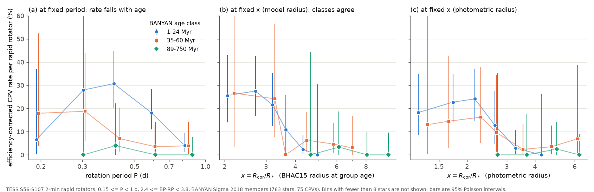
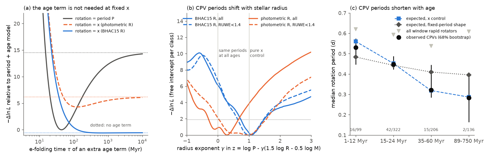
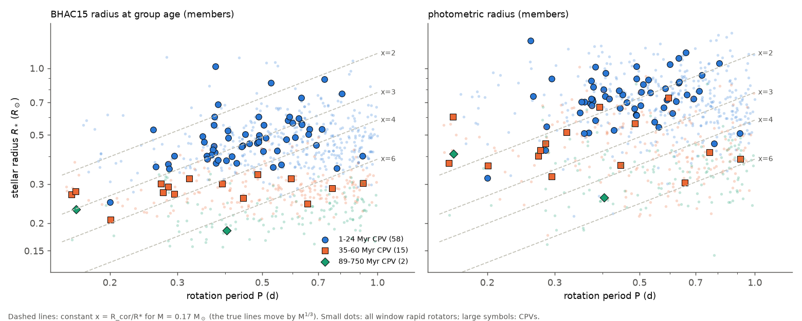

# Stellar contraction can explain the age decline of the CPV rate in TESS M dwarfs: at a fixed corotation-to-stellar radius ratio, the rate does not need an extra age term

**Job:** sci-1107-hp-astronomy-9e0e5ed64d30. **Campaign:** 11_07_2026. **Topic:** astronomy. **Machine:** hp. **Account:** claude-olen. **Model:** Claude Opus 5.5 (claude-opus-5-5), working as an automated research agent. **Date:** 2026-11-10. The signing key is a campaign-machine key. It is not a personal authorship claim.

## Summary

Complex periodic variables (CPVs) are young, rapidly rotating M dwarfs with sharp dips that repeat at the rotation period. The probable cause is material that co-rotates with the star near the corotation radius R_cor = (G M P^2 / 4 pi^2)^(1/3). A TESS survey of sectors 56 to 107 (`sci:sha256:22057485...`) found 126 on-target CPVs among 29,707 red dwarfs within 150 pc. A follow-up (`sci:sha256:82e139ee...`, our earlier job) found that at a fixed rotation period P, the CPV rate per rapid rotator falls from 16% at 15-24 Myr to 2% at 89-200 Myr. That is an e-folding time of 44 Myr. That publication said that "a property that changes with age" must cause this, for example loss of a material reservoir.

Here we test one specific property: the size of the star. Pre-main-sequence M dwarfs contract by a factor of about 2 between 20 and 150 Myr. At a fixed P, the ratio x = R_cor / R* thus increases as the star contracts. We ask: is the CPV rate a function of x, so that the age decline at fixed P is only the effect of contraction?

We used the same 763 BANYAN Sigma members (75 CPVs) with 0.15 <= P < 1 d and 2.4 <= BP-RP < 3.8, and the same detection-efficiency correction. We used two radius estimates. R_iso is the BHAC15 model radius at the group age and at the effective temperature of the star. R_sb is the Stefan-Boltzmann radius from Gaia photometry.

Main results:

1. **At a fixed x, the age classes have the same CPV rate** (Figure 1). At a fixed P, the 35-60 and 89-750 Myr classes have fewer CPVs. At a fixed x, the curves of the classes agree within their errors. The rate falls steeply above x = 2: it is proportional to x^(-6.5 +/- 1.4) with R_iso in the young classes.
2. **With x in place of P, the age term is not necessary.** With R_iso, a model with no age parameter fits as well as the earlier model with a free 44-Myr exponential (negative log-likelihood 223.9 against 224.5, with one parameter fewer). An extra age term then has p = 0.76, e-folding time > 75 Myr (95% lower limit), and a power-law slope of +0.01 +/- 0.42 (earlier: -1.43 +/- 0.29). With R_sb the extra age term is weak (p = 0.053, tau > 50 Myr, slope -0.49 +/- 0.35).
3. **A model fitted only to the 1-24 Myr stars predicts the older classes.** With x (R_iso) it predicts 14.2 CPVs (95% interval 10.4-18.8) among the 342 older members, and we observe 17. With P it predicts 54.6 (42.9-66.8). With R_sb, x predicts 23.0 (17.0-32.7).
4. **CPV periods become shorter with age, as contraction predicts** (Figure 2). This test gives each age class a free intercept, so it does not use the rate decline. The median period of the CPVs is 0.53, 0.45, 0.32 and 0.28 d in the 1-12, 15-24, 35-60 and 89-750 Myr classes. The x model predicts 0.56, 0.45, 0.32 and 0.29 d. A fixed-period shape predicts 0.48, 0.44, 0.41 and 0.40 d. In a model with z = log P - gamma (1.5 log R - 0.5 log M), the best radius exponent is gamma = 1.08 (0.75 to 1.48) with R_iso and a spline shape. gamma = 1 is pure x control. gamma = 0 means that CPVs occur at the same periods at all ages; the data reject it (p = 5e-4).
5. **The result also holds without kinematic ages.** Among all 1,836 window rapid rotators (field stars included), a model fitted to stars more than 1.5 mag above the main sequence predicts 10.9 CPVs (6.3-21.5) among stars less than 1 mag above it, if it uses x (R_sb). We observe 6. With P it predicts 93.4.

Thus the decline of the CPV rate at a fixed period does not require a loss of circumstellar material on a 44-Myr time scale. Contraction moves the corotation radius outward in units of the stellar radius. When x becomes larger than about 3 (R_iso) or 2.5 (R_sb), CPVs become rare. Old M dwarfs could keep a small x only if they rotate at P < 0.15-0.2 d, and few of them do. The data permit a smaller residual age effect, but they do not need it.

## Question and prior work

The source survey (`sci:sha256:22057485...`) found that the CPV rate increases with height above the main sequence. A second follow-up (`sci:sha256:0737cdf0...`) showed that height still predicts CPVs after adjustment for period and colour. Our earlier job (`sci:sha256:82e139ee...`) replaced height by BANYAN Sigma group ages and found a 44-Myr e-folding time at fixed P. It did not test the reason. Another follow-up (`sci:sha256:c1d97d85...`) showed that a fixed-density transit factor proportional to P^(-2/3) does not explain the period dependence. It did not let the stellar radius change. Theory papers say that the smaller R_cor / R* of inflated young M dwarfs helps to hold co-rotating material (Jardine and Collier Cameron 2019; Daley-Yates, Jardine and Bouma 2026). We did not find a demographic test of this idea against measured CPV rates. Our question is: does x = R_cor / R* alone explain the age decline at fixed P?

## Data

- **Source CPV survey** `sci:sha256:22057485a2da3a065a5f74f1a999add62ae8add4988f98bbb1998078166493e0`: per-star table `files/data/population_s56_107_stars.parquet` (CPV labels, rotation periods, rapid-rotator flags, Gaia DR3 G, BP-RP and parallax-based M_G, height dMG).
- **Age classes and efficiency** `sci:sha256:82e139eed109fa6f6bfbff2e90503862a06d83e37ef5852e6e3c9946ef3c6394`: `files/data/star_age_classes_banyan2018.csv` (BANYAN Sigma 2018 class, probability-weighted log age, injection efficiency of each star) and `files/data/injection_eta_vs_noise.csv` (efficiency plateau).
- **BHAC15 evolutionary tracks** (Baraffe et al. 2015), `BHAC15_tracks+structure` from `https://perso.ens-lyon.fr/isabelle.baraffe/BHAC15dir/`, retrieved 2026-11-10. Not bundled.
- **Mamajek dwarf colour-temperature table** version 2022.04.16 (Pecaut and Mamajek 2013), `https://www.pas.rochester.edu/~emamajek/EEM_dwarf_UBVIJHK_colors_Teff.txt`, retrieved 2026-11-10. Not bundled.
- `files/provenance/input_provenance.json` gives the SHA-256 of the two source ZIPs, of each file that we used from them, and of the two external tables. No shared campaign dataset was relevant. We did not add a dataset. We did not download TESS or Gaia data again.

## Method

1. **Stellar parameters** (`01_stellar_params.py`). Teff and the bolometric correction BC_G = BC_V - (G - V) come from BP-RP through the Mamajek table. L follows from M_G + BC_G, and R_sb = sqrt(L) (5772 K / Teff)^2. The mass M_trk comes from a linear interpolation of the BHAC15 tracks in (log Teff, log L). For R_iso and M_iso we interpolated the BHAC15 tracks at the probability-weighted BANYAN age of the star and at its Teff. R_iso does not use the photometric height. Thus it has no scatter from unresolved binaries, but it assumes that all members of a class have the class age. Then R_cor = (G M P^2 / 4 pi^2)^(1/3) and x = R_cor / R*.
2. **Rate models** (`02_models.py`). Star-level Poisson models of the CPV label with log(relative efficiency) as offset. The shape term is a quadratic in log P or in log x, plus a colour term. The age term is exp(-t / tau) (profile over tau) or a power law in age. We compare the age term of the P model and of the x model.
3. **Transfer test** (`02_models.py`). We fitted the x model and the P model only to the 1-12 and 15-24 Myr members. Then we predicted the number of CPVs in the older classes. Intervals come from 300 bootstrap refits of the young sample. The p-value is the chance of the observed count or fewer under the bootstrap predictions. We also repeated the test inside the common range of the young x values.
4. **Height test** (`02_models.py`). The same transfer, but with all window rapid rotators (field included). We trained on dMG >= 1.5 mag and predicted dMG < 1 mag. This test does not use BANYAN ages. It uses R_sb only, because R_iso needs an age.
5. **Period-shift test** (`05_shift_test.py`). Each age class has its own free intercept (89-200 and 400-750 Myr together), so the overall rate change carries no information. The shape is a quadratic or a natural cubic spline in z = log P - gamma (1.5 log R - 0.5 log M). We profiled gamma. We also computed the median CPV period that each model expects in each class.
6. **Variants** (`03_variants.sh`, `results/variants.csv`): R_sb or R_iso; P from 0.08 to 2 d and from 0.2 to 0.8 d; BP-RP from 2.0 to 4.2; RUWE < 1.4; main-sequence mass in place of the track mass; all group ages multiplied by 0.67 or 1.5 (for R_iso).

## Results

### Age term with P or x as the rotation variable (BANYAN members)

| variant | members (CPVs) | tau with P (Myr) | extra age term with x: tau (Myr, 95%) | p | age slope with P | age slope with x | x-model predicts / observed in older classes | P-model predicts |
|---|---|---|---|---|---|---|---|---|
| primary, R_sb | 763 (75) | 44 (28-81) | 124 (>50) | 0.053 | -1.43 +/- 0.29 | -0.49 +/- 0.35 | 23.0 / 17 | 54.6 |
| R_iso | 763 (75) | 44 | 691 (>75) | 0.76 | -1.43 | +0.01 +/- 0.42 | 14.2 / 17 | 54.6 |
| P 0.08-2 d, R_sb | 1426 (77) | 44 | 220 (>67) | 0.19 | -1.40 | -0.18 +/- 0.32 | 20.9 / 17 | 56.4 |
| P 0.08-2 d, R_iso | 1426 (77) | 44 | no decline (>110) | 1.0 | -1.40 | +0.41 +/- 0.35 | 14.8 / 17 | 56.4 |
| BP-RP 2.0-4.2, R_sb | 822 (77) | 43 | 129 (>51) | 0.055 | -1.45 | -0.45 +/- 0.33 | 24.1 / 18 | 57.4 |
| BP-RP 2.0-4.2, R_iso | 822 (77) | 43 | 529 (>73) | 0.69 | -1.45 | +0.03 +/- 0.39 | 15.6 / 18 | 57.4 |
| RUWE < 1.4, R_sb | 540 (51) | 46 | 189 (>53) | 0.30 | -1.52 | -0.33 +/- 0.45 | 12.9 / 12 | 41.7 |
| RUWE < 1.4, R_iso | 540 (51) | 46 | 1600 (>70) | 0.91 | -1.52 | -0.01 +/- 0.51 | 9.1 / 12 | 41.7 |
| main-sequence mass, R_sb | 763 (75) | 44 | 129 (>51) | 0.060 | -1.43 | -0.47 +/- 0.35 | 22.2 / 17 | 54.6 |
| P 0.2-0.8 d, R_sb | 578 (68) | 35 | 65 (33-361) | 0.008 | -1.56 | -0.86 +/- 0.38 | 24.4 / 13 | 51.8 |
| P 0.2-0.8 d, R_iso | 578 (68) | 35 | 168 (>44) | 0.38 | -1.56 | -0.30 +/- 0.53 | 12.1 / 13 | 51.8 |
| ages x 0.67, R_iso | 763 (75) | 44 | no decline (>81) | 0.95 | -1.43 | +0.09 +/- 0.43 | 13.2 / 17 | 54.6 |
| ages x 1.5, R_iso | 763 (75) | 44 | 310 (>67) | 0.48 | -1.43 | -0.11 +/- 0.40 | 15.8 / 17 | 54.6 |

The "p" column is the likelihood-ratio p-value of the extra exponential age term in the x model. In the primary window, the x model with R_iso and no age term has a lower AIC than the P model with a free age term (455.9 against 459.0). In the wide window (0.08-2 d) the P model with a free age term fits better than the x model (negative log-likelihood 239.3 against 245.0). But an extra age term does not improve the x model there, and its power-law slope is positive. Thus, in that window, the quadratic x shape fits the slow rotators less well, and the contraction shift is a little larger than the data need. The R_sb result in the narrow window (P 0.2-0.8 d) is the only variant with a significant residual age term (p = 0.008, tau = 65 Myr).

### Period-shift test (free intercept per age class)

| sample | radius | shape | gamma (95%) | p for gamma = 0 | p for gamma = 1 |
|---|---|---|---|---|---|
| primary | R_iso | spline | 1.08 (0.75-1.48) | 5e-4 | 0.47 |
| primary | R_iso | quadratic | 0.48 (0.08-1.13) | 0.025 | 0.087 |
| primary | R_sb | spline | 0.30 (-0.28-0.65) | 0.18 | 0.006 |
| RUWE < 1.4 | R_iso | spline | 1.03 (0.65-1.45) | 2e-4 | 0.93 |
| RUWE < 1.4 | R_sb | spline | 0.98 (0.05-1.55) | 0.040 | 0.94 |
| BP-RP 2.0-4.2 | R_iso | spline | 1.13 (0.78-1.73) | 6e-4 | 0.42 |
| P 0.08-1 d | R_iso | spline | 1.00 (0.60-1.38) | 0.001 | 1.0 |
| P 0.15-2 d | R_iso | spline | 0.25 (-0.15-1.45) | 0.22 | 0.083 |
| P 0.08-2 d | R_iso | spline | 0.25 (-0.13-1.25) | 0.20 | 0.046 |
| ages x 0.67 / x 1.5 | R_iso | spline | 1.05 / 1.13 | 4e-4 / 1e-3 | 0.67 / 0.37 |

`results/shift_test.csv` and `results/shift_test_spline.csv` give all rows. Inside one class, R_iso changes only with Teff. Thus the R_iso rows measure the shift between classes. The R_sb rows also use the scatter of the photometric radius inside a class. With all stars, R_sb gives gamma near 0.3. With RUWE < 1.4 it gives gamma near 1. A probable cause is unresolved binaries: they make R_sb too large and x too small, but they do not change the true x of the star. Our earlier job found the same effect: inside a class, CPVs are not higher above the main sequence than their peers. When we add the slow rotators with P = 1-2 d (2 of 77 CPVs), the shift test becomes weak (gamma = 0.25, interval to 1.25-1.45). Across classes, the CPV periods differ (Mann-Whitney p = 0.036 for 1-24 Myr against 35-750 Myr; medians 0.47 and 0.32 d). The parent rapid rotators change less (0.61 and 0.56 d).

### Rate versus x and the period-radius plane

81% of the member CPVs have 2 <= x_iso <= 4 (median 3.0; 10% to 90% range 2.3 to 4.6). In the older classes, the CPVs are at shorter periods, where the smaller stars reach the same x. In the young classes, the binned rate is 22% to 28% at x_iso < 3.5, 11% at 3.5-4, 2% at 4-5 and 0 of 16 at 5-6.5 (`results/iso/binned_rates.csv`). The power-law slope of the rate above x = 2 is -6.5 +/- 1.4 (R_iso, young members) and -8.2 +/- 2.6 (R_sb). A transit chance alone gives a slope of about -1 (`sci:sha256:c1d97d85...`). Thus the remaining steep fall must come from the physics that holds the material near corotation. A dipole field at corotation weakens as x^(-3), and its magnetic pressure as x^(-6). This agrees with the measured slope, but our data do not test a specific model.

Per star (all members of a class in the colour window), the CPV fraction is 1.9%, 2.2%, 2.7%, 0.3% and 0% in the five classes. The fraction of stars that are rapid rotators with x_sb < 2.5 is 11%, 9%, 12%, 1.2% and 0.9%. Up to 35-60 Myr, the spin-up of contracting stars keeps many stars at small x. In the 89-200 Myr class, few stars rotate fast enough to have a small x. Field stars in the BANYAN classes can cause part of this deficit, so we do not use it as a test.

## Interpretation

The earlier 44-Myr e-folding time is a correct description of the CPV rate at a fixed period. But it does not measure the life time of the material. A single variable, x = R_cor / R*, predicts most or all of the age decline. It also predicts the shift of the CPV periods to shorter values in older stars, which a pure age effect at fixed period does not predict. With the BHAC15 contraction law, the data need no extra age term. A star becomes a CPV only when its corotation radius is within about 2-4 stellar radii (the absolute value depends on the radius scale). Contraction moves stars out of this range at a fixed period. This agrees with prominence and centrifugal-magnetosphere models in which material can stay near corotation only if corotation is inside the strong closed field near the star.

This result changes the meaning of "how long the material survives". The time scale of tens of Myr is set by stellar contraction and spin evolution, not necessarily by the loss of a circumstellar reservoir. The sector-to-sector changes of the CPV shape (our earlier job; `sci:sha256:a1cd485d...`) measure the life time of single clumps. The data do not exclude an additional, slower decline of material supply (tau > 50-110 Myr at 95% in most variants).

## Limitations

- **Same labels and sample.** One automated agent made the visual CPV labels of the source survey. All tests use these labels and the same 2-minute target selection. The vetter saw folded light curves (and thus P), but not radii or ages.
- **Radius scale.** R_iso depends on the BHAC15 models. Real young M dwarfs can be larger than these models (spots and magnetic fields), and the BHAC15 and Mamajek temperature scales differ. Thus the absolute x values are uncertain by about a factor of 1.5 (median x of the member CPVs: 2.0 with R_sb, 3.0 with R_iso). The tests use relative x, but an age-dependent radius error (for example more inflation in the youngest stars) would change gamma.
- **R_iso and age are not independent.** R_iso is a function of the group age and Teff. The x model with R_iso thus uses the age, but through a fixed physical law with no free age parameter. The test is whether this fixed law fits as well as a free age law. It does. This is evidence that contraction is sufficient. It is not a proof that the material supply has no age dependence.
- **Few old CPVs.** Only 17 CPVs are older than 35 Myr, and only 2 are older than 89 Myr. Thus the residual age term has wide limits (tau > 50-110 Myr). With R_sb in the narrow 0.2-0.8 d window, a residual term is significant (p = 0.008).
- **Model shape.** The shape of the rate versus z is a quadratic or a spline with 4 degrees of freedom. When we include slow rotators (P = 1-2 d), the period-shift test is weak and gamma = 1 is marginal (p = 0.046 to 0.083).
- **Main-sequence fast rotators.** Among stars less than 0.5 mag above the main sequence, the x model predicts 3.4 CPVs and we observe 0 (p = 0.06). This is a weak sign that old fast rotators at small x are less often CPVs.
- **Binaries and extinction.** Unresolved binaries make R_sb too large. We did not correct for extinction; it is small within 150 pc, but not zero in some star-forming regions.
- **Membership and ages.** BANYAN Sigma without RVs gives some false members. The group ages come from the literature. Age scales of x0.67 and x1.5 do not change the result.
- We did not obtain spectra, new observations or new light curves.

## Reproduction

`sh files/code/run_all.sh BASE_ZIP AGE_ZIP SCRATCH` repeats the full analysis in a separate scratch folder. BASE_ZIP is `campaign/22057485a2da3a065a5f74f1a999add62ae8add4988f98bbb1998078166493e0.zip` and AGE_ZIP is `campaign/82e139eed109fa6f6bfbff2e90503862a06d83e37ef5852e6e3c9946ef3c6394.zip`. The script verifies both ZIPs with `sci verify`, downloads the BHAC15 tracks and the Mamajek table, checks their SHA-256 values, and runs the scripts in order. On the campaign host it took about 2.3 minutes, and it reproduced every result file byte for byte. Python 3.12.15, numpy 2.5.4, pandas 3.1.1, scipy 1.18.1, matplotlib 3.11.2.

Files:

- `files/code/`: all analysis code (MIT licence).
- `files/results/<variant>/`: `summary.json` (fits, transfer tests, medians), `tau_profile_P.csv`, `tau_profile_x.csv`, `gamma_profile_*.csv`, `transfer_young_to_old.csv`, `transfer_height.csv`, `binned_rates.csv`. `files/results/variants.csv` collects all variants. `shift_test*.csv`, `shift_profiles*.csv` and `cpv_period_by_class*.csv` are the period-shift test. All files are aggregate results.
- `files/figures/`: the three figures. Figure 2c uses the quadratic shape; Figure 2b uses the spline shape.
- `files/provenance/`: input hashes and the printed outputs of the main runs.
- `files/EXTERNAL_DATA.md`: notice for external data.

We do not bundle the record-level table of stellar parameters (`derived/stars_params.parquet`), because it derives from Gaia DR3 records. `run_all.sh` writes it into the scratch folder.
