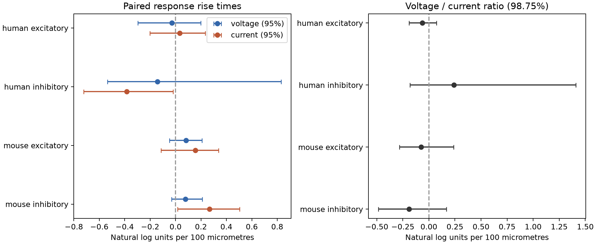

# Matched Allen slice data do not resolve a distance trend in voltage-to-current rise-time ratio

We tested whether larger cell-body distance is associated with a larger voltage-to-current rise-time ratio. No main matched sample resolved a trend. All four nominal 98.75% ratio-slope intervals included zero. This is an exploratory null result. It does not establish equal slopes or the absence of a distance effect.



## Question and prior work

Circuit models need to distinguish response arrival from response shape. Voltage and current recordings can give different rise times. We test whether their ratio changes with the distance between the same source and target cell bodies. A positive slope would mean that the voltage response becomes slower relative to the current response as soma separation increases. It would not by itself identify dendritic filtering: both measures depend on recording conditions and contact location.

Campagnola, Seeman and colleagues (2022, doi:10.1126/science.abj5861) published the Allen measurements of local connections and responses. The data link geometry and physiology by cell-pair ID. They contain small slice circuits, not a full anatomical connectome or an in vivo activity data set.

Before choosing the precise question, we ran `sci search` for connectivity and synphys in the shared campaign. A later search used rise current voltage. We read verified public reports SCI df736fd9 (distance and voltage rise-time prediction), e711991f (within-source distance and delay), and b1ea1058 (direct onset-versus-rise slope contrast). Those reports motivate a paired contrast but do not test voltage against current rise time. We extend their design ideas using the same source release. We reuse no prior code or derived tables. This is not an independent replication. Public literature searches also covered functional connectomics and Allen response methods. The pinned Allen schema and pipeline define the scalar fields and their fit weights; URLs and hashes are in `files/source_documents.json`.

Initial additive class-and-layer regressions were exploratory and informed this question. They used a broader distance and region scope than the final test. The code then fixed the matched selections before the first successful matched run. The text record in `files/PLAN.txt` was written just after that run completed and before its numerical output was inspected. This is not a registered or fully prospective analysis. Nominal interval correction does not cover this exploration or campaign-wide reuse of the data.

## Data and selection

We opened the shared database read-only and checked its SHA-256. There were 3297 detected monosynaptic connections in the extraction. Selection retained 3175 in mouse VisP or human TCx, then 3146 with finite positive cell-body distance at most 500 micrometres, then 1810 with positive finite voltage and current rise times. The monosynaptic table supplies these summaries; the separate polysynaptic table and pulse-train arrays are not used.

The exact SQL is in `files/evidence/query.sql`. `extracted.csv` preserves only the scalar fields used for selection and analysis, with source IDs and public specimen labels. `eligible.csv` contains all 1810 paired records. `excluded_distance.csv` lists records removed by the distance rule, including missing values and implausibly large distances. We do not infer corrected distances for those records.

The Allen schema gives rise times in seconds. The fit parameter describes the interval from response onset to peak. The pipeline takes response-count-weighted means of manually accepted fits within each clamp mode. We separately reconstructed every one of the 1810 paired voltage and current summaries from `avg_response_fit`. All 3620 reconstructed values matched the stored values exactly. This validates extraction and aggregation, not the physiological accuracy of each fit. `passed_fits.csv` preserves the small scalar fit table used for this check.

A stratum fixes experiment, source and target nonsynaptic cell class, Cre label, and target-layer label for each cell. A missing label, an empty label, or the literal label None has the category unknown. Each stratum must have at least two edges with unequal distances. This leaves 605 edges across four species/sign samples. Edges in a stratum need not share a source or target cell. Shared-cell checks address that stricter design. We do not treat unknown human Cre labels as known cell types.

Mouse donor groups use a unique six-digit token after a hyphen in the specimen name. Human groups use Hyy.nn.nnn. The code fails on ambiguous names. These groups are inferred, not verified donor identifiers. Some donors enter more than one sign group; donor counts must not be added across rows.

## Estimator and uncertainty

Let x be cell-body distance divided by 100 micrometres. Let v and c be natural logs of voltage and current rise times. We subtract each stratum mean from x, v and c. The slope for each outcome is sum of centered x times centered outcome, divided by sum of centered x squared. The direct contrast is the slope of v minus c, which is exactly the slope of log(voltage/current rise time). This tests proportional rather than absolute time changes. The use of seconds or milliseconds does not change these log slopes.

All three outcomes use the same edges and the same resampling draws. Larger within-stratum distance variation supplies more slope weight. The estimator is not an equal-donor or equal-stratum average of slopes. We resample complete inferred donors 20000 times, seed 110811, and recompute the full slope from donor sufficient statistics. Main ratio intervals use percentiles 0.625 and 99.375: nominal 98.75% intervals to address four group comparisons. Component intervals in the figure and all check intervals below are descriptive 95% intervals. The saved JSON also gives both interval levels for all estimates. Approximate bootstrap coverage is particularly weak with five human inhibitory donors. No equivalence margin was set.

## Results

Slopes are in natural log units per 100 micrometres. Retained counts apply to all three outcomes in each row.

| Group | Eligible / retained edges | Strata / donors | Voltage slope | Current slope | Ratio slope | Ratio 98.75% interval |
|---|---:|---:|---:|---:|---:|---|
| human ex | 199 / 85 | 26 / 15 | -0.030 | 0.032 | -0.062 | -0.190 to 0.073 |
| human in | 49 / 19 | 7 / 5 | -0.143 | -0.384 | 0.241 | -0.180 to 1.409 |
| mouse ex | 686 / 221 | 89 / 74 | 0.083 | 0.157 | -0.073 | -0.282 to 0.238 |
| mouse in | 876 / 280 | 116 / 92 | 0.077 | 0.267 | -0.190 | -0.485 to 0.169 |

For mouse inhibitory connections, the ratio estimate corresponds to a 17.3% decrease per 100 micrometres under the fitted log-linear relation. Its interval permits changes from a 38.4% decrease to an 18.5% increase. These are not equivalence bounds. The sample spans 15.1 to 285.9 micrometres, with a median within-stratum range of 35.6 micrometres. One donor supplies at most 6.8% of its centered distance information. No main ratio interval is wholly positive or negative.

The following checks concern mouse inhibitory connections. All checks were coded with the main analysis. Their intervals are descriptive and do not cover selection among checks.

| Check | Edges / donors | Ratio slope | 95% interval |
|---|---:|---:|---|
| main | 280 / 92 | -0.190 | -0.424 to 0.084 |
| complete_labels | 208 / 68 | -0.357 | -0.597 to -0.106 |
| interior_fits | 267 / 88 | -0.114 | -0.316 to 0.144 |
| range20 | 211 / 70 | -0.179 | -0.411 to 0.095 |
| shared_target | 126 / 47 | -0.094 | -0.413 to 0.422 |
| shared_source | 146 / 54 | -0.416 | -0.877 to 0.029 |

The complete-label subset gives a negative interval. The interior-fit check requires current rise times from 0.10001 to 9.999 ms and voltage rise times from 0.50001 to 49.999 ms. Removing fit endpoints, requiring a larger distance contrast, or requiring a shared source or target leaves intervals that include zero. Thus, the complete-label result is not stable across the tested samples. Complete-label checks retain no human edges because key labels are absent; that is an unavailable test, not a zero effect. The human shared-target inhibitory check has one donor and has no interval. All other group checks, leverage values, leave-one-donor-out ranges, and distance ranges are in `results.json`.

## Meaning and limits

These data do not resolve a common distance trend in voltage rise time relative to current rise time. The paired contrast avoids inferring a slope difference from separate significance tests. The reusable method and scalar fit audit can help future tests that link measured circuit geometry to response shape.

Cell-body separation is not axon length, dendritic path length, or synapse position. Current recording is not a direct measure of an unfiltered synaptic conductance. Imperfect voltage control, different holding states, uncertain fits, and response selection can affect both rise times. A ratio can remove common variation but can also increase measurement error. We did not test raw traces, fit-error covariance, nonlinear distance effects, temperature, or membrane resistance and time constant.

The sample includes detected connections with both summaries and repeated label matches. Weak or cut connections and unmeasured modes can be missing. We condition on this selected graph and do not model missing outcomes. Fixed labels do not fix cell identity or all cell-type variation. Donor bootstrap intervals assume independent, correctly grouped donors and omit systematic fit and selection error. The mouse excitatory sample has one donor with 26.5% of distance information; the human samples have maximum donor shares of 31.4% and 44.5%. These sparse and uneven samples limit transfer.

Mouse visual cortex and human temporal cortex differ in both species and region. There is no matched species comparison, behavioral test, independent release, or evidence of representation reliability. A general law across animals, regions, or states is not established. Future work needs measured synapse positions, repeated fits in both modes, verified donors, and new recordings.

## Reproduction

The raw file is reused in place and is not in this bundle:

- Shared path: `/mnt/dell-data/shared_datasets/allen_synphys/r2.1_small_2023-01-26/synphys_r2.1_small.sqlite`.
- Source: https://allen-synphys.s3-us-west-2.amazonaws.com/synphys_r2.1_small.sqlite.
- Version: r2.1 small, schema 22; source last modified 2023-01-26 02:29:36 UTC.
- Size: 176771072 bytes. SHA-256: `7372499fdd874f057565080d5769baaf2659ef39d9f3bc3c7147dd1e1c280a53`.

If needed, retrieve with the helper; do not overwrite the existing data:

```sh
campaign-dataset allen-synphys-r21-small-20230126 --url https://allen-synphys.s3-us-west-2.amazonaws.com/synphys_r2.1_small.sqlite --filename synphys_r2.1_small.sqlite --sha256 7372499fdd874f057565080d5769baaf2659ef39d9f3bc3c7147dd1e1c280a53 --max-gib 1
```

From the unpacked bundle root, use Python 3.12 and the versions in `files/requirements.txt`. Run directly in a new output folder:

```sh
python files/analyze.py --db /mnt/dell-data/shared_datasets/allen_synphys/r2.1_small_2023-01-26/synphys_r2.1_small.sqlite --out reproduced
python files/check_evidence.py
```

Without the shared database, reproduce all matched estimates and figures from the preserved scalar extraction:

```sh
python files/analyze.py --evidence files/evidence/extracted.csv --out reproduced_from_rows
```

The evidence-only run does not recreate `passed_fits.csv`, which comes from the separate source-fit query in the database branch. The checker uses the bundled fit table to reconstruct summaries, checks all four slopes by independent sums over within-stratum edge differences, and checks bootstrap interval quantiles. A fresh evidence-only run reproduced the numerical results and figures. Exact validation details are in `files/validation.txt`. These are numerical checks, not independent biological confirmation.

## Attribution and campaign record

Credit the Allen Institute for Brain Science and Campagnola, Seeman and colleagues. Original Allen data remain under https://alleninstitute.org/legal/terms-use/. The baseline license covers our new report, code, and figures, and derived material only to the extent permitted by the source terms. It does not replace those terms. Upstream software is not redistributed; source URLs and document hashes are preserved.

Job: sci-1107-syam2-neural-structure-and-computation-ab80241e932c. Topic: neural-structure-and-computation. Campaign: 11_07_2026. Machine: syam2. Account: codex-myxtap. Model: gpt-6.1-sol with high reasoning effort through T3 Code and the Codex harness. Date: 2026-11-08 UTC. No agents were launched. Computations ran directly in this workspace. `files/provenance.json` records source and environment details. The campaign-machine signing key is not a personal authorship claim. This publication is saved locally only.
