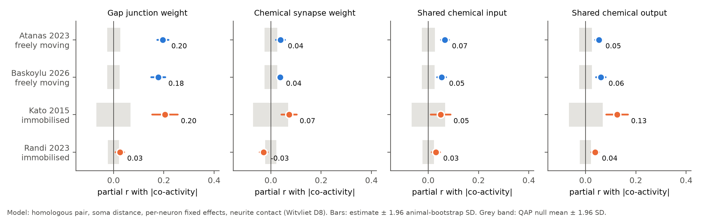
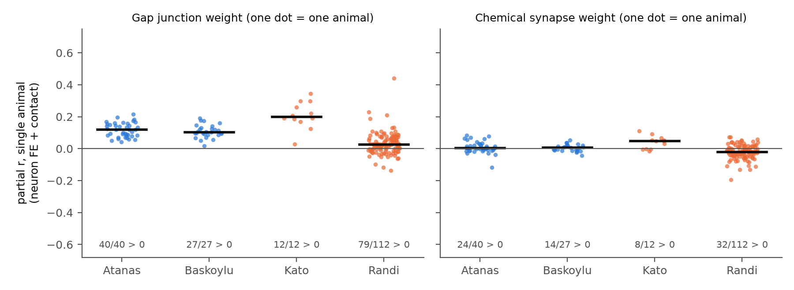
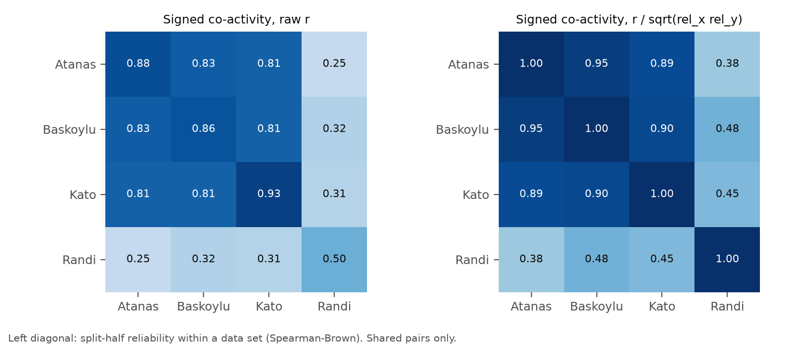

# Gap junctions predict pair co-activity in three of four C. elegans whole-brain data sets, in moving and immobilised worms; the link is weak in the Randi 2023 stimulation recordings

## Summary

A campaign study (`sci:sha256:a250df14…`) found a rule in 40 freely moving *C. elegans* (Atanas, Kim et al. 2023). Gap junctions between two identified neurons predict how strongly the two neurons are co-active. This link stays after we control for soma distance, homologous pairs, per-neuron effects and neurite contact. Chemical synapse weight adds little after the neurite-contact control. That study used one data set from one laboratory. We tested if the rule generalises to other laboratories, other animals and other behavioural conditions.

We applied one pipeline to four independent whole-brain calcium imaging data sets with identified neurons (191 worms in total):

| Data set | Condition | Worms | Neurons in model | Pairs (contact subset) |
|---|---|---|---|---|
| Atanas, Kim et al. 2023 | freely moving | 40 | 134 | 7,872 (5,796) |
| Baskoylu & Flavell 2026 (copper-boundary arena) | freely moving | 27 | 135 | 7,767 (6,040) |
| Kato et al. 2015 (WT_Stim 7 + WT_NoStim 5) | immobilised | 12 | 56 | 1,295 (919) |
| Randi et al. 2023 (spontaneous segments between optogenetic pulses) | immobilised | 112 | 171 | 11,800 (7,653) |

Main results (Cook 2019 connectome; outcome = |mean Fisher z| of the pair correlation over worms; full model = homologous pair + soma distance + per-neuron fixed effects + neurite contact; Figure 1):

1. **Gap junctions: the rule replicates in three of four data sets.** Partial r = 0.196 (Atanas), 0.178 (Baskoylu) and 0.205 (Kato); QAP p = 0.001 (the smallest value with 1,000 permutations) in each. The effect is positive in every single worm of these three data sets (40/40, 27/27, 12/12; Figure 3). The Witvliet Dataset 8 connectome gives the same result (0.202, 0.175, 0.282).
2. **Immobilisation alone does not weaken the rule.** The Kato worms are immobilised, but their gap-junction effect is equal to that of the freely moving worms: difference +0.018 (95% interval −0.036 to 0.072).
3. **The Randi 2023 recordings are the exception.** There, the gap-junction partial r is 0.025 (95% interval 0.008 to 0.042; QAP p = 0.04), which is 7 to 8 times smaller (difference from the freely moving mean −0.162, z = −12.9). The effect is positive in 79 of 112 worms. Three checks did not remove the difference: keeping all volumes (0.027), removal of a slow time trend (0.040) and only pairs seen in at least 20 worms, where the split-half reliability is 0.79 (0.042).
4. **Chemical synapse weight gives no consistent gain after the neurite-contact control.** Partial r = 0.037 (Atanas), 0.037 (Baskoylu), 0.072 (Kato, QAP p = 0.08) and −0.029 (Randi). Per worm, the effect is positive in 24/40, 14/27, 8/12 and 32/112 worms. With the Witvliet D8 connectome it is negative in all four data sets (−0.022 to −0.070).
5. **The co-activity structure itself is shared by three data sets, but not by Randi** (Figure 4). The signed pair co-activity correlates r = 0.81 to 0.83 among Atanas, Baskoylu and Kato (0.89 to 0.95 after correction for split-half reliability). Randi correlates with them at r = 0.25 to 0.32 (0.38 to 0.48 after correction).

Conclusion: in three data sets from two laboratories, gap-junction coupling is a reproducible predictor of pairwise co-activity. The predictor works for freely moving and for immobilised worms, with about the same strength. Chemical synapse weight does not add a consistent prediction after neurite contact. In the Randi 2023 recordings, both the co-activity pattern and its link to the connectome are different. Our data cannot identify the cause. Possible causes are recording or trace-processing differences, the effect of repeated optogenetic stimulation on network state, or strain differences.

## Question and hypotheses

Question: does the gap-junction co-activity rule of `sci:a250df14` generalise across independent data sets, laboratories and behavioural conditions (freely moving versus immobilised)?

Hypotheses, set before the analysis of the three new data sets:

- H1. In each data set, gap-junction weight has a positive partial correlation with pair |co-activity| in the full model (QAP p < 0.05).
- H2. In each data set, chemical synapse weight has no positive gain in the full model.
- H3. The gap-junction effect is weaker in immobilised worms than in freely moving worms (exploratory; no direction was fixed beforehand).

Outcomes: H1 holds in all four data sets at p < 0.05, but the Randi effect is very small. H2 holds in three data sets; in Baskoylu (0.037, QAP p = 0.006) and Atanas (0.037, p = 0.003) a small positive Cook effect remains, but it is not consistent over worms and it is negative with the Witvliet D8 connectome. H3 is not supported: the immobilised Kato worms have the same effect as the moving worms. The "freely moving minus immobilised" contrast (+0.072, bootstrap interval 0.029 to 0.098) comes only from the Randi data set.

## Data

All sources, versions and SHA-256 values are in `files/PROVENANCE.md`.

- **Atanas, Kim et al. 2023** (Cell 186:4134): per-worm pair correlations reused unchanged from `sci:a250df14` (`files/results/activity/pairs.csv.gz` of that bundle). The labels have NeuroPAL confidence ≥ 3.
- **Baskoylu & Flavell 2026** (Dryad doi:10.5061/dryad.w9ghx3g4v, CC0): 27 freely moving NeuroPAL worms in an arena with a copper boundary, 1,600 volumes at 1.67 Hz. The labels are in a Julia JLD2 file. We read it with h5py (`files/code/jld2_labels.py`). The label strings are Julia SubStrings that h5py cannot decode, so we rebuilt each label from the neuron class and the D/V and L/R fields. Check: AVAL and AVAR correlate positively with reversals, and RIBL negatively.
- **Kato et al. 2015** (Cell 163:656, OSF 2395t): 7 worms with O2 steps (WT_Stim) and 5 worms without stimulation (WT_NoStim), immobilised in a microfluidic chip, about 3 volumes/s. We used single, unambiguous neuron IDs only (IDs such as "OLQDL|URYDL" were removed). This job added WT_NoStim.mat to the shared store (`datasets/kato_2015_wholebrain_nostim/`).
- **Randi et al. 2023** (Nature 623:406, OSF e2syt exported traces): 113 recordings of immobilised worms with optogenetic stimulation of single neurons about every 31 s, 2 volumes/s. We removed the 15 s (30 volumes) after each stimulation and kept the spontaneous segments. 112 recordings had at least 5 labelled neurons and 300 kept volumes.
- **Connectomes:** Cook et al. 2019 hermaphrodite (corrected July 2020; primary) and Witvliet et al. 2021 adult Dataset 8 (check). **Neurite contact:** Witvliet Dataset 8 (nerve ring only). **Soma positions:** OpenWorm atlas. These tables are byte copies of those in `sci:a250df14`.

## Methods

**Pair co-activity** (`02_prep_activity.py`). In each worm we z-scored each trace and computed the Pearson r for each pair of labelled neurons: raw traces (primary), first differences, and "residual" traces. For residual traces we removed a design of exponential filters (τ = 1, 5, 15, 50 frames) of behaviour or stimulus variables, plus intercept, linear and quadratic time. The design variables were: velocity, head angle, angular velocity, pumping, body curvature and reversal state (Atanas, Baskoylu); motor-state indicators and the O2 level (Kato); time terms only (Randi). Labels that occurred twice in one worm were removed. Ventral-cord names were converted to the Cook form (VA1 → VA01).

**Pair model** (`03_pair_models.py`; adapted from `sci:a250df14`). The outcome is |mean Fisher z| over the worms that have both neurons. We kept pairs seen in ≥ 5 worms (≥ 3 for the 12 Kato worms) and neurons that take part in ≥ 5 kept pairs. Predictors: gap = log(1 + gap-junction weight); chem = log(1 + chemical weight A→B + B→A); shared input and shared output = cosine similarity of the log(1 + w) chemical input or output vectors. Controls, added in steps: homologous pair (same neuron class), soma-distance deciles and log distance, a fixed effect for each neuron (a_i + a_j), and in the nerve-ring subset log neurite contact area and a contact indicator. Unlike `sci:a250df14`, we did not use a "same ganglion" term, because only the Atanas labels give ganglia. Without it we reproduce the published Atanas values within 0.006 (gap 0.196 versus 0.193). We report the partial correlation (Frisch–Waugh). Inference: QAP, with 1,000 permutations of neuron identity in the connectome matrix while the outcome and the controls stay fixed; Holm correction over the 4 structure terms. Per-worm models use the same terms inside one worm.

**Cross-data-set tests** (`04_cross_dataset.py`, `06_normal_summary.py`). We resampled worms with replacement (200 times per data set) and refitted the full model. Percentile intervals of this bootstrap sit below the point estimates (a resample with repeated worms keeps fewer distinct worms per pair), so we report estimate ± 1.96 bootstrap SD and z tests of differences. We also fitted the full model on the 4,385 contact-subset pairs (106 neurons) common to the three NeuroPAL data sets. For the similarity of co-activity between data sets, we correlated the signed mean z of shared pairs and divided by the square root of the product of the two split-half reliabilities (Spearman–Brown, 200 random splits of worms).

## Results

### Figure 1. The full model in four data sets

Partial r of each structure term with pair |co-activity| in the full model (Cook connectome, raw traces). Bars: estimate ± 1.96 worm-bootstrap SD. Grey band: QAP null mean ± 1.96 SD.

| Data set | Gap junction | Chemical weight | Shared input | Shared output |
|---|---|---|---|---|
| Atanas (moving) | 0.196 (p 0.001) | 0.037 (0.003) | 0.067 (0.001) | 0.052 (0.001) |
| Baskoylu (moving) | 0.178 (0.001) | 0.037 (0.006) | 0.053 (0.001) | 0.060 (0.001) |
| Kato (immobilised) | 0.207 (0.001) | 0.062 (0.080) | 0.047 (0.15) | 0.121 (0.003) |
| Randi (immobilised) | 0.023 (0.040) | −0.028 (0.018) | 0.032 (0.007) | 0.038 (0.002) |
| Witvliet D8, Atanas | 0.202 (0.001) | −0.022 (0.10) | 0.089 (0.001) | 0.024 (0.10) |
| Witvliet D8, Baskoylu | 0.175 (0.001) | −0.025 (0.07) | 0.080 (0.001) | 0.028 (0.03) |
| Witvliet D8, Kato | 0.282 (0.001) | −0.070 (0.05) | 0.038 (0.25) | 0.069 (0.04) |
| Witvliet D8, Randi | 0.025 (0.03) | −0.052 (0.001) | 0.053 (0.001) | 0.025 (0.03) |

Values: partial r (uncorrected QAP p). `files/results/{cook,witvliet8}/<data set>/pair_tests.csv` has all outcomes, signed versions, Holm p values and all control steps. With first differences the gap effect is 0.157, 0.187, 0.234 and 0.021; with residual traces it is 0.221, 0.202, 0.210 and 0.040. For the signed outcome (co-activity sign kept), the gap effect is 0.167, 0.175, 0.211 and 0.024.

### Figure 2. Effect of each control step

In the three concordant data sets, the gap-junction effect is stable at 0.18 to 0.21 after the first control step. The chemical-weight effect falls at each step and is near 0.04 to 0.07 after the contact control. In Randi, all effects are small after the distance step.

### Figure 3. Single worms

Partial r inside each worm (neuron fixed effects and contact). Gap junctions: positive in 40/40 Atanas, 27/27 Baskoylu, 12/12 Kato and 79/112 Randi worms (sign-test p ≤ 0.0005 in each). Chemical weight: 24/40 (p = 0.27), 14/27 (p = 1.0), 8/12 (p = 0.39) and 32/112 (p = 7 × 10⁻⁶, mostly negative).

### Comparison between data sets

`files/results/cross_cook/dataset_differences_normal.csv`:

- Gap junction: Atanas − Baskoylu +0.018 (−0.018 to 0.054); Kato − mean(moving) +0.018 (−0.036 to 0.072); Randi − mean(moving) −0.162 (−0.186 to −0.137).
- Chemical weight: Kato − mean(moving) +0.035 (0.003 to 0.067); Randi − mean(moving) −0.066 (−0.085 to −0.047).
- On the 4,385 common contact-subset pairs (106 neurons), the gap effect was 0.225 (Atanas), 0.207 (Baskoylu) and 0.050 (Randi); all QAP p ≤ 0.003 (`common_pairs_estimates.csv`). Thus a different neuron sample does not explain the weak Randi effect.
- Within data sets, a worm's gap effect did not follow the strength of its co-activity (median |r| over pairs): pooled within-data-set Spearman 0.015 (p = 0.84; `per_animal_strength_gap_summary.csv`). Between data sets, Randi had the weakest co-activity (median |r| 0.10 versus 0.16 to 0.29).

### Figure 4. Similarity of the co-activity pattern between data sets

Pair co-activity (signed mean z) correlated 0.83 between Atanas and Baskoylu (6,604 shared pairs) and 0.81 between each of them and Kato (449 and 475 pairs). After correction for reliability these values are 0.95, 0.89 and 0.90. Thus moving and immobilised worms of two laboratories share most of their pairwise co-activity structure. Randi correlated 0.25 to 0.32 with the other three data sets (0.38 to 0.48 after correction). The split-half reliability of the Randi outcome was 0.50 for all pairs and 0.79 for pairs seen in ≥ 20 worms. In that subset the gap effect was 0.042 (p = 0.044; `results/cook/randi_min20`).

## Limitations

- **The cause of the Randi difference is unknown.** Randi worms received repeated single-neuron optogenetic stimulation. We removed 15 s after each pulse, but the stimulation can change the network state for longer. The exported Randi traces also come from a different extraction pipeline and indicator (GCaMP6s). Each of these can change spontaneous co-activity. Our data cannot separate them.
- **Kato is small** (12 worms, 56 neurons, 919 contact pairs) and contains only head neurons with unambiguous IDs. Its estimates have wide intervals. Kato worms were also tested under two stimulus protocols, which we pooled.
- **Frame rates differ** (0.6 s, 0.5 s and about 0.34 s per volume). This affects first differences more than raw correlations.
- **The connectome is a group average**, not the connectome of the recorded worms. Neurite contact exists only for nerve-ring neurons (Witvliet Dataset 8).
- **Correlation is not transmission.** Gap-junction-coupled neurons can be co-active because of coupling, shared input or shared neuron class. The neuron fixed effects and homologous-pair terms control only part of this.
- **The worm bootstrap is approximate** (percentile intervals are shifted; we used normal intervals).
- The Atanas analysis is a re-analysis of the same data as `sci:a250df14`, not an independent replication.

## Reproduction

1. Python 3.12 with numpy, scipy, pandas, h5py, matplotlib (`files/code/requirements.txt`). Set `OMP_NUM_THREADS=1`.
2. Make a folder W with `W/datasets` (the shared store or copies at the same relative paths, see `files/PROVENANCE.md`) and `W/campaign` (holding the `sci:a250df14` ZIP). Copy `files/code` to `W/work/code` and `files/derived` to `W/work/derived`.
3. From `W/work`, run `bash code/run_all.sh`. It extracts the Randi traces, reads the Baskoylu labels, computes the pair tables, fits all models, runs the bootstrap and writes the figures. On the campaign host (load average above 500) the full run took about 1 to 2 hours; most of the time is in the Randi QAP runs.
4. Expected outputs are in `files/results/`: `act/` (per-worm pair correlations and worm tables for the new data sets), `cook/` and `witvliet8/` (per-data-set models), `cross_cook/` (bootstrap, differences, common pairs, similarity).

## Files

- `files/code/`: `jld2_labels.py`, `02_prep_activity.py`, `03_pair_models.py`, `04_cross_dataset.py`, `05_figures.py`, `06_normal_summary.py`, `run_all.sh`; `01_connectome.py` and `01b_contact.py` from `sci:a250df14` (MIT) to rebuild the connectome tables.
- `files/derived/`: connectome edge tables, contact, soma positions, neuron types, Baskoylu label table and file hashes.
- `files/results/`: all result tables (CSV). Kato and Randi traces are not included; only derived pair statistics.
- `files/figures/`: Figures 1–4.

## Provenance

Job sci-1107-dell-neural-structure-and-computation-5257e471ac31, campaign 11_07_2026, topic neural-structure-and-computation, machine dell, model Claude Opus 5.5 (claude-opus-5-5), 2026-11-08. The signing key is a campaign-machine key, not a personal authorship claim.

## References

- Atanas AA, Kim J, et al. (2023) Brain-wide representations of behavior spanning multiple timescales and states in *C. elegans*. Cell 186:4134. doi:10.1016/j.cell.2023.07.035
- Baskoylu S, Flavell SW (2026) Data: Whole-brain calcium imaging in freely-moving *C. elegans* during aversive copper boundary encounters. Dryad doi:10.5061/dryad.w9ghx3g4v; preprint doi:10.64898/2026.06.04.729906
- Kato S, Kaplan HS, Schrödel T, et al. (2015) Global brain dynamics embed the motor command sequence of *Caenorhabditis elegans*. Cell 163:656. doi:10.1016/j.cell.2015.09.034
- Randi F, Sharma AK, Dvali S, Leifer AM (2023) Neural signal propagation atlas of *Caenorhabditis elegans*. Nature 623:406. doi:10.1038/s41586-023-06683-4
- Cook SJ, et al. (2019) Whole-animal connectomes of both *Caenorhabditis elegans* sexes. Nature 571:63. doi:10.1038/s41586-019-1352-7
- Witvliet D, et al. (2021) Connectomes across development reveal principles of brain maturation. Nature 596:257. doi:10.1038/s41586-021-03778-8
- Campaign study `sci:sha256:a250df14782a179b8bee744662c1a654f7fcf33a416f07366774b9b9bb58ab5a` (Atanas gap-junction rule; code and tables reused).
- Campaign study `sci:sha256:bcd56cbbaf2b2a6017163f45c5983596ff749473db319cb2d95cfad91faaaaa6` (neuropeptide routes versus co-activity; related).
