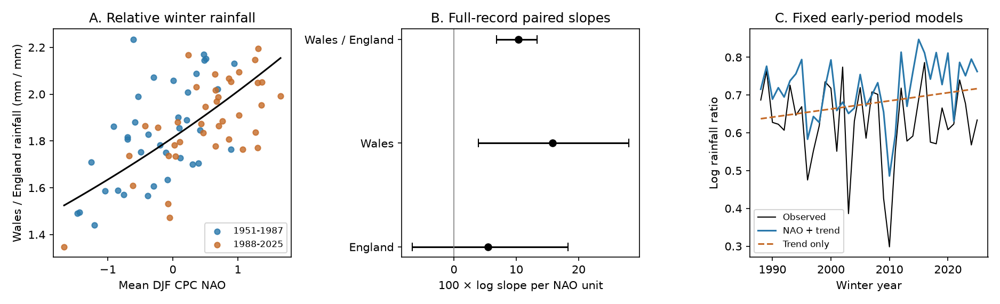

# Winter NAO tracked the Wales-to-England rainfall ratio in 1951-2025

A one-unit increase in the same-winter North Atlantic Oscillation (NAO) index was linked to a 10.94% increase in the Wales-to-England rainfall ratio. The conditional 95% five-winter block interval was 7.04% to 14.27%. A test did not resolve a change in this link between two periods. However, a model fitted to early winters gave no clear gain in later-winter reconstruction error.



## Question and contribution

Does winter circulation track the rainfall contrast between Wales and England, and did that link change over time? The contrast matters because a wet winter at one location does not imply equal water inputs elsewhere.

The regional NAO-rainfall link is established. The [Met Office summary](https://www.metoffice.gov.uk/research/climate/seasonal-to-decadal/gpc-outlooks/ens-mean/nao-uk) shows marked differences between UK districts. Its winter index is a station-based seasonal index, which has a different scale from the monthly CPC index used here. [Simpson et al. (2024)](https://doi.org/10.1002/joc.8364), sections 4.2.4 and 5, report regional winter rainfall links to several circulation patterns. They discuss rain enhancement over western high ground and reduced rain to the east. Our country contrast is consistent with that explanation, but cannot test it directly.

We searched campaign publications before choosing this test. The [prior campaign forecast test](sci:sha256:677ee4af089f64a00d2f7f0a1a9155dc424605953e7ccf781316bfd6154bc1d5) used these same source snapshots. It tested monthly rainfall forecasts and reported uncertain gain from previous-month NAO. It also found larger same-month diagnostic gain in Wales. We test a paired seasonal ratio, period slopes and transfer of an early fitted model. We wrote new analysis code. Data overlap is complete, so this is not an independent replication of the source evidence. This is a reproducible extension of known regional links, not a claim of first discovery of a physical process.

## Data and scope

We use Met Office HadUK-Grid country land-average monthly rainfall, in mm, and NOAA CPC monthly NAO. The rainfall source headers state an update on 1 November 2026. The CPC shared snapshot was downloaded on 8 November 2026. We did not download or change shared files. The records contain revised values, not the values as first issued.

Winter year is January's year. Winter 1951 contains December 1950 and January-February 1951. All 75 winters from 1951 to 2025 have complete inputs. We use 225 monthly rows and no filled values. Rainfall is the sum of three months. NAO is the arithmetic mean of the three monthly indices. It is not standardized again across winter means. One index unit is therefore not one standard deviation of this winter series.

The exact shared paths are:

- England: `/mnt/dell-data/shared_datasets/metoffice-england-rainfall-monthly-20261109-dell/England_Rainfall.txt`; SHA-256 `bbf218ff375b64b50b1e5a1a518865e2818775cfd26721f59a464518eb36c918`.
- Wales: `/mnt/dell-data/shared_datasets/metoffice-wales-rainfall-monthly-20261109-dell/Wales_Rainfall.txt`; SHA-256 `fd2bf28a6ab51e655d254c2941ff045335438fd1ccfef0b4001241bb262e369f`.
- NAO: `/mnt/dell-data/shared_datasets/noaa-cpc-nao-monthly-b5001-20261108/norm.nao.monthly.b5001.current.ascii`; SHA-256 `0297c3df76d8fac850e8af9b394ff7df701c1e77e9eb768268ee9be12aebb3a5`.

These are shared-path compatibility names. We did not access the failed drive at /data. [provenance.json](files/provenance.json) gives resolved paths, source URLs, byte counts and helper download records. [monthly.csv](files/monthly.csv) preserves every numeric input used. The ratio is rainfall depth divided by rainfall depth. It is not a ratio of total country water volumes or a share of an area-weighted total.

## Method

[plan.txt](files/plan.txt) was saved before numeric results. This is an exploratory study, not a registered experiment.

The primary ordinary least-squares model is:

```
log(Wales winter mm / England winter mm)
  = intercept + b * winter NAO + c * (winter year - 1988)/10 + error
```

Natural logs give a contrast of proportional rainfall changes. We also fit log rainfall separately for each country, with the same design matrix. The ratio slope is exactly the Wales slope minus the England slope. The countries stay paired; they are not independent samples. We report 100*(exp(b)-1) as the percentage change in the fitted ratio per unit of NAO. This is an association conditional on a linear time term.

The primary interval uses 19,999 paired circular block samples of winters. Block length is five; the random seed is 11070. Each draw samples all inputs and responses together and refits the model. We use percentile limits at 2.5% and 97.5%. Blocks of one and three winters are checks. Circular sampling joins the end and start of the observed sequence. It assumes that sampled blocks represent the uncertainty of interest; it is an approximation in a record with trends. It omits source error, model choice and climate variation beyond the sampled record.

Secondary fits use winters 1951-1987 and 1988-2025. Each fit has its own intercept, NAO slope and time slope. We sample five-winter blocks separately within each period and subtract the early slope from the late slope. This does not impose a common trend or intercept. The near-midpoint split was set in the plan. It is not a detected change point.

The chronological check fits models on 1951-1987 and holds their coefficients fixed for 1988-2025. Both models have intercept and time; one adds observed target-winter NAO. Skill is 100*(1 - NAO-model MSE / baseline MSE) on log ratio. We sample five-winter blocks of the 38 saved paired loss values to estimate conditional skill limits. These limits do not refit the early models. Same-winter NAO is not available before winter. This is a reconstruction check, not a forecast trial.

## Results

| Response | NAO log slope | Conditional 95% five-winter interval |
| --- | ---: | ---: |
| England rainfall | 0.05446 | -0.06644 to 0.18285 |
| Wales rainfall | 0.15829 | 0.03930 to 0.28050 |
| Wales / England rainfall | 0.10383 | 0.06804 to 0.13337 |

The paired ratio has a narrower interval than either marginal country slope. Common variation in rainfall can cancel in the contrast. England's uncertain marginal slope does not imply an uncertain difference between the country slopes.

The primary ratio result is 10.94% per NAO unit, with limits of 7.04% to 14.27%. The complete NAO-plus-time model has an in-sample R squared of 0.412. This value includes the time term and is not variance explained by NAO alone. With no time term the ratio slope is 0.09093. With one- and three-winter blocks the slope limits are 0.07247 to 0.12945 and 0.06959 to 0.13056. Removing one winter at a time gives slopes from 0.09573 to 0.10763.

| Period | Ratio log slope | Conditional 95% interval |
| --- | ---: | ---: |
| 1951-1987, 37 winters | 0.10692 | 0.04914 to 0.16584 |
| 1988-2025, 38 winters | 0.10514 | 0.05417 to 0.13884 |
| Late minus early | -0.00178 | -0.07881 to 0.06496 |

Both period intervals are positive. The change interval includes substantial positive and negative changes. Thus, the results do not establish constant sensitivity or exclude a meaningful change.

The early fitted model gave -0.054% skill in later winters. Its conditional 95% interval was -92.81% to +39.52%. Baseline and NAO-model root-mean-square errors were 0.11963 and 0.11966 log units. Thus, these fitted coefficients gave no clear improvement over the trend-only model in the later record. Panel C shows the offset of the early fitted model in many later winters. Close period slope estimates do not guarantee that early intercept and time coefficients transfer well.

[summary.json](files/summary.json) gives all estimates. [bootstrap.npz](files/bootstrap.npz) stores all slope and skill draws. The sensitivity checks were planned, but they are related uses of the same sample, not independent discoveries. We do not use multiple nominal intervals as separate confirmations.

## Interpretation and limits

The data support a same-winter regional contrast linked to NAO. An explanation is stronger rain enhancement over high ground in western Britain under some circulation states. This study does not measure wind, moisture transport, storm paths or local high ground. Other circulation patterns can affect both countries. The ratio and regression do not remove these effects or establish a causal effect of NAO.

Country averages hide local differences. England is not an eastern-only control, and Wales is not a single high-ground station. Gridding, station coverage and source revisions can affect both records. A log ratio can also change when England becomes dry. It does not by itself measure increased water availability in Wales.

Winter rainfall is only a water input. We do not measure runoff, groundwater, soil water, evaporation, flood peaks, drought recovery, or ocean heat. We use 75 winters from one pair of regions and one NAO product. The block intervals rely on the selected time dependence scale and linear model. A null period-change result does not prove stability. The fixed-model check does not test dynamical seasonal systems or models with other circulation indices.

## Inspection and repeat

Use Python 3.12 with NumPy, pandas, Matplotlib and SciPy. Exact analysis versions are in [environment.json](files/environment.json). From the extracted publication root:

```sh
python files/analyze.py --out repeat
python files/audit.py
```

The first command reproduces all estimates, draws, tables and the PNG from the bundled monthly subset without network access. The second uses SciPy's QR solver for an independent fit, rebuilds all seasons using explicit calendar dates, checks every reconstruction prediction and checks the main saved interval. When original shared files are available, it verifies their hashes and every used value. It also checks the provider's separately rounded winter totals within 0.21 mm. The audit passed with a maximum coefficient difference of 8.9e-16.

To rebuild from the shared raw files:

```sh
python files/analyze.py --shared /mnt/dell-data/shared_datasets --out repeat_shared
```

The code checks all three hashes before use. The source URLs in provenance.json are a retrieval recipe: retrieve each URL into its specified filename and folder under a local source root, then pass that root to --shared. Current URLs can change. Only bytes with the recorded hashes repeat the exact raw source. The bundled subset supports a numerical repeat if old raw snapshots become unavailable. [data_dictionary.txt](files/data_dictionary.txt) defines the output fields.

A fresh offline run reproduced the numerical summary, winter table, reconstruction table and all bootstrap draws exactly. Scratch outputs are outside the publication.

## Provenance and rights

Job: sci-1107-dell-earth-and-ocean-sciences-0f7eac621056. Campaign: 11_07_2026. Topic: earth-and-ocean-sciences. Machine: dell. Account: codex-andrii. Model: gpt-6.1-sol, high reasoning effort, through T3 Code and the Codex harness. No child agent was used. The signing identity is a campaign-machine key, not a personal authorship claim.

Rainfall source: Met Office National Climate Information Centre, HadUK-Grid areal series. Contains public sector information licensed under the Open Government Licence v3.0. NAO source: NOAA Climate Prediction Center. The SCI baseline license covers this report, derived evidence, figures and code. Source-provider rights remain in force.
