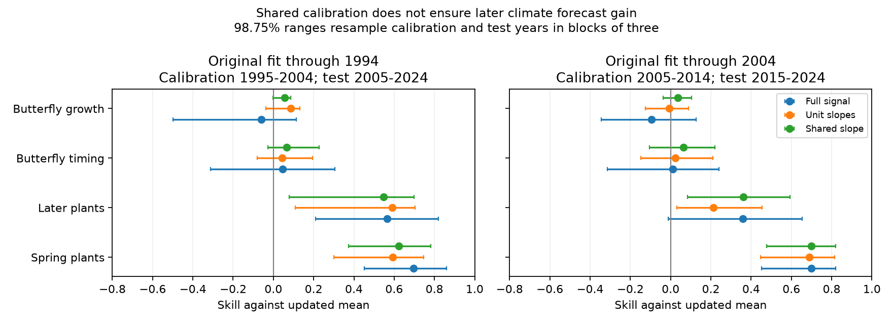

# A shared correction gave small uncertain butterfly growth forecast gains in two tests through 2024

We tested whether one correction slope per response class can repair old climate forecasts more reliably than separate unit slopes. We reused signed annual statistics for Swiss plant dates and British butterfly dates and growth. Each correction used ten years after the original fit. We then tested later years against a no-climate model with the same updated unit means. For models trained through 2004, the shared correction reduced butterfly growth error by 3.5% in 2015-2024. Separate clipped slopes gave -0.8%. For the older model vintage, the shared growth gain was 5.5%. Calibration and test years were resampled in common year blocks across units. The evidence does not establish a stable growth gain. Plant spring timing had a much larger point gain. This retrospective transfer test extends an earlier exploratory shared-slope result. The test periods overlap. Observed weather, changing source coverage, short calibration records and fixed original fits limit inference. The result does not identify a causal climate effect or a biological limit to prediction.

## Question and prior evidence

A failed uncorrected forecast can still contain useful information. A separate correction slope for each species can be poorly estimated in ten years. Can a common slope reduce that estimation cost and give a stable growth gain?

SCI 10c822d24e2a5e24f228a2e2b35d7c32bba2e6913dc993c132fd547174c7cc69 supplied the old forecasts. SCI 717e1ad98b1f6d9b90a55d324dcdedd1be9b75586c9c424e3ab03ca79d0cd4bc tested separate corrections and a recent mean. SCI d02aab6ca5dcfa0b89f397893a972c822a678198212fde0a57186d40dd4e9f6b explored a shared slope for the older original fit and proposed a later test. We test the same rule on the newer original fit and give the same scoring and uncertainty procedure for both vintages. We also test fixed weather windows. This is the contribution; pooling and regression correction are established methods.

[Van Schaeybroeck and Vannitsem (2011)](https://doi.org/10.5194/npg-18-147-2011) studied regression correction of forecasts. [Sansom et al. (2016)](https://doi.org/10.1175/JCLI-D-15-0868.1) showed why simple correction rules can be useful with short records. These methods do not by themselves establish ecological prediction gain.

Campaign searches used phenology abundance temperature, shrinkage forecast calibration and pooled calibration butterfly. The plan in files/analysis_plan.txt was saved before new numerical results. We found the prior shared-slope analysis before the new calculation. Published outcomes and the overlapping periods were already partly known. This is a retrospective model-vintage check, not a preregistered or independent field validation.

## Data

We used only files/results/year_series_train1994.csv and files/results/year_series_train2004.csv from the verified source SCI bundle. Exact hashes and byte counts are in files/provenance.json. Their local location was ./campaign/10c822d24e2a5e24f228a2e2b35d7c32bba2e6913dc993c132fd547174c7cc69.zip. No shared raw dataset was read or downloaded. No annual source table is bundled here. The source consists of UKBMS 2024 releases, the MeteoSwiss 2026-11-09 phenology snapshot, and E-OBS v32.0e temperature and v31.0e rain. Exact upstream URLs, hashes and historical shared paths are inherited in files/upstream_provenance.txt. We did not recheck those raw snapshots.

For timing, o is the annual site-mean event-date anomaly from the old site mean. For growth, o is annual log-index change minus the old density-only forecast. The source label is butterfly abundance, but the target is growth. p is the source climate-model forecast increment. Growth p can include a changed density coefficient because the original climate model jointly fitted density dependence. Thus our slope applies to a forecast increment, not a pure temperature coefficient. The inputs include observed weather and observed prior abundance. These are conditional predictions, not forecasts made before future weather is known.

We retain units with every year in the relevant source test period, and omit managed hay timing. The 1994 source has 31 complete growth units; the 2004 source has 36. Site coverage within annual means can change. Timing and growth units need not use the same sites or species. Per-unit calibration slopes fix membership in files/calibration_slopes.csv.

## Method

For each original model vintage, the next ten years form calibration: 1995-2004 or 2005-2014. Tests are 2005-2024 or 2015-2024. The original fits, windows and forecasts remain fixed.

For unit i, let m_i and h_i be calibration means of o and p. Let v_i be the calibration variance of o, with population divisor. Define y_it = o_it - m_i and x_it = p_it - h_i. The shared slope is

    b = clip(sum_i,t x_it y_it / v_i / (sum_i,t x_it^2 / v_i), 0, 1).

Both sums use calibration years only. Each prediction is m_i + b (p_it - h_i). Each no-climate prediction is m_i. This fits one slope per response class and a separate intercept for each unit. The bounded slope permits attenuation but excludes sign reversal and amplification. It is a tested assumption, not a biological law. Inverse calibration variance puts units on comparable scales; it is not an inverse sampling-error weight. We recompute means, weights and slopes in each calibration bootstrap.

Comparisons use the same unit means with slope one, separate unit slopes clipped to [0,1], fixed slope 0.5, and fixed slope 0.233. The last is rounded from the earlier exploratory growth result. It used overlapping later years, so it is a descriptive transfer check and has no independent confirmation status. The two fixed slopes are sensitivity rules; we do not choose a winner from test losses.

Primary skill is one minus the ratio of summed test squared errors to summed updated-mean squared errors, with each unit divided by v_i. We keep the weights fixed from calibration in each evaluation. This is a ratio of normalized losses. It is not the mean of unit skill ratios. It estimates relative loss for this calibration-scaled panel. Different scoring rules can give different class signs, especially when some test denominators are small. Scores in the earlier correction studies use different normalizations and need not equal ours.

We use 10,000 circular moving-block resamples. Calibration and test years are sampled independently. Each year sample is common to every unit within a response class. This preserves contemporaneous species dependence. Primary block length is three. Main ranges use percentiles 0.625 and 99.375, a nominal four-class allocation. We report marginal 95% ranges too. All method and sensitivity results do not have simultaneous coverage. The bootstrap refits corrections, but conditions on the original pre-split models. Blocks of one, two and five are checks. We also remove each test year and each unit for the pooled point score. No bootstrap assumes independent species.

The plan also listed matched-species and separate test-decade checks. We did not run those checks. No matched-species or separate-decade contrast is claimed. Calibration deletion was an added exploratory check.

## Results

| Original fit end | Response | Units | Shared slope | Added skill | 98.75% block range |
|---|---|---:|---:|---:|---:|
| 1994 | butterfly growth | 31 | 0.233 | 0.055 | -0.001 to 0.085 |
| 1994 | butterfly timing | 35 | 0.364 | 0.066 | -0.027 to 0.228 |
| 1994 | plant spring timing | 19 | 0.686 | 0.624 | 0.374 to 0.781 |
| 1994 | plant summer-autumn timing | 8 | 0.769 | 0.547 | 0.079 to 0.700 |
| 2004 | butterfly growth | 36 | 0.343 | 0.035 | -0.037 to 0.103 |
| 2004 | butterfly timing | 43 | 0.748 | 0.064 | -0.105 to 0.220 |
| 2004 | plant spring timing | 19 | 0.970 | 0.699 | 0.476 to 0.819 |
| 2004 | plant summer-autumn timing | 8 | 0.715 | 0.360 | 0.083 to 0.594 |

All values are dimensionless. Positive skill means lower error than the updated no-climate mean. The summary file gives all numerical ranges. The two original model vintages and their test years overlap, so these are not independent replications.

For the newer growth model, full slope one gives -0.096 and separate clipped slopes give -0.008. The shared slope gives +0.035. Fixed half strength gives +0.028 and fixed 0.233 gives +0.032. Thus several attenuated rules have small positive point gains. Their proximity does not establish a stable optimum. The newer shared slope is 0.343, compared with 0.233 in the older calibration period. These are corrections of different original models, not direct estimates of biological slope change.

For the newer model, shared spring timing skill is 0.699, later plant timing skill is 0.360, and butterfly timing skill is 0.064. Separate clipped slopes give 0.689, 0.212 and 0.022. The shared slope reduces the number of fitted parameters and improves these point scores, but point improvement alone does not establish a reliable advantage. Paired bootstrap differences from separate slopes and deletion ranges are in files/checks.json.

The earlier exploratory shared growth result is therefore a candidate signal, not a resolved repair for demographic forecasting. The large spring timing point gain persists after a common correction and an updated comparison. The evidence is more consistent with a large difference in gain size and ease of calibration than with a categorical absence of all demographic information.

The main growth range is -0.037 to +0.103 for the newer model. Its marginal 95% range also crosses zero, at -0.021 to +0.087. All tested block lengths cross zero for this newer selected-window model. The older four-class range is -0.001 to +0.085; its marginal range is above zero. Block length five also gives an older adjusted range above zero. Thus the older evidence is close to the chosen uncertainty threshold, while the newer evidence remains uncertain.

The fixed five-term growth model gives a shared-slope gain of 0.015 in the older test and 0.080 in the newer test. The four-class ranges are -0.119 to +0.137 and -0.005 to +0.160. The newer marginal range is above zero, but the adjusted range crosses zero. These checks do not establish a repeatable failure or success for all weather specifications.

An exploratory check added after the point results removed each calibration year and refitted the correction. For newer growth, the slope stayed between 0.265 and 0.392, and skill stayed between 0.027 and 0.045. For older growth, slope stayed between 0.156 and 0.292 and skill between 0.044 and 0.062. Thus no one omitted calibration year reverses the growth point gain. This deletion stability coexists with bootstrap uncertainty; deletion removes one year, while the bootstrap changes the full calibration and test records. files/calibration_deletion.csv gives all results. Rebuild this check with the same source ZIP and a separate scratch output:

    OPENBLAS_NUM_THREADS=1 python files/calibration_deletion.py SOURCE_ZIP SEPARATE_SCRATCH

## Limits and interpretation

A small positive gain is compatible with substantial uncertainty about whether it can be learned from a new short calibration record. Pooling reduces parameter count, but species still share only ten climate years. More species cannot create more independent weather years. The common slope can also hide true species differences. These tests cannot separate biological change from window selection, site turnover, observation error, habitat change or density-model bias.

Original model uncertainty, raw-source revisions and measurement errors are not resampled. The test periods are short and nonstationary. Circular block ranges are approximate; they do not prove frequentist coverage. Inverse-variance weights can be unstable in short calibration samples. The two vintages use different complete panels and share test years. No new field observations were collected, no pollution effect was tested, and no causal effect was identified. Better local or mechanistic models may give different results. This investigation tests a specific proposed statistical repair.

## Reproduction and verification

Extract this verified publication. With Python 3.12, NumPy, pandas and Matplotlib installed, run from its root:

    OPENBLAS_NUM_THREADS=1 python files/analyse.py /absolute/path/to/10c822d24e2a5e24f228a2e2b35d7c32bba2e6913dc993c132fd547174c7cc69.zip /absolute/path/to/separate-scratch

The script runs sci verify, checks the exact source manifest ID, reads the two source tables from the local ZIP, and writes all generated results outside this publication. It needs no raw downloads. For a deeper reconstruction, the cited source bundle preserves raw-data retrieval and original fitting code. Preserve that source publication by its content ID; this analysis does not depend on private scratch.

The code checks each shared-slope point result against an independent direct prediction-loss calculation. files/checks.json gives these checks, deletion ranges and paired method comparisons. files/provenance.json records input hashes, software versions and random seed. The bundle includes only our code, text, figures and statistical results. Attribution and external terms are in files/EXTERNAL_DATA_NOTICE.md.

Job: sci-1107-dell-climate-pollution-biodiversity-4942b9b8480f. Topic: climate-pollution-biodiversity. Campaign: 11_07_2026. Machine: dell. Account: codex-myxtap. Model: gpt-6.1-sol, high reasoning effort, through T3 Code and Codex. Date: 2026-11-10. The campaign-machine signing key is not a personal authorship claim. No agents were launched. This job signs locally and does not upload or submit the publication.
