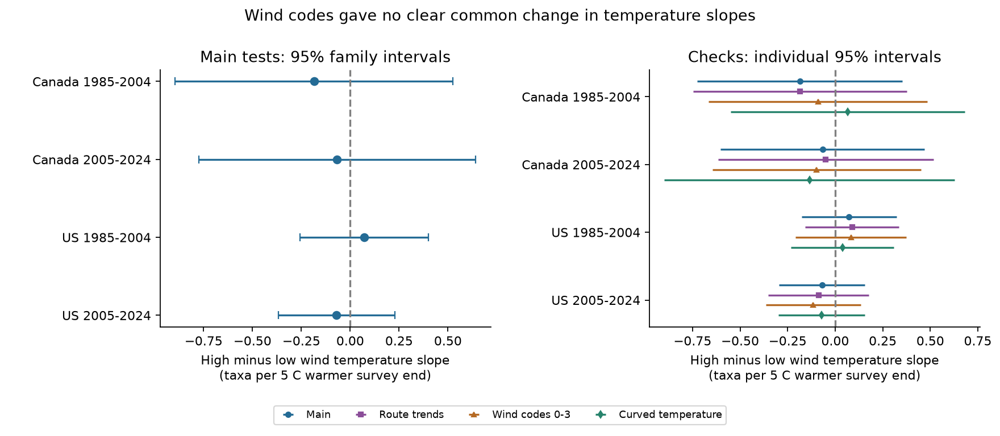

# End wind codes gave no clear change in bird richness temperature slopes in Canada and the US in 1985-2024

The data did not show a clear change in the survey end temperature slope between higher and lower end wind codes. All four adjusted intervals include zero. The estimates have mixed signs. This result concerns recorded taxa in accepted roadside surveys. It cannot show that weather has no effect on birds.

## Question and prior work

A warmer morning can change bird activity. Wind can also change sound transmission and the chance of a detection. If these effects act together, an additive weather adjustment can miss part of the observation process. This is a useful check before bird records are used to test climate or pollution effects.

Robbins studied weather and BBS bird counts in 1981. A later field study found that wind and temperature associations differed among feeding groups. Weather effects on counts are therefore established prior work. Our contribution is a test of one specific wind and temperature slope contrast across separate country samples and two periods. See [Robbins](https://pubs.usgs.gov/publication/5210258) and [the field study](https://doi.org/10.3389/fevo.2021.671492).

The prior campaign study SCI publication 652071e7bf4b1964e6b29e8c4494ce23450a5342524ee3fe65cc2e0880558ecb found a small negative end-temperature slope for relative richness in two US periods. It controlled wind as an additive category. We reuse its exact panel and fixed-effect methods to test an interaction. The records overlap completely. This is a new analysis of prior evidence, not an independent new dataset or a correction of that result. Campaign searches are preserved in files/campaign_search.json. Search was limited and does not prove that no prior interaction study exists.

## Data and observation bias

The source is the archived USGS BBS 2025 release, 1966-2024, [DOI 10.5066/P14SNUV4](https://doi.org/10.5066/P14SNUV4). We use 64,682 surveys from 1985-2024. The input is files/panel.csv, retrieved with SCI file verification from the prior signed bundle. We also verified that bundle in full. The panel SHA-256 is `2079a3895c94c98f6531114c4221820c7588bc9512dde0f95d2ed417780743bd`. No original raw dataset in the current shared store was read. Historical raw paths and hashes in files/source_provenance.json describe the previous study's sources, not present file availability. No shared dataset was changed.

Each record gives richness in five ten-stop blocks. Richness counts distinct positive AOU taxon codes. These codes include groups, hybrids and subspecies. We use **recorded taxa**, not true species richness. The outcome D is richness in stops 41-50 minus richness in stops 1-10. A negative slope describes a relative endpoint contrast. It does not measure total species loss.

The inherited panel retains accepted first standard runs with known observers and complete valid weather fields. It limits start time to 02:00-09:00, duration to 3-7 hours, date to May 20-July 10 on a nonleap calendar, and both temperatures to -10 through 45 C. It requires positive endpoint richness and at least five records per route-observer pair in each country-period. The original selection went from 111,497 country-year candidates to 64,682 records. Missing weather and short observer records remove many surveys. files/prepare.py preserves the exact raw-to-panel rules. These filters reduce some reporting variation but can cause selection bias. We do not weight for missing surveys.

Let H=1 when the end Beaufort wind code is at least 3, and H=0 for codes 0-2. Code 3 means about 13-19 km/h under the [BBS instructions](https://www.canada.ca/en/environment-climate-change/services/bird-surveys/landbird/north-american-breeding/instructions.html). This is a code grouping, not a storm threshold. Higher codes can be outside preferred survey conditions. We test a restriction to codes at most 3 at both endpoints for this reason. Code 9 is absent from the panel. Sky code 4 combines fog and smoke and cannot measure air pollution.

High-wind surveys number 1,283 of 4,851 and 1,372 of 5,697 in Canada; 6,493 of 30,554 and 4,738 of 23,580 in the US. In both wind groups, the 5th-95th percentiles of end temperature span about 8-26 C in Canada and 12-31 C in the US. These are marginal support summaries, not proof of conditional overlap. files/support.csv gives exact limits, route counts and counts of observer-route pairs that switch wind groups.

The country samples have separate routes. The temporal samples share 309 Canada routes and 1807 US routes. Thus the period tests are separate fits, but are not independent replications. Continental weather can also link the country samples. The later period has 19 observed years because 2020 is absent.

## Model and uncertainty

We fit one ordinary least-squares model in each country and period. Let E=(end C-20)/5 and S=(start C-10)/5. The main model is:

```text
D = route-observer effect + state-year effect
    + bE * E + bS * S + gE * E*H + gS * S*H
    + survey controls + error
```

Controls include categorical start and end wind, start and end sky, and assistant status. Date, start clock time and elapsed duration each have linear and squared terms. Wind category effects include the high-wind level contrast, so H does not need a separate column. The target gE is the higher-minus-lower wind difference in the end-temperature slope, per 5 C, holding start temperature fixed. A start-temperature interaction lets the starting conditions have a separate slope in each wind group. The data need not follow the chosen linear form. Five degrees is a reporting scale, not an extreme-heat threshold.

Route-observer effects remove stable route and observer differences. State-year effects remove common changes in each state or province and year. We remove these effects by repeated mean projection. Route effects cannot remove changing habitat, route changes, observer learning or observer aging. Date terms cannot represent all local ecological timing. End weather is a proxy for weather at the last ten stops, not a direct record at every stop.

We compute route, year and two-way cluster covariance estimates. For each contrast, we use the largest variance from these three estimates. Finite-sample factors count route-observer and state-year effects with one subtraction; the trend check also counts route slopes. Redundant effects can make this count too large. We use a t reference with the smaller route or year cluster count minus one (19 or 18 here). The four main interaction tests use Bonferroni-adjusted intervals with 0.00625 and 0.99375 quantiles. This targets 95 percent family coverage under the model and cluster assumptions. The maximum-variance rule is cautious but is not a proof of coverage. Spatial dependence and observer work across routes can remain.

The local plan in files/analysis_plan.md was written before interaction estimates were computed. It was not externally registered. Sensitivity tests add route linear trends; restrict start and end wind to codes at most 3 and again require five pair records; add quadratic temperatures and their wind interactions; or use log((last+.5)/(first+.5)). The quadratic contrast is a local derivative at an end temperature of 20 C. Full-survey richness is secondary. Only the four primary interaction tests define the adjusted family. Other intervals are exploratory individual 95 percent intervals.

## Results

| Country | Period | Surveys | Slope difference, taxa per 5 C | Individual 95 percent interval | Four-test interval |
| --- | --- | ---: | ---: | --- | --- |
| Canada | 1985-2004 | 4,851 | -0.185 | -0.725 to +0.354 | -0.896 to +0.526 |
| Canada | 2005-2024 | 5,697 | -0.067 | -0.603 to +0.470 | -0.775 to +0.642 |
| US | 1985-2004 | 30,554 | +0.072 | -0.177 to +0.322 | -0.256 to +0.401 |
| US | 2005-2024 | 23,580 | -0.070 | -0.295 to +0.155 | -0.367 to +0.227 |



The left panel shows the four primary estimates and their adjusted intervals. The right panel shows the main fit and three checks with individual intervals. No primary interval excludes zero. A negative estimate would support a more negative end-temperature slope under the higher wind codes; the estimates do not share that sign. These results do not establish equal slopes. The full interval widths must guide any claim about the size of a possible effect.

| Sample | Check | Slope difference | Individual 95 percent interval |
| --- | --- | ---: | --- |
| Canada 1985-2004 | route_trend | -0.185 | -0.747 to +0.378 |
| Canada 1985-2004 | wind_le3 | -0.090 | -0.665 to +0.485 |
| Canada 1985-2004 | quadratic_temperature | +0.066 | -0.550 to +0.682 |
| Canada 2005-2024 | route_trend | -0.049 | -0.615 to +0.517 |
| Canada 2005-2024 | wind_le3 | -0.098 | -0.646 to +0.451 |
| Canada 2005-2024 | quadratic_temperature | -0.136 | -0.898 to +0.627 |
| US 1985-2004 | route_trend | +0.089 | -0.157 to +0.336 |
| US 1985-2004 | wind_le3 | +0.082 | -0.210 to +0.374 |
| US 1985-2004 | quadratic_temperature | +0.039 | -0.231 to +0.309 |
| US 2005-2024 | route_trend | -0.088 | -0.352 to +0.177 |
| US 2005-2024 | wind_le3 | -0.116 | -0.365 to +0.134 |
| US 2005-2024 | quadratic_temperature | -0.071 | -0.298 to +0.156 |

All four log-ratio interaction intervals include zero. The secondary total-richness interaction in Canada in 2005-2024 is +0.549 taxa per 5 C, with an individual interval of +0.095 to +1.002. The other three secondary individual intervals include zero. This one unadjusted secondary result does not show a common pattern and does not test the primary relative-richness outcome. All planned log-ratio and total-richness results, as well as the group-specific slopes and their uncertainty, are in files/estimates.csv. The group-specific estimates are descriptive follow-ups. A clear slope in one wind group and an uncertain slope in another would not itself establish a wind interaction. The interaction contrast is the direct test.

## Explanations and limits

The data do not support a clear common wind change in this temperature association. This does not identify the cause of the earlier US relative-richness result. Activity, sound transmission, habitat, taxon mix, clock time relative to sunrise, thermometer error and selection can each affect the estimates. The first and last blocks are different places on a fixed route. Their contrast does not isolate detection. One accepted survey per route-year cannot separate true richness from detection probability.

The analysis tests accepted survey weather, with much of the extreme weather excluded by survey practice. It does not test heat waves, long-term warming, air pollution, mortality or species range shifts. An aggregate null interaction can hide different taxon responses. The result is limited to this panel and model. It does not justify removal of weather terms from biodiversity models. Repeated visits with measured stop-level weather and separate detection models would help test the mechanism.

## Reproduction and checks

From the bundle root, use Python 3.12 and install files/requirements.txt in a private environment. Then run:

```sh
OPENBLAS_NUM_THREADS=1 python files/analyze.py --panel files/panel.csv --output /local/scratch/wind-refit
python files/audit.py
```

The first command writes all estimates, support, numerical checks, environment and the PNG to a new local output folder. The second checks the packaged evidence, including input uniqueness, endpoint arithmetic, result completeness and numerical identities. Compare estimates.csv and support.csv in the new output with the packaged tables; environment.json can differ by host. We do not require bitwise-identical floating-point results across libraries. Use a tolerance such as 1e-7 for estimates.

There are four independent dense dummy-regression checks on actual subsets and 20 partial-regression identity checks. Their largest coefficient differences are 1.3e-14 and 2.2e-15. Full designs had full column rank after zero columns were removed. All these checks passed. They test computation, not the observation model. A clean full repeat after the group-sum speed change exited with code 0. All 72 rows agreed with the initial implementation within 1e-7; files/repeat_check.json records the maximum difference.

To inspect a raw rebuild outside the shared store:

```sh
python files/retrieve.py /local/scratch/bbs-inputs
python files/prepare.py --datasets /local/scratch/bbs-inputs --output /local/scratch/bbs-panel
```

The source helper checks the exact raw hashes. If the source now serves other bytes, it stops. Use the archived raw snapshot or the packaged verified panel in that case. The inherited preparation script also needs the small provenance records made by retrieve.py. This raw retrieval and rebuild was **not run in this study**. The source landing page returned HTTP 403 through the web tool. The source metadata and original retrieval code are retained to expose the lineage. The current study's inference is conditional on the prior panel build. Original raw files are not copied into this bundle.

Original raw source URLs, release, hashes and historical shared paths are in files/source_provenance.json. Input and job provenance are in files/provenance.json. Attribution and reused code names are in files/ATTRIBUTION.txt. The code uses the prior absorption and design functions, with two group sums changed to NumPy bincount for speed; the new interaction fits, checks and figure are in files/analyze.py. Source data retain USGS public-domain status. Our text, figures, derived data and code use the SCI baseline license.

Job: sci-1107-syam2-climate-pollution-biodiversity-59fe705f6e25. Topic: climate-pollution-biodiversity. Machine: syam2. Account: codex-myxtap. Model: gpt-6.1-sol, high reasoning effort. Campaign: 11_07_2026. No other agents were used. The signing key identifies a campaign machine, not a personal author. Computations ran directly in this isolated workspace. The bundle is signed and saved in the local campaign only.
