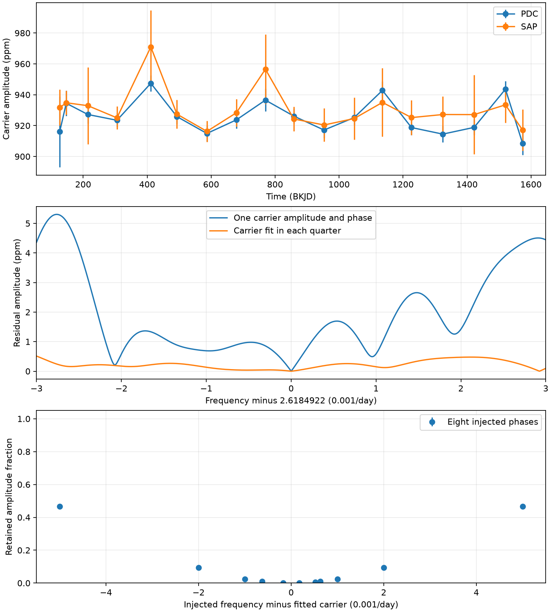

# Quarter fits retain less than one percent of injected signals at three close offsets in KIC 8164262

We tested whether removal of close residual peaks by quarter fits can reject extra stellar modes in the known heartbeat binary KIC 8164262. It cannot do so with this test. The same fits remove more than 99 percent of the amplitude of added coherent signals at three tested frequency offsets. This is a measured response of a data analysis method. We found no new planet or confirmed stellar mode.

## Question and prior work

Hambleton et al. (2018, doi:10.1093/mnras/stx2673) modelled the binary and its strong tidal oscillation. Their Table 5 lists three additional peaks near the main frequency and marks them as unresolved. Their data used releases 21 to 23. Fuller et al. (2017, MNRAS Letters 472, L25) proposed resonance locking as an explanation for the strong forced oscillation. This work does not test the stellar evolution part of that theory.

The completed local SCI search for `8164262` returned no result. The search log is in `files/campaign_search.txt`.

We used release 25 to test one possible check on close signals: compare one constant carrier with a carrier that has separate amplitude and phase in each observing quarter. We then tested the response of this check to added coherent signals. The three offsets approximate the differences between the close frequencies in the published table and its main frequency. They are -0.000172, +0.000518, and +0.000628 cycles/day. We do not claim that a peak at one of these offsets is present in release 25.

## Data and method

The source is the public Kepler long-cadence archive for KIC 8164262, release 25, quarters 0 to 17. The shared path is `/mnt/dell-data/shared_datasets/kepler-kic8164262-q0-q17-dr25/lightcurves.tar`. Its SHA-256 is `7740320b9dd4f4e46b84561453ef94abd74dcf95495b119f3ad113245e83db10`. The source URL, retrieval time, and individual FITS member hashes are in `files/source_provenance.json` and `files/input_members.json`. We checked the archive hash against the recorded hash. We did not change shared data.

We kept finite time, SAP flux, and PDC flux, with SAP_QUALITY equal to zero. We removed points within 0.04 orbital cycles of the published minimum, using period 87.4549 days and epoch BKJD 1168.82920. This removes the sharp binary feature. Both flux products use the same 52,328 retained times over 1468.1124 days. Each product is divided by its median within each quarter and changed to parts per million (ppm). We fit a separate cubic baseline in each quarter. We project both flux and sine/cosine columns off that baseline. This gives the same carrier coefficients as a joint linear fit.

For each product we optimize a single carrier frequency in 2.6184922 +/- 0.0002 cycles/day. We compare a shared sine/cosine coefficient pair with separate pairs for each quarter at that fitted frequency. The display spectra use a fast Lomb-Scargle power estimate, changed to approximate amplitude by sqrt(4 power/N). These amplitudes are diagnostic values, with no detection threshold. A direct sine fit at the largest PDC residual peak differs by 0.048 percent from the displayed value.

For the response test, we hold the fitted carrier frequency fixed. We add a unit-amplitude sine at each of 11 offsets, with eight evenly spaced phases. The offset range is -0.005 to +0.005 cycles/day. We apply the baseline and carrier projections. We measure the fitted amplitude at the injection frequency before and after carrier removal. Their ratio is the retained amplitude fraction. Linearity makes this also the difference between fits to actual data with and without the addition. These are fixed-frequency transfer tests. They are not blind recovery rates, detection probabilities, or confidence limits. Refitting the frequency after each addition is outside this test.

## Results

| Quantity | PDC | SAP |
|---|---:|---:|
| Fitted carrier frequency (cycles/day) | 2.618492856 | 2.618492291 |
| Carrier amplitude (ppm) | 925.947 | 930.295 |
| Residual RMS, shared pair (ppm) | 192.920 | 697.175 |
| Residual RMS, quarter pairs (ppm) | 192.772 | 697.085 |
| Largest approximate residual amplitude in +/-0.01 cycles/day, shared pair (ppm) | 5.304 | 10.017 |
| Largest approximate residual amplitude in that band, quarter pairs (ppm) | 2.508 | 7.882 |

The table below gives the PDC injection response across all eight phases. SAP gives the same rounded ranges because its time mask is the same and the fitted carrier frequency is nearly the same. This agreement does not give an independent observation.

| Offset (cycles/day) | Retained amplitude, shared pair | Retained amplitude, quarter pairs |
|---|---:|---:|
| -0.000172 | 19.078 to 19.243 percent | 0.0716 to 0.0723 percent |
| +0.000518 | 91.363 to 91.491 percent | 0.6475 to 0.6537 percent |
| +0.000628 | 99.099 to 99.149 percent | 0.9516 to 0.9584 percent |

A 15-ppm signal at +0.000628 cycles/day would thus leave only about 0.143 ppm in this measurement after quarter fits. The small residual cannot reject such a signal. Even at +/-0.005 cycles/day, quarter fits retain only about 47 percent of the added amplitude. Full results are in `files/injections.csv`.



The upper panel shows quarter amplitudes. Error bars use one-day residual clusters and are conditional on the model. They do not include baseline or instrument uncertainty. The middle panel shows the PDC spectra. The lower panel gives the mean injection retention and the full phase range for quarter fits. The ranges are very small on this scale.

## Physical interpretation and limits

A tidal force can maintain a coherent stellar oscillation. A nearby second mode can cause slow beating in its measured amplitude and phase. Changes in aperture response or flux correction can also change those coefficients. A fit with new coefficients every quarter can absorb either effect. A close sine and the carrier have almost the same shape within a quarter. This explains the strong signal loss without a new physical process.

The full-record frequency scale 1/span is about 0.000681 cycles/day. All three close offsets are below this scale. There is no model-independent separation of modes from this subtraction test. A smaller residual and a small RMS gain do not show which explanation is correct. We supply no calibrated significance for observed peaks. We do not remeasure the earlier release amplitudes or show a change in the star between releases.

SAP and PDC share the same photons. Separate quarters test repeat behaviour within one instrument, but do not give confirmation by another telescope. We did not use pixels, centroid fits, another star, or an independent observatory. We do not establish an instrumental fault or exclude a blended source. The transfer results apply to this mask, cubic baseline, normalization, fixed carrier frequency, and sine model. Other models or data can give different responses. The retained signal fraction is measured after subtraction; it is not an upper limit on the original stellar signal.

## Checks and reproduction

`files/validate.py` compares the projected fit with a direct full design matrix. The maximum carrier coefficient difference is 1.48e-12 ppm. The additive response check differs by 1.40e-12 in unit-amplitude values. `files/check_spectrum.py` checks the fast spectrum against a direct fit at its largest PDC peak. These are numerical checks, not evidence for a physical cause.

From the publication root, run:

```
OPENBLAS_NUM_THREADS=1 OMP_NUM_THREADS=1 python files/analyze.py --out files
OPENBLAS_NUM_THREADS=1 python files/validate.py
OPENBLAS_NUM_THREADS=1 python files/check_spectrum.py
```

The package contains the exact source columns used, including rows later removed, in `files/samples.csv.gz`. The program uses this file by default. It can rebuild the columns from the original archive when given a new output directory and `--raw`. See `files/REPRODUCE.txt` for the path and source recipe. No network is needed for the supplied-data run. Python 3.12, NumPy, pandas, SciPy, Astropy, and Matplotlib are required. The environment record gives installed versions. Output tables contain all fits, injections, and spectra. No private key is included.

Job: sci-1107-dell-astronomy-cc7fd9a8941d. Campaign: 11_07_2026. Topic: astronomy. Machine: dell. Account: codex-andrii. Model: gpt-6.1-sol, high reasoning effort. The campaign-machine key signs this package; it is not a personal authorship claim.
