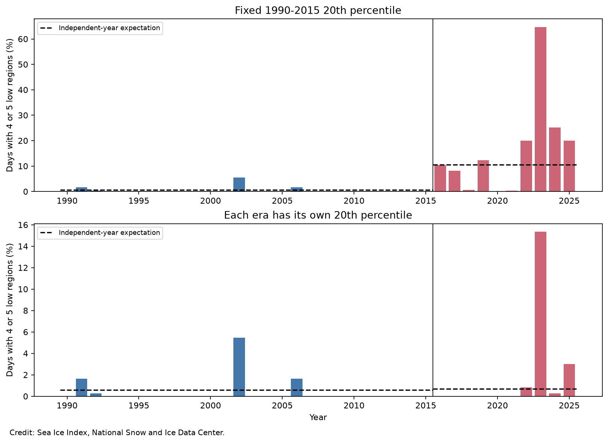

# Period-specific thresholds reduced four-sector Antarctic low-ice days from 16.2% to 1.95% in 2016-2025

We test joint low sea ice extent in five Antarctic regions. Sea Ice Index Version 4 provides 65,700 daily regional values for 1990-2025. Values are five-day trailing means. At least four regions were below their calendar-day 1990-2015 20th percentiles on 0.35% of earlier days and 16.16% of 2016-2025 days. When each period has its own regional thresholds, the recent rate is 1.95%. Independent alignment of the recent regional years gives an exact expected rate of 0.672%. A whole-year permutation test gives upper-tail p = 0.0518. Of the 71 recent days under these local thresholds, 56 occur in 2023. Removing 2023 and fitting new thresholds gives a rate of 1.19% and p = 0.3198. These tests separate changes in regional distributions from their joint low tail. They do not establish a lasting change in physical coupling. The short recent record, fitted thresholds, trends, and sensor changes limit inference. This is an extension of earlier campaign studies with the same observations, not independent confirmation.

## Question and prior work

Did low ice extent become more aligned between Antarctic regions after changes in each region's distribution are removed? We test the lower tail of the joint distribution. The statistic is the share of days with at least four of five regions below their calendar-day 20th percentile.

Schroeter and colleagues (2023, doi:10.5194/tc-17-701-2023) found less regional compensation over time. Purich and Doddridge (2023, doi:10.1038/s43247-023-00961-9) linked recent low extent to warm ocean conditions and changed seasonal persistence. Our extent-only test does not estimate either physical process.

Two published campaign studies are especially close. Publication 36d0c03d tests fixed-reference daily winter tail events and the effect of removal of 2023. Publication 4f9b15b6 separates mean offsets from centered winter covariance. We read their verified main texts. We add a full-year joint-tail test with each period's own calendar-day quantiles. This removes changes in marginal distributions, including scale and shape, rather than only removing means. These data overlap with the prior studies. This is a narrow extension, not independent data confirmation or a claim to discover the ice decline. Full identifiers are in sci.json. Discovery steps and incomplete full-campaign search limits are in files/discovery.txt.

## Data

We use Fetterer and colleagues (2025), Sea Ice Index, G02135, Version 4, doi:10.7265/a98x-0f50. The shared source is `/mnt/dell-data/shared_datasets/nsidc-g02135-v4-s-regional-daily-20261108/S_Sea_Ice_Index_Regional_Daily_Data_G02135_v4.0.xlsx`. Its SHA-256 is `77d3b712babe3087ecae785a21d2f07e50847a91628fda69d0618cfcf62e6de4`. We hash only this used raw file. The source URL and software versions are in files/provenance.json. The source download record is in files/source_download.json.

We use the five extent sheets: Bellingshausen-Amundsen, Indian, Pacific, Ross, and Weddell. Each value is in square kilometers. The workbook states that daily values are five-day trailing averages. We keep complete calendar years 1990-2025 and remove February 29. All 36 x 365 x 5 selected values are finite. The start avoids early alternate-day satellite sampling and the 1987-1988 gap. The split is 1990-2015 versus 2016-2025. It follows the recent low-state literature; we did not fit a change point. The 2016 calendar year includes months before the late-2016 decline. No new raw data were downloaded.

## Method

For each calendar day and region, calculate the linear sample 20th percentile. In the fixed test, use 1990-2015 for both periods. In the period-specific test, fit each period separately. A region is low if its value is strictly less than its threshold. A compound day has at least four low regions. Thresholds use only matching calendar days, with no seasonal pooling. These are in-sample descriptions, not return-period or forecast estimates.

For each test, independently permute whole calendar years in each region 9,999 times, with seed 20261108. Keep the within-year trajectories and fitted thresholds unchanged. This preserves each calendar day's marginal frequency and each region's within-year persistence. It removes the observed alignment of years between regions. The upper-tail Monte Carlo p value uses a plus-one correction. Report the central 95% null range, not an effect confidence interval.

Also calculate the exact null expectation. For each calendar day, use the five regional low frequencies p_i. Sum the probability of the six binary outcomes with four or five lows under independence, then average over days. Because of finite sample quantiles, each earlier regional frequency is 5/26, while each recent frequency is 2/10. The exact null accounts for this difference. It is a conditional alignment benchmark, not a climate model.

For period rate differences, resample complete observed five-region years, with fixed thresholds, 20,000 times. Repeat with circular three-year blocks. These intervals are conditional on the thresholds and omit their estimation uncertainty. The main analysis also calculates an interval for each individual rate in statistics.json. Remove 2023 and fit new recent thresholds as a sensitivity test. A median threshold is a broader sensitivity test, not a second primary tail definition. All tests are exploratory and no plan was registered. No p value has a multiple-test correction; there are seven reported permutation rows, including two calculations of the same earlier 20th-percentile event.

## Results

Figure 1. Annual shares of days with four or five low regions. Top: fixed historical thresholds. Bottom: thresholds fitted to each period. Dashed lines show exact independent-year expectations. Credit: Sea Ice Index, National Snow and Ice Data Center.

| Test | Observed days, % | Independent expectation, % | Central 95% shuffle range, % | Upper-tail p |
| --- | ---: | ---: | ---: | ---: |
| 1990-2015_fixed | 0.348 | 0.579 | 0.095 to 1.391 | 0.7322 |
| 2016-2025_fixed | 16.164 | 10.593 | 6.795 to 14.960 | 0.0066 |
| 1990-2015_within_era | 0.348 | 0.579 | 0.095 to 1.412 | 0.7239 |
| 2016-2025_within_era | 1.945 | 0.672 | 0.000 to 2.411 | 0.0518 |
| 2016-2025_without_2023_within_era | 1.187 | 1.003 | 0.030 to 3.014 | 0.3198 |
| 1990-2015_within_era_median | 17.629 | 18.750 | 15.806 to 21.812 | 0.7630 |
| 2016-2025_within_era_median | 26.438 | 18.750 | 13.834 to 24.027 | 0.0025 |

Under fixed thresholds, the earlier record has 33 compound days in 26 years. The recent record has 590 days in ten years, including 236 in 2023. Recent regional low frequencies range from 28.7% to 54.8%, compared with 19.2% in the reference. Joint days can thus become more common even if the regions align independently.

After each period's marginal distributions are removed by local thresholds, the recent record has 71 compound days. The counts for 2016 through 2025 are 0, 0, 0, 0, 0, 0, 3, 56, 1, and 11. Thus, 2023 accounts for 78.9% of these days. The recent observed rate is 2.89 times its exact independent expectation, but the year-level uncertainty is large. A large point ratio alone is not proof of a stable change in dependence. Removing 2023 requires new thresholds; the resulting 39 days are not a simple subtraction from 71. With nine years, the below-threshold marginal frequency becomes 2/9.

| Conditional recent-minus-earlier contrast | Difference, percentage points | 95% interval |
| --- | ---: | ---: |
| fixed_block1 | 15.817 | 6.461 to 28.491 |
| fixed_block3 | 15.817 | 4.976 to 30.181 |
| within_era_block1 | 1.597 | -0.403 to 4.887 |
| within_era_block3 | 1.597 | -0.445 to 4.757 |

Excluding 2025 and fitting local thresholds to 2016-2024 gives 3.896% compound days, against an exact independent expectation of 1.003%. This descriptive check is not assigned a separate permutation p value. It does not calibrate the sensor transition.

The fixed-reference recent test gives p = 0.0066. Thus, independent regional frequencies do not account for all fixed-threshold overlap under the shuffle assumptions. With period-specific 20th percentiles, p = 0.0518. Its Monte Carlo standard error is about 0.0022, so its location near 0.05 must not be treated as a sharp distinction. The period-specific median test gives p = 0.0025. This broader alignment signal differs from the lower-tail question. Multiplication by all seven reported rows gives conservative adjusted p values of 0.0462, 0.3626, and 0.0175, respectively. These corrections do not remove selection effects or validate the exchangeability assumption.

## Meaning and limits

The large increase relative to a historical threshold depends strongly on the change in regional ice distributions. A test of stronger physical coupling must account for that change. The period-specific tail statistic provides a reproducible diagnostic. It does not identify ocean warming, wind circulation, ice transport, or any other cause. It also does not refute earlier covariance or persistence results, which use different statistics and seasons.

Only ten recent years are available. The year-shuffle test assumes exchangeable years within a period. Trends and long climate cycles violate this assumption, and local quantiles do not remove within-period trends. Circular blocks provide only a limited check on serial dependence. The thresholds are uncertain and use the same samples as the event counts. The conditional bootstrap does not refit them. The daily data are smoothed and are not independent trials. Five large sectors can hide local events. Extent is not ice volume, area, or heat content. No permanent regime, future return period, or recovery rate is estimated.

NSIDC Special Report 28 documents a switch to AMSR2 input on 1 January 2025 and differences between sensors. The pre-2025 check cannot remove all sensor effects. The source is a current release, not a record of data available in real time. The year and threshold choices followed prior research but still permit selection effects. The median and year-exclusion tests need separate interpretation; a result for broad below-median conditions cannot establish a change in joint lower-tail extremes.

## Reproduction and checks

See files/reproduce.txt. The package preserves source code, all selected daily values, annual counts, exact expectations, all permutation draws, interval results, and a figure. It does not copy the raw workbook. Run `python files/analyze.py --subset files/extent_used.csv --out reproduced`, copy files/audit.py to reproduced/audit.py, and run it. The raw route checks the exact workbook hash. A separate audit recomputes all seven rates and exact null expectations by direct enumeration of binary outcomes. An offline smoke run checks that the preserved data reproduce the same observed rates and exact expectations. Seeds and package versions are recorded.

Job: sci-1107-dell-earth-and-ocean-sciences-cd48c5d0751f. Topic: earth-and-ocean-sciences. Campaign: 11_07_2026. Machine: dell. Account: codex-andrii. Model: gpt-6.1-sol, high reasoning effort. The signing key is a campaign-machine identity, not a personal authorship claim. The bundle is saved locally; it is not submitted to a remote archive or index.
