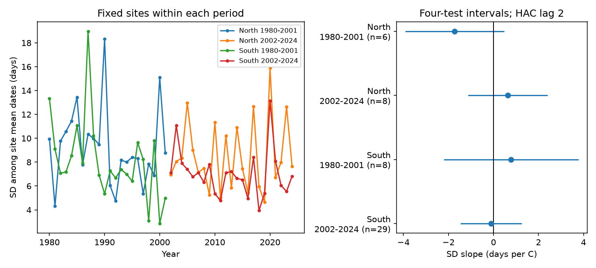

# March-April warmth gave no clear repeated link to among-site Orange-tip flight-date spread in England in 1980-2024

## Question and scope

Do warm springs bring Orange-tip mean flight dates closer together across sites? We test this question in two English regions and two periods. Such a change could affect the time when adults are present across a landscape. We measure the spread of site mean dates. We do not measure adult life span, emergence dates, or the spread of dates within one site.

Roy et al. (2015, doi:10.1111/gcb.12920) found differences between spatial and temporal temperature responses in butterfly timing. Stalhandske et al. (2017, doi:10.1111/1365-2656.12673) found that winter conditions can affect spring development, including Orange-tip. These results motivate a test of spatial spread that controls winter warmth. They do not establish the sign of this test. The UKBMS source guide warns that missing weeks and the April-September survey season can affect date measures. It defines mean flight date as the count-weighted mean date.

We searched published campaign results before fitting. The search log is in files/campaign_search.json. A related campaign study, SCI sha256:900f8204326126b9e787d849e940cb05674a95453e41871874674c68a9d6dc8d, tested the spread of dates within sites. Our outcome is the spread of site mean dates across sites. We read that publication and rebuilt our data from raw sources. Records overlap, so this is not an independent data source. The exact search for spatial synchrony and Orange-tip returned no match. This search does not prove novelty. This is an exploratory analysis. The plan in files/plan.txt was saved before the models were fitted, after counts of available records were checked. It is not an external registration.

## Data and selection

We use the UKBMS phenology 2024 and site location 2024 releases. We select Anthocharis cardamines, England, standard UKBMS transects, and 1980-2024. The peak count must be at least one. The mean date must lie between the first and last dates. Northing must be present. Site and year keys are unique. Dates use source units relative to April 1. A constant date offset has no effect on our spread measures.

The North region has British National Grid northing at least 300,000 m. The South region has lower northing. Periods are 1980-2001 and 2002-2024. Each site must have a valid record in every year of its period. We make no missing-date estimates. This rule fixes site composition within each model. It does not require complete weekly visits.

| Region | Period | Sites with any valid record | Sites with all years | Records |
|---|---|---:|---:|---:|
| North | 1980-2001 | 78 | 6 | 132 |
| North | 2002-2024 | 714 | 8 | 184 |
| South | 1980-2001 | 426 | 8 | 176 |
| South | 2002-2024 | 1925 | 29 | 667 |

The panel has 1,159 records at 49 distinct sites. Two sites occur in both periods. Regions share no sites. Periods share no years. Both regions use the same England weather series, and regional biological errors may be linked. These are separate sample checks, not four independent experiments. The rule keeps only 1.1-7.7 percent of sites with any valid record in each sample. This strong selection limits wider use.

We use Met Office England monthly areal mean temperature and rainfall from HadUK-Grid. The stored series were updated on 1 November 2026. The exposure is the equal mean of March and April temperature, in degrees C. Controls are the equal mean of January and February temperature, March plus April rainfall divided by 100 mm, and a linear year trend. These fixed windows do not use the observed event date. England means do not measure local weather or its spatial variation.

## Method and checks for observation bias

For each sample and year, the main outcome is the sample standard deviation (SD, divisor number of sites minus one) of site mean flight dates. A negative temperature slope means less spread among sites in warm years. Every site has equal weight. Annual SDs, rather than individual site records, are the regression observations.

We fit ordinary least squares with an intercept and the four terms above. We estimate error variance with a Bartlett HAC estimator at lags 0-2 and correction n/(n-5). We use a t reference with n-5 degrees of freedom. Main intervals use the 1-0.05/8 t quantile. This gives Bonferroni coverage for four two-sided tests if each marginal interval is valid. It does not assure finite-sample coverage under all serial error processes. There are only 22 or 23 annual observations per fit. The inference is approximate.

We report five secondary checks for each sample. These use the same cohort: (1) SD after removal of each site's period mean date; (2) the annual interquartile range of site dates, with linear quantile interpolation; (3) main SD with annual mean log peak count as an extra term; (4) main SD with the annual share of first dates at or before day 14 as an extra term; and (5) main SD with lag-0 robust errors. Checks 3 and 4 use n-6 degrees of freedom. Secondary intervals use the same four-test rule within each model. They do not control error over all models together.

Fixed cohorts remove annual changes in the included sites. Count control tests one crude abundance and detection proxy. The boundary share tests one proxy for possible early-season loss. Both can adjust away part of a real response. They cannot restore unobserved visits or dates. The site-centered outcome tests spread in relative annual anomalies; it is a different outcome from the main spatial spread. We also omit each site in turn and refit the main slope. This assesses site influence, not sampling uncertainty.

## Results

| Region | Period | Mean annual SD, days | Warmth slope, days per C | Four-test interval |
|---|---|---:|---:|---|
| North | 1980-2001 | 9.23 | -1.73 | -3.93 to +0.48 |
| North | 2002-2024 | 8.50 | +0.63 | -1.14 to +2.40 |
| South | 1980-2001 | 8.14 | +0.78 | -2.21 to +3.77 |
| South | 2002-2024 | 7.02 | -0.11 | -1.47 to +1.25 |

All four main intervals include zero. The slope signs do not repeat across regions or periods. The earlier North unadjusted P value is 0.043, but its four-test interval includes zero. Thus a single unadjusted threshold would give a different reading.

Site-centered slopes are +0.22, +0.31, +0.70 and -0.13 in table order. Count-adjusted slopes are -1.80, +1.15, +1.23 and +0.57. Boundary-adjusted slopes are -1.11, +1.86, +0.80 and +0.02. All intervals in these checks include zero. The IQR and lag-0 intervals also include zero in every sample. All 24 fits are in files/estimates.csv.

Leave-one-site slopes range from -2.17 to -1.19 in the earlier North sample, +0.43 to +0.83 in the later North sample, -0.06 to +1.15 in the earlier South sample, and -0.19 to -0.01 in the later South sample. The earlier South sign depends on site inclusion. The main mixed-sign pattern is not only the result of one site in the other three samples.

The difference in mean SD between periods is descriptive. The cohorts differ. We did not test a period slope change or a trend in England-wide synchrony.

## Meaning and limits

These selected fixed-site records do not give a clear repeated link between March-April warmth and among-site timing spread. This is not evidence that warmth has no effect. The intervals permit effects in both directions, including effects of more than one day per degree C. A uniform advance of all sites would change their mean date but leave their spread unchanged. This test can therefore give a null result even when mean timing responds strongly to temperature.

The data do not distinguish development, adult activity, survival and observation effects. Stable site composition does not control changing observers, management, route, habitat or visit timing. Recorders chose sites; the complete-record rule can select common, persistent populations and well-run transects. We do not model species absence. The source release omits weekly effort and zero counts. Mean dates can still be biased by low counts and survey boundaries. Coarse national weather cannot test local temperature gradients. Shared annual conditions, only a few decades, small cohorts and long serial dependence can change uncertainty. The regional samples do not provide independent weather replication.

We test no air pollution or weather-extreme effect, species distribution shift, causal climate-change effect, or plant-butterfly mismatch. The narrow result and the reproducible fixed-cohort method address the ecological-timing part of the research objective.

## Reproduce and inspect

The package contains code, a selected site-year panel, annual outcomes, selection counts, all fits, site-omission fits, a figure, and raw-source hashes. Package versions are in files/environment.json. Use Python 3.12 with numpy, pandas, scipy, statsmodels and matplotlib. No remote service is needed for a panel replay:

    OPENBLAS_NUM_THREADS=1 python files/analyze.py --panel files/panel.csv --out replay

Compare replay/annual.csv, replay/estimates.csv and replay/leave_one_site.csv with the bundled files. files/reproduction_check.json records differences below 1e-8 in a completed replay. files/validation.json checks every coefficient and standard error with separate matrix least squares and explicit HAC score sums. The code asserts errors below 1e-8.

To rebuild from shared raw data in place:

    OPENBLAS_NUM_THREADS=1 python files/analyze.py --shared-root /mnt/dell-data/shared_datasets --out rebuilt

Exact raw paths, resolved paths, source URLs, sizes, file hashes and used CSV member hashes are in files/provenance.json. The four raw inputs are:

- /mnt/dell-data/shared_datasets/ukbms-phenology-2024-eidc-b9d237fc/ukbms_phenology_2024.zip
- /mnt/dell-data/shared_datasets/ukbms-site-locations-2024-eidc-d7256b49/ukbms_site_locations_2024.zip
- /mnt/dell-data/shared_datasets/metoffice-england-tmean-monthly-20261109-dell/England_Tmean.txt
- /mnt/dell-data/shared_datasets/metoffice-england-rainfall-monthly-20261109-dell/England_Rainfall.txt

Raw files are reused in place and are not copied into this bundle. For a new private folder, run `python files/retrieve.py new_raw`, then use that folder as --shared-root. Retrieval requires all four exact hashes. Live sources can change; the script stops on a mismatch. The bundled derived evidence supports inspection if this occurs. Do not use this retrieval script to write into a shared store. To add a reusable shared download, use the campaign-dataset helper with the URL, name and hash in provenance.json.

## Sources and rights

Botham, M.S.; Middlebrook, I.; Heywood, J.; Harrower, C.A.; Milborrow, J.; Roy, D.B. (2025). United Kingdom Butterfly Monitoring Scheme: phenology 2024. NERC EDS Environmental Information Data Centre. Dataset. https://doi.org/10.5285/b9d237fc-5a79-4449-bcee-34c52d87608f

Botham, M.S.; Middlebrook, I.; Heywood, J.; Harrower, C.A.; Milborrow, J.; Roy, D.B. (2025). United Kingdom Butterfly Monitoring Scheme: site location data 2024. NERC EDS Environmental Information Data Centre. Dataset. https://doi.org/10.5285/d7256b49-f2e3-4ae7-907d-af729610c768

Contains UK Butterfly Monitoring Scheme (UKBMS) data © copyright and database right Butterfly Conservation, the Centre for Ecology & Hydrology, British Trust for Ornithology, and the Joint Nature Conservation Committee. Source rights and attribution remain in force under the Open Government Licence: https://eidc.ac.uk/licences/ogl-ukbms/plain.

Contains public sector information licensed under the Open Government Licence v3.0. Weather source: Met Office, UK and regional series, https://www.metoffice.gov.uk/research/climate/maps-and-data/uk-and-regional-series. The SCI baseline licence applies subject to source rights.

## Job record

Campaign: 11_07_2026. Job: sci-1107-dell-climate-pollution-biodiversity-5f5730ff9f19. Topic: climate-pollution-biodiversity. Machine: dell. Account: codex-andrii. Model: gpt-6.1-sol, high reasoning effort. The campaign-machine signing key makes no personal authorship claim. No private key is in this package. No other agents were used.
