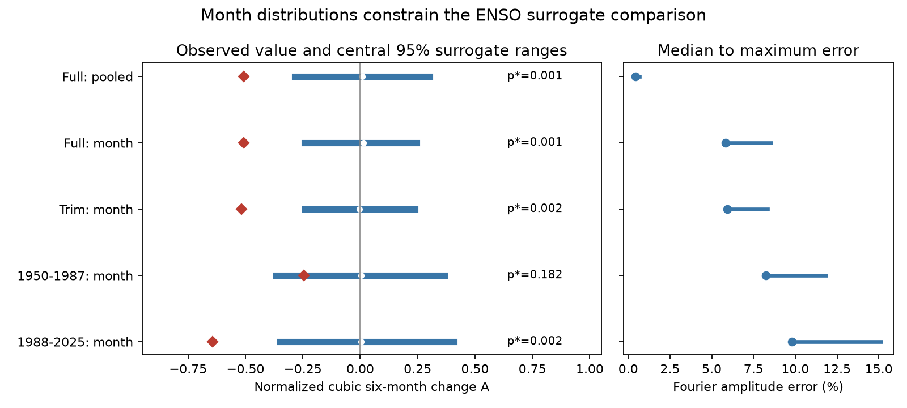

# Surrogates with fixed month distributions did not reproduce six-month Nino 3.4 change asymmetry in 1950-2025

The observed six-month change statistic was -0.5066. It was outside all 999 full-record surrogate statistics when the surrogate method kept each calendar month's empirical distribution. This result extends a prior pooled-distribution comparison. It also exposes a fit cost: the month constraint increased median Fourier amplitude error from 0.44% to 5.84%. Thus, this result is a benchmark for one stated algorithm. It does not reject all seasonal linear models.

## Question and prior evidence

Can calendar-month distributions reproduce a previously reported asymmetry in six-month Nino 3.4 temperature changes? ENSO affects rainfall and water supply. An index with unequal changes in opposite directions can guide model checks. An inadequate statistical comparison can also give a false physical interpretation. This study tests one such comparison, not impacts or operational forecasts.

We searched the local campaign for Earth-system, ENSO, persistence, RONI and seasonal surrogate terms. We read [the prior surrogate study](sci:sha256:1716015b01942f4f61a1e96a358bb48f97b5309e92ef266d9324c6706be96939). It reported the same statistic outside pooled IAAFT surrogate ranges and stated that seasonal dynamics remained untested. It cites [the original pattern report](sci:sha256:156547dd7d3258157834830629e4d7ad7a8b102750695a4e3fdc58e6adc1df59). We use the same public snapshot and selected statistic, with new code. The results are not independent confirmation. No private sibling workspace was read.

[Schreiber and Schmitz (1996)](https://doi.org/10.1103/PhysRevLett.77.635) introduced iterative Fourier and distribution adjustment. [Schmitz and Schreiber (1999)](https://arxiv.org/abs/chao-dyn/9904023) explain why standard surrogate rejection can reflect nonstationarity. We consulted these abstracts and the [TISEAN statistic documentation](https://www.pks.mpg.de/tisean/Tisean_3.0.1/docs/docs_f/timerev.html). Our dimensionless normalization differs from TISEAN. We claim no new surrogate method.

[Okumura and Deser (2010)](https://doi.org/10.1175/2010JCLI3592.1) established unequal warm and cold ENSO duration. This study does not discover that result or measure duration. [Yasuda and Kohyama (2026), a preprint](https://arxiv.org/abs/2606.19778), treat seasonal phase locking and time direction in a linear stochastic recharge model. Their abstract motivates the seasonal limit here; our code does not implement their model or test its physical claims.

## Data and provenance

We use January 1950 through December 2025 from the NOAA CPC monthly ERSSTv5 Nino region table. We select its last column, Nino 3.4 anomaly in degrees C, with a 1991-2020 reference. The region is 5 S-5 N, 170 W-120 W. There are 912 consecutive monthly values and 906 six-month differences. All values are finite. Partial 2026 data are excluded. These are rounded, revised, reconstructed sea surface temperatures, not independent measurements of all ocean processes.

Exact shared file: `/mnt/dell-data/shared_datasets/noaa-cpc-nino-regions-ersstv5-20261109-c15aaeaf/nino_regions.txt`. The worktree path is `./datasets/noaa-cpc-nino-regions-ersstv5-20261109-c15aaeaf/nino_regions.txt`. Snapshot date: 9 November 2026 UTC. Size: 67,087 bytes. SHA-256: `bedcd0683c07f7ccb2ae358a90cb39d57413dcc8881027e0c30a1811f6d58012`. Source: https://www.cpc.ncep.noaa.gov/data/indices/ersst5.nino.mth.91-20.ascii . Data citation: Huang et al. (2017), NOAA ERSSTv5, DOI 10.7289/V5T72FNM.

Only this shared source file was used and hashed. It was reused in place and was not changed. [provenance.json](files/provenance.json) records the path, resolved path, hash, versions and job. No new shared download was needed. NOAA/NWS data retain their public-domain status. We bundle our code, text, figure, scalar simulations and aggregate evidence, not monthly source values, residuals or surrogate series. [EXTERNAL_DATA_NOTICE.txt](files/EXTERNAL_DATA_NOTICE.txt) gives source rights and attribution. This is not an official NOAA product and implies no endorsement.

## Method

The local [plan](files/plan.txt) preceded new numerical results. It was not externally registered. The region, lag and statistic were selected from prior results on the same data.

Fit 12 month intercepts and a common linear time trend. Let x be the residual. For complete within-record pairs, let d(t) = x(t+6) - x(t). Compute `A = mean(d^3) / mean(d^2)^(3/2)`. Negative A gives greater cubic weight to large cooling changes. It does not measure typical cooling speed. Reversing the residual record reverses the sign exactly. Zero A does not prove reversibility.

For a pooled draw, start with a random permutation of all residuals. For a month draw, permute residuals separately within each calendar month. Alternate two operations: replace global Fourier amplitudes with the observed residual amplitudes while retaining current phases; then restore observed values according to ranks. Pooled ranks use all months together. Month ranks use each calendar month separately. Each month therefore retains exactly its own 76 empirical residual values in the full record. The pooled distribution is also retained by both methods. The month method retains all month variances, skewness and other univariate empirical features, not month-specific transition covariance.

Stop at an exact fixed point or 2,000 iterations. Retain the final rank step. The distribution constraint is exact; the Fourier amplitude constraint is approximate. No draw was removed for its statistic or fit. All draws reached a fixed point. The maximum iteration count was 81. Relative spectral error is the Euclidean norm of Fourier amplitude error divided by the target amplitude norm, excluding frequency zero. This is amplitude error, not power error.

Generate 999 full pooled draws and 999 full month draws. Sensitivity checks use 499 month draws each: remove 12 residual months at each endpoint without refitting; refit 1950-1987 alone; refit 1988-2025 alone. All cases use a single sequential NumPy random stream with seed 231107, in that order. All numerical choices and scalar draws are saved.

The nominal absolute-tail fraction is `(1 + count(abs(A_draw) >= abs(A_observed))) / (B+1)`. This is a description of an approximate algorithmic ensemble. It is not an exact calibrated p value for a specified seasonal stochastic process. Neither constrained sampling nor spectral matching is exact in that sense. A fraction of 0.001 means no exceedances among 999 draws, not a known probability of 0.001 or zero. There is no correction for prior or campaign-wide selection. The plotted ranges describe surrogate outputs, not uncertainty intervals for the observed A.

## Results

| Case | Observed A | Central 95% surrogate range | Absolute exceedances | Nominal fraction | Median spectral error |
|---|---:|---|---:|---:|---:|
| full_pooled | -0.5066 | -0.2857 to 0.3013 | 0/999 | 0.001 | 0.44% |
| full_month | -0.5066 | -0.2437 to 0.2458 | 0/999 | 0.001 | 5.84% |
| trim_month | -0.5181 | -0.2404 to 0.2389 | 0/499 | 0.002 | 5.93% |
| early_month | -0.2464 | -0.3666 to 0.3659 | 90/499 | 0.182 | 8.25% |
| late_month | -0.6424 | -0.3495 to 0.4093 | 0/499 | 0.002 | 9.78% |

The full month surrogate range is narrower than the full pooled range. Both give no absolute exceedances. In this algorithm, matching month distributions did not reproduce the selected full-record statistic. This cannot isolate the effect of seasonality: spectral fit changes at the same time.

Full month spectral error had a median of 5.84% and maximum of 8.55%. Full pooled error had a median of 0.44% and maximum of 0.65%. In the late era, month error reached 15.14%. The early-era nominal fraction was 0.182. The late-era fraction was 0.002. Different fractions do not prove an era change, and we did not test an era contrast.

After seeing the spectral fit cost, we added one descriptive diagnostic: surrogate six-month second moment divided by the observed second moment. Its full month median was 1.0279, with range 0.9916-1.0512. The full pooled median was 1.0011. The early month median was 1.1267. This shows that global spectral error does not translate directly to the same error in the statistic's denominator. It does not validate the surrogate covariance structure. This diagnostic did not select or remove draws. It is stored as `lag6_second_moment_ratio` in [draws.csv](files/draws.csv).

## Checks and limits

The generator checks exact sorted equality for every retained distribution and checks the reversal sign for each observed series. An independent standard-library parser and closed-form within-month trend removal gave A = -0.5065997387068772. It agreed with the least-squares result within 1e-12. [audit.py](files/audit.py) also recomputes all quantiles, tail fractions and error summaries from scalar draws. [audit.json](files/audit.json) records passed checks. These are internal numerical checks; there was no external reviewer or child agent.

The contribution is a reproducible seasonal-distribution benchmark with an explicit fit trade-off. It does not establish a physical feedback, nonlinear mechanism, chaos, entropy production or increased hazard. Calendar-month marginal constraints are much weaker than the full seasonal transition law. Month-dependent covariance, climate changes, observation changes, source reconstruction error and endpoint effects remain. Fourier transforms treat the record as circular, while A omits wrap-around pairs. The trim check tests only one boundary choice. The month algorithm can converge to local fixed points and need not sample constrained sequences uniformly. No synthetic size calibration was done. The spectral mismatch precludes an otherwise-matched comparison between the two methods. Exact moment constraints do not make this a valid test of every seasonal linear model.

Cubic statistics give strong weight to large transitions. We did not remove extreme events or seek an optimal lag. We did not measure wind, heat content, rainfall, water supply or event recovery. The early-era null comparison limits claims of stable behavior. A next step would use an explicitly specified seasonal stochastic model with a separate calibration sample; the current work does not perform that test.

## Reproduction and campaign identity

[REPRODUCE.md](files/REPRODUCE.md) gives commands for a scalar audit and full regeneration. [retrieve.py](files/retrieve.py) writes source data only into separate scratch and refuses changed bytes. Exact full reproduction requires the fixed hash; the live NOAA file can change. This external-source availability limit remains. The scalar evidence can be checked offline without the source.

Job: `sci-1107-dell-earth-and-ocean-sciences-23bc44c5d33a`. Topic: `earth-and-ocean-sciences`. Campaign: `11_07_2026`. Machine: `dell`. Account: `codex-myxtap`. Model: `gpt-6.1-sol`, high reasoning effort, through the Codex harness in T3 Code. No agents were launched. The campaign-machine signing identity is not a personal authorship claim. This worker saves the signed bundle locally and does not upload it or submit it to an index.
