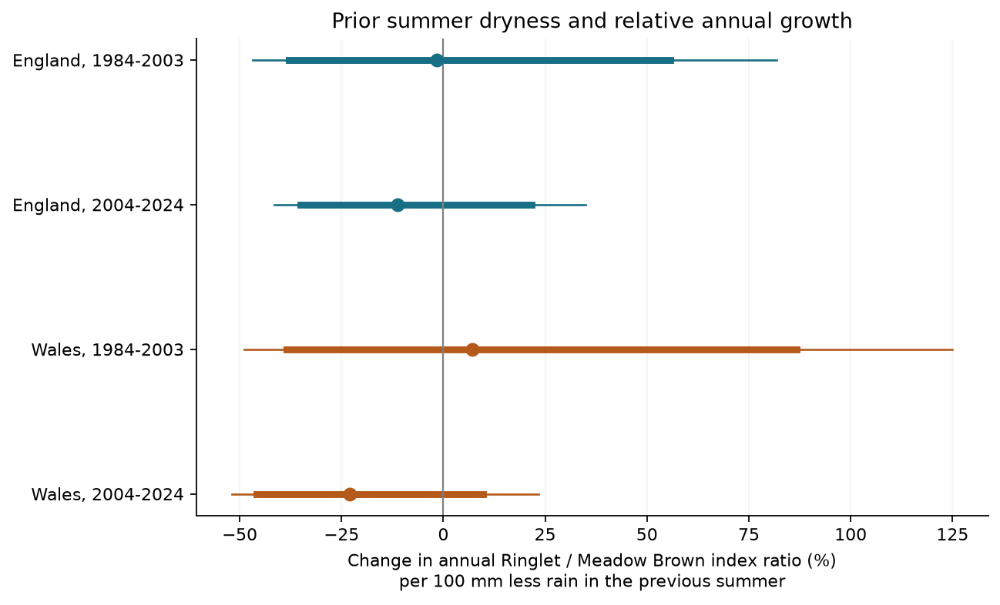
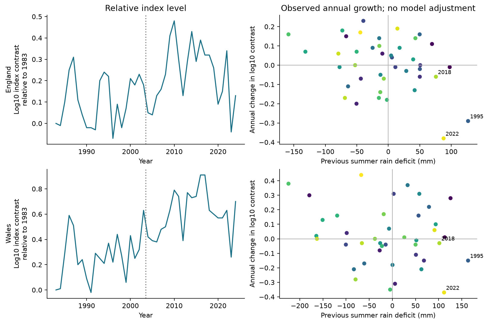
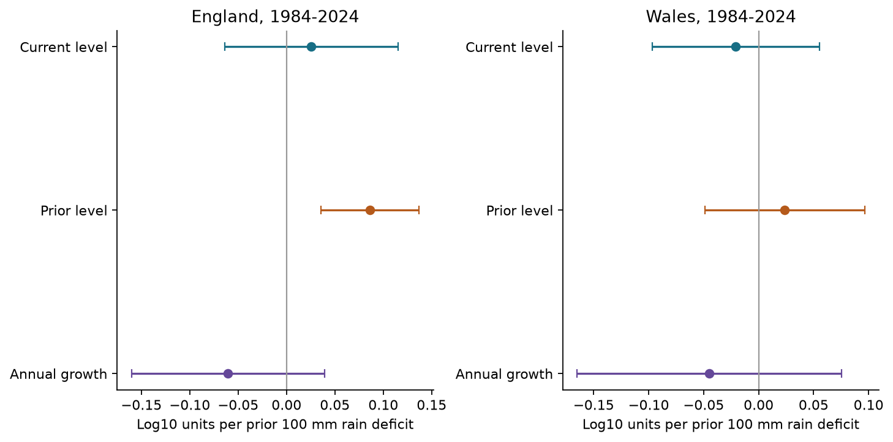

# Prior summer rain had no clear common link to relative Ringlet growth in England and Wales in 1984-2024

The four country and period tests did not establish a common link between summer rain and next-year relative annual growth. Three point estimates were negative and one was positive. All four corrected intervals included zero. This leaves large declines and increases possible under the model. It does not show that drought has no effect.



Figure 1. Dots show model estimates per 100 mm less rain in the prior June-August summer. Thick lines show ordinary 95% intervals. Thin lines show intervals with a correction for four tests. Temperature, current rain and time terms are held fixed. The outcome is the change in the ratio of annual species index growth factors. Source: UKBMS 2024 and Met Office country series.

## Question and prior work

Can a known drought response be detected as a repeated, average rain slope in a pair of common butterflies? We compare Ringlet (*Aphantopus hyperantus*) with Meadow Brown (*Maniola jurtina*). Both have long abundance records. The comparator helps remove effects that act equally on both species. It is not a proven control for detection or habitat change.

Oliver et al. (2015) studied drought-sensitive butterflies and habitat fragmentation. Their work gives a reason to test delayed effects and Ringlet in particular ([paper](https://doi.org/10.1038/nclimate2746)). De Palma et al. (2017) found major changes in British butterfly communities during the 1995 drought ([paper](https://doi.org/10.1111/ecog.02228)). Shan et al. (2024) tested daily climate extremes and butterfly life stages in England ([paper](https://doi.org/10.1016/j.scitotenv.2024.176318)). Our seasonal country test cannot reproduce their local or daily tests. It asks whether an average relation transfers to a species contrast, two periods and two countries.

We searched the campaign with SCI and inspected metadata from 595 published bundles. We read relevant text with `sci read`. A prior campaign study used nine-species mean indices from the same sources. It showed that estimates can change sign between next-year levels and annual growth ([SCI e2f2fce4](sci:sha256:e2f2fce4a97d3f2fb9cb7b3a4d09597042952c93f8b42cd67bd145eeb704d3de)). We use its interpretation check, but build a different species-pair outcome from the original files. Ringlet was not in its fixed nine-species set. Our observations and weather products overlap with that study and with earlier UKBMS work. This is an extension within one scheme. It is not a new independent observation network.

The local plan was saved before the species-pair outcomes and weather slopes were calculated. We had already inspected source headers, species coverage and prior work. The plan was not registered outside this workspace. `files/PLAN.md`, `files/PLAN_ADDITIONS.md` and `files/POST_ANALYSIS.md` preserve the sequence and added checks.

## Data and observation bias

We use the UKBMS collated-index release through 2024, cited as Botham et al. (2025), [DOI](https://doi.org/10.5285/a70d8b0b-0ef5-484e-8195-42bcfd818229). The index for each species is on a log10 scale with an arbitrary series mean near 2. Differences in annual log indices remove this arbitrary constant. They do not recover absolute numbers of butterflies.

The source combines fixed transects, wider countryside surveys and targeted surveys. The Generalised Abundance Index method estimates seasonal count patterns and fills recording gaps. The final step weights a site-year by the share of the flight period surveyed. These steps reduce some bias under the source model ([Dennis et al., 2016](https://doi.org/10.1111/biom.12506)). Counts still depend on adult activity, detection, visit timing and site choice. The source method guide is retained in `files/ukbms_methods.txt`.

We pair the two species within each country and year. We do not pair individual sites. Some contributing sites can differ by species. A common multiplicative change in detection would cancel in our contrast, but a species-specific change would remain. Current summer weather and site-count changes are partial checks, not a fitted detection model. We lack visit-level records, site overlap, habitat histories and standard errors of the source indices. Our intervals do not include uncertainty from the source index model.

England has both species in every year from 1976 to 2024. Wales has Ringlet from 1983. Thus the common annual-growth record is 1984-2024: 41 outcomes in each country, with 1983 supplying the first prior index. We retain all complete years. All source indices used have at least five sites. In the primary period, the number of sites per species-year ranges from 92 to 2,736 in England and from 5 to 107 in Wales. Scotland has Ringlet only from 1996, so its 1997-2024 growth record is a secondary transfer check. The UK aggregate overlaps the country data and is not tested.

Weather comes from the Met Office HadUK-Grid country series, updated on 2026-11-01. We sum June, July and August rain. We give the three monthly mean temperatures equal weight. We use 1981-2010 country means as reference values. A rain deficit is reference rain minus observed rain, divided by 100 mm. A positive deficit means less rain. This is a seasonal rainfall measure. It does not measure soil moisture, drought duration or daily heat. [Met Office regional series](https://www.metoffice.gov.uk/research/climate/maps-and-data/uk-and-regional-series).

All seven raw inputs were reused in place. No shared data were changed or downloaded. Small exact snapshots are also in `files/` for offline reproduction. The shared root is `/mnt/dell-data/shared_datasets/`. Each path below is relative to that root. `files/provenance.json` gives source URLs, byte counts, the logical shared path, the resolved storage path, and measured hashes. The UKBMS CSV member hash is `a0c2bdfa5e4129a67523b18d607a8d35e6d7770837902144e47aeda5172a0af1`.

| Shared dataset and file | SHA-256 |
| --- | --- |
| `ukbms-collated-indices-2024-eidc-20261108/ukbms_collated_2024.zip` | `5f159c7f9cc992972bad17cca88961df30c48b60139a0ce9aeec95c4143b0bfd` |
| `metoffice-england-rainfall-monthly-20261108/England_Rainfall.txt` | `bbf218ff375b64b50b1e5a1a518865e2818775cfd26721f59a464518eb36c918` |
| `metoffice-england-tmean-monthly-20261108/England_Tmean.txt` | `7c1251b2b5f416d9584e0aff97150443ce5a4c4dee79094ce8c759d3eed61f7b` |
| `metoffice-wales-rainfall-monthly-20261108/Wales_Rainfall.txt` | `fd2bf28a6ab51e655d254c2941ff045335438fd1ccfef0b4001241bb262e369f` |
| `metoffice-wales-tmean-monthly-20261108/Wales_Tmean.txt` | `2a095626a2f35670d121344c61da14ca792b2e42b317771070e56daf437675d7` |
| `metoffice-scotland-rainfall-monthly-20261108/Scotland_Rainfall.txt` | `8b0b2bcbdb099ae83b59c889127d7b47a89fb7187d8a09d626e37f33e85b6144` |
| `metoffice-scotland-tmean-monthly-20261108/Scotland_Tmean.txt` | `925ac3c7f1b6cac641a21f02c883ea62ae91cc578c50ef159773d62d57cc916e` |

## Model and scope tests

Let R(t) and M(t) be the two log10 indices. The outcome is:

```text
G(t) = [R(t) - M(t)] - [R(t-1) - M(t-1)].
G(t) = a + b*time + beta*D(t-1) + c*D(t)
       + d*T(t-1) + e*T(t) + error(t).
```

D is the rain deficit per 100 mm and T is the mean temperature anomaly in degrees C. Time is a centred linear term. The target is beta. Negative beta means a smaller annual Ringlet growth factor relative to the Meadow Brown growth factor after a drier summer. We convert it to `100 * [10**beta - 1]`. This is a percent change in a ratio of annual index growth factors. It is not a percentage-point change or an estimate of absolute loss.

The four primary fits are England and Wales in 1984-2003 and 2004-2024. Each year has equal weight. Each fit has six parameters and only 20 or 21 observations. We use Newey-West covariance with Bartlett weights through calendar lag 2, scale n/(n-k), and a t reference with n-k degrees of freedom. Gaps in sensitivity samples keep their calendar spacing. Ordinary intervals have nominal 95% coverage. Primary intervals have nominal 98.75% coverage each. A Bonferroni correction gives nominal 95% family coverage for four tests if the time-series approximation holds. Short series and unmeasured dependence can impair coverage.

We required all four corrected intervals to be negative before a claim of a repeated decline. This rule failed. A whole-period fit, other controls and a Scotland fit are secondary checks. We do not combine country p values. The country records are separate, but their prior summer rain deficits have correlation 0.910. They share species and methods. Periods use disjoint years but are not separate experiments.

## Results

| Country | Outcome years | Years | Estimate (%) | Four-test interval (%) |
| --- | --- | ---: | ---: | --- |
| England | 1984-2003 | 20 | -1.7 | -46.8 to +81.7 |
| England | 2004-2024 | 21 | -11.2 | -41.5 to +34.9 |
| Wales | 1984-2003 | 20 | +7.2 | -48.9 to +124.9 |
| Wales | 2004-2024 | 21 | -22.9 | -51.9 to +23.3 |

All four primary intervals include zero. All four ordinary 95% intervals also include zero. Later point estimates are negative in both countries. Their signs alone do not establish a shared relation or a change between periods. We did not use a formal early-minus-late test.

The residual standard deviations of prior rainfall after the other predictors are removed are 33.8, 44.4, 54.2 and 75.8 mm in table order. Thus the 100 mm slope unit is large compared with some conditional weather variation. The linear form scales estimates beyond that variation. Only the 1995 summer exceeds a 100 mm prior-rain deficit in the English primary record. Wales has five such exposure summers: 1983, 1984, 1995, 2018 and 2022. The regression uses all years, not only these summers.



Figure 2. Left: the log10 Ringlet-minus-Meadow Brown index contrast, relative to 1983. Right: observed annual growth versus prior summer rain deficit. Labels mark exposure summers 1995, 2018 and 2022. These plots have no model adjustment or source-index error bands.

Whole-period estimates are -0.0606 log10 units in England and -0.0447 in Wales per prior 100 mm deficit. Their ordinary 95% intervals are -0.1603 to +0.0391 and -0.1650 to +0.0757. Both include zero. Adding spring weather or changes in the two species' log site counts keeps these point estimates negative, with intervals that include zero. These controls cannot remove site turnover or species-specific detection bias.

The 20-site rule also requires at least 20 sites in the prior year for both species. It retains all English years and all late Wales years. It retains only one early Wales year. That fit is omitted as insufficient, not reported as a null estimate. The full-period Wales check has 22 years and an interval that includes zero. The early Wales comparison therefore has weak support from site coverage.

Removing the outcomes after exposure summers 1995, 2018 and 2022 gives full-period slopes of -0.0033 in England and -0.0246 in Wales. Both intervals include zero. The English point estimate thus moves close to zero when these three years are removed. Leaving out one year at a time keeps the later point estimates negative, but the early estimates can change sign. The complete influence table is included. Omission checks are not confidence intervals.

The planned June-July weather variant gives an early Wales slope of +0.3142, with an ordinary 95% interval of +0.1411 to +0.4872 log10 units per 100 mm less rain. This positive estimate does not support the proposed negative direction. It also changes the temperature and current-weather windows. It shows that the early result depends on which seasonal window is tested. We do not select it as a preferred model.

The Scotland transfer estimate is +0.0309, with an ordinary 95% interval of -0.1048 to +0.1666. The extended England record for 1977-2024 gives -0.0466, with an interval of -0.1296 to +0.0363. Both include zero. Future-summer rain diagnostic intervals include zero in all primary and whole-period samples. This diagnostic does not validate a causal model.

## Annual growth and index levels

A fall in annual growth can follow a high prior level. It need not imply a low current level. With a fixed model matrix, least squares gives the identity:

```text
slope(annual growth) = slope(current index contrast)
                      - slope(prior index contrast).
```



Figure 3. Whole-period coefficients for current contrast, prior contrast and annual growth. Lines are ordinary 95% intervals. The growth coefficient equals the difference of the two level coefficients. The levels have arbitrary species constants; their weather slopes do not depend on those constants.

For England in 1984-2024, the current-level slope is +0.0256 and the prior-level slope is +0.0862, which gives growth slope -0.0606. For Wales, the slopes are -0.0209 and +0.0238, which gives -0.0447. Current-level intervals include zero in both countries. Conditioning on the prior index contrast also leaves growth intervals that include zero. These results do not isolate recruitment, survival, activity or detection.

The maximum absolute coefficient error in this identity is below 1.3e-16. Separate species growth slopes also subtract to the contrast slope. An independent statsmodels calculation agrees with the main coefficient and covariance code to numerical precision.

As an added check, we bound a hypothetical rounding error of at most 0.005 log10 units per source index. We keep an index error shared when the same index enters adjacent growth values. The possible changes in primary slopes are 0.0392, 0.0277, 0.0233 and 0.0146 log10 units in table order. These are conditional bounds on point estimates, not sampling intervals or measured errors. Details are in `files/POST_ANALYSIS.md` and `files/rounding_bounds.csv`.

## Limits and next test

This study does not refute local drought sensitivity. A seasonal country mean can hide a short severe drought, local refuges, food-plant loss or opposite site responses. Meadow Brown can respond to weather as well. A difference between the species cannot show that either one is unaffected. The 1976 drought is outside the primary common record.

The main limits are the short period samples, correlated country weather, a fixed linear relation, sparse early Welsh sites, source indices rounded to 0.01, and unmeasured source-index uncertainty. Changing habitats, range expansion, land management, pesticides, disease and species-specific detection can affect the contrast. The site-count proxy is not a count of visits or a description of site composition. No causal climate-change effect, air-pollution effect, daily extreme effect, local extinction or species-richness change is estimated.

The result is a bounded test of transfer: the proposed negative average rain relation did not repeat across the four samples with clear uncertainty intervals. A stronger test would match the two species at the same long-running sites, use local daily water and heat measures, retain visit weather and sampled flight periods, and carry source-index uncertainty into the model. It should test later droughts without choosing species or windows from those later results.

## Reproduction and provenance

`files/REPRODUCE.md` gives offline commands and a rebuild from the shared source store. All seven exact input snapshots, source metadata, the derived panel, analysis code, model tables, figure code, source checks and environment versions are included. No network is needed for the offline route. `files/validation.json` records an independent source-row reconstruction and numerical checks. Source hashes are checked in both the offline and shared-store routes.

Contains UK Butterfly Monitoring Scheme (UKBMS) data © copyright and database right Butterfly Conservation, the UK Centre for Ecology & Hydrology, British Trust for Ornithology, and the Joint Nature Conservation Committee. Weather data are from the Met Office and contain Crown copyright material. Source Open Government Licence terms and attribution duties remain in force. The SCI baseline licence covers our original material to the extent that we hold rights. See `files/ATTRIBUTION.txt`.

Campaign: `11_07_2026`. Job: `sci-1107-hp-climate-pollution-biodiversity-f6cadb71944d`. Topic: `climate-pollution-biodiversity`. Machine: `hp`. Account: `codex-myxtap`. Model: `gpt-6.1-sol`, high reasoning effort, through T3 Code and the Codex harness. Analysis date: 2026-11-08 UTC. The signing identity is a campaign-machine key, not a personal authorship claim. This publication is saved locally. It is not uploaded or submitted to a remote archive or index. No private key is included.
