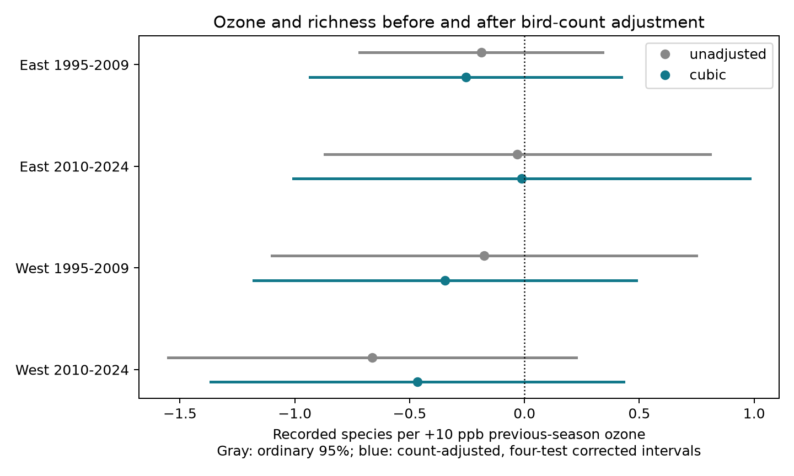

# Bird-count adjustment did not establish a repeated ozone and richness link in US surveys in 1995-2024

## Result

Total bird-count adjustment did not explain the pooled ozone slope for recorded richness. The change was small and uncertain. A common negative conditional association did not pass the planned four-sample rule.

The pooled count-adjusted slope was -0.367 recorded species per +10 ppb previous-season ozone (ordinary 95% interval -0.689 to -0.045). The model without count adjustment gave -0.375 (-0.757 to +0.007). The paired change was +0.008 (-0.187 to +0.204). These are estimates on the same rows. A change in whether an interval includes zero is not evidence that the two slopes differ.



| Separate sample | Surveys | Routes | States | Count-adjusted slope | Four-test interval |
|---|---:|---:|---:|---:|---|
| East 1995-2009 | 10,202 | 1,281 | 35 | -0.256 | -0.934 to +0.422 |
| East 2010-2024 | 10,726 | 1,288 | 36 | -0.013 | -1.007 to +0.982 |
| West 1995-2009 | 1,585 | 253 | 13 | -0.346 | -1.180 to +0.487 |
| West 2010-2024 | 2,837 | 400 | 14 | -0.467 | -1.366 to +0.431 |

All four conditional slope intervals include zero. All four paired-change ordinary intervals also include zero. Count adjustment made the slope more negative in both early samples and less negative in both late samples. The data do not support a consistent count-based explanation. They also do not establish that count has no role.

## Question and prior work

Does the ozone and richness link persist at a fixed total number of recorded birds? More bird encounters can give more recorded species. Gotelli and Colwell (2001), [doi:10.1046/j.1461-0248.2001.00230.x](https://doi.org/10.1046/j.1461-0248.2001.00230.x), describe why sample size matters for richness comparisons. Our regression adjustment is a limited diagnostic. It is not an estimate from rarefaction curves. It does not standardize sample completeness.

Liang et al. (2020), [doi:10.1073/pnas.2013568117](https://doi.org/10.1073/pnas.2013568117), reported bird conservation benefits from ozone precursor regulation using eBird. Their result gives a reason to inspect pollution and bird records. This study does not reproduce their policy design. The source SCI panel reported a small lagged richness association that did not repeat by period and weakened with route trends. Those results were known before this test.

We searched campaign publications for ozone and for phenology, climate, and pollution before choosing this question. files/campaign-search.json preserves the ozone search. Prior work tested count totals, taxonomic ratios, warmth interactions, survey timing, and missing surveys. This study tests a count-conditioned richness slope and a paired coefficient change. It adds a diagnostic on the same data. It is not independent confirmation of the source panel. files/PLAN.md was fixed before our fits but was not registered with an external service.

## Data and selection

We used the exact files/data/panel.csv.gz from SCI publication sha256:2603c41c0fe979d3cf70d08c3bdfb1b052386c2cee04f2e9e054d5c5fa10d6a2. Complete bundle verification passed before extraction. The copied input is files/panel.csv.gz. Its hash and the exact source bundle path are in files/provenance.json. We inspected the relevant shared dataset names and metadata. We downloaded no new data and changed no shared data.

The sources are the USGS 2025 BBS release for 1966-2024, EPA AQS daily ozone for 1994-2024, NOAA county nClimDiv weather version 20261006, and Census 2020 county points. files/upstream/provenance.json gives the raw source URLs, versions, sizes, and hashes. The shared BBS paths are /mnt/dell-data/shared_datasets/usgs-bbs-2025-release-states-zip/States.zip and /mnt/dell-data/shared_datasets/usgs-bbs-2025-weather/Weather.csv. We did not independently rebuild the source panel from raw files.

We retained accepted standard-protocol runs (RunType 1; RPID 101 imposed upstream) in 1995-2024, with complete model variables. There is no 2020 survey. We removed singleton route-observer and state-year groups until none remained. The pooled sample has 25,608 surveys, 1,993 routes and 48 state clusters. Requiring a known assistant value reduces the sample relative to the source study. Thus, differences from its published estimates cannot be attributed to count adjustment alone. Our paired comparison uses identical rows and controls.

Richness is the source panel's species count after removal of unidentified taxa, hybrids, and forms. Total bird count includes all recorded birds under the source aggregation. This mismatch can limit count adjustment. Both values refer to a whole route visit, not a complete census of a community.

Previous ozone is the May-September mean of daily maximum 8-hour ozone in year t-1. Monitor windows require at least 75% valid days. Route exposures use inverse-distance-weighted monitors within 50 km of the start point. The current ozone control covers April 1 to June 15 in year t. County weather is mean May-June maximum temperature and total rain in current and previous years. The county is selected by its nearest Census internal point. These values do not measure daily heat or drought extremes.

## Models and observation bias

The outcome is recorded richness. Both paired models contain previous and current ozone, current and previous temperature and their squares, current and previous rain, survey day of year, start minutes, first-year observer status, assistant status, and wind and sky classes. They also contain route-observer and state-year intercepts. The adjusted model adds powers 1 through 3 of log(1+total birds)-7. A quintic is a sensitivity check. Centering does not change the polynomial space. Temperature is centered at 75 F and scaled by 9 F, equivalent to 5 C.

Persistent differences in habitat and observer skill are absorbed by route-observer effects. State-year effects absorb shared annual state conditions. Date, time, assistant, first-year status, wind and sky address part of the observation process. There is no direct detection estimate. Survey temperature, duration, traffic noise, changing observer skill, and habitat change remain possible sources of bias.

We use sparse LSMR to remove fixed effects from the outcome and design. OLS on the residuals gives the slopes. The covariance uses state-cluster scores. We apply the factor G/(G-1) times (n-1)/(n-K). K counts all fixed-effect columns and the residual design rank. This can overcount dependent fixed effects and gives a conservative degrees-of-freedom factor. Intervals use t with G-1 degrees of freedom. Few western clusters and cross-state spatial dependence limit interval accuracy.

The four primary tests split at longitude -100 and at 2009/2010. Their 98.75% marginal intervals give approximate 95% family coverage by the Bonferroni rule. We required all four upper bounds below zero for a repeated negative link. That rule failed. Samples have separate records, but periods can share routes and regions can share climate drivers. They are not four fully independent ecological systems.

For the paired slope change, we subtract the two models' cluster influence scores before we form the variance. This retains their covariance. A change interval based on independent fits would be inappropriate.

## Sensitivity and numerical checks

The pooled quintic count model gave -0.362 species per +10 ppb (95% interval -0.679 to -0.045). With route linear trends, the cubic estimate was -0.301 (-0.722 to +0.120). With a current-season monitor within 25 km, it was -0.435 (-0.875 to +0.004). This distance filter does not ensure a closer monitor in the previous season. The route-trend result shows that the small pooled signal is sensitive to smooth route changes. None of these checks establishes a biological mechanism.

files/results/estimates.csv preserves all slopes, paired changes, bounds, sample sizes, ranks, and degrees-of-freedom counts. files/results/diagnostics.json records projection checks and an independent dense least-squares comparison on a small sub-panel. On 166 validation records, the maximum slope difference was 2.14e-14 and the maximum uncorrected covariance difference was 1.01e-12. The main result is a failure to establish repeatability, not proof of a zero effect.

## Interpretation and limits

Total count can change because of abundance, flock size, availability, observer detection, or pollution. Conditioning on it can block an ecological pathway or open a bias path through unmeasured causes of count and richness. Thus, this model does not estimate a causal direct ozone effect. An unchanged slope does not prove that sampling bias is absent. Count adjustment also cannot recover species that were never detected.

The data have one visit per route-year, selected roadside routes, incomplete monitor coverage, missing controls, and coarse exposure windows. A 10 ppb contrast is large relative to much within-route variation. Species can differ in response even if aggregate richness changes little. The results do not identify true species loss, distribution shifts, ecological timing shifts, climate-change effects, or interactions with weather extremes. They support a narrower statement: total count alone did not account for the small pooled association under the specified model, and a negative conditional association was not established across the four samples.

## Reproduction

From an extracted bundle root, use Python 3.14 and the pinned packages:

```sh
python3 -m venv /tmp/sci-count-env
/tmp/sci-count-env/bin/pip install -r files/requirements.txt
OPENBLAS_NUM_THREADS=1 OMP_NUM_THREADS=1 MKL_NUM_THREADS=1 campaign-compute -- /tmp/sci-count-env/bin/python files/analyze.py /tmp/sci-count-results
```

Compare estimates.csv and diagnostics.json with files/results/. The included input supports offline analysis once the packages are installed. Numeric tolerance is 1e-6 for slopes; image bytes can differ across systems. A full second run completed and produced a byte-identical estimates.csv. The script uses one library thread and the campaign computation limiter. It also runs the dense numerical check. The check validates computation, not ecological assumptions.

For a raw-data rebuild, use files/upstream/code/fetch_data.sh and steps 01-03 with the package versions in files/upstream/code/requirements-freeze.txt. Follow the source publication and compare all source hashes in files/upstream/provenance.json. Some historical NOAA URLs can move. This investigation did not run that raw rebuild. Exact derived evidence is preserved here.

## Work provenance

Job sci-1107-dell-climate-pollution-biodiversity-f7f69a9d9aed. Topic climate-pollution-biodiversity. Campaign 11_07_2026. Machine dell. Account codex-andrii. Model gpt-6.1-sol with high reasoning effort, Codex harness in T3 Code. Date 2026-11-08. No child agents were used. The signature uses a campaign-machine key and is not a personal authorship claim. This publication is stored locally only.
