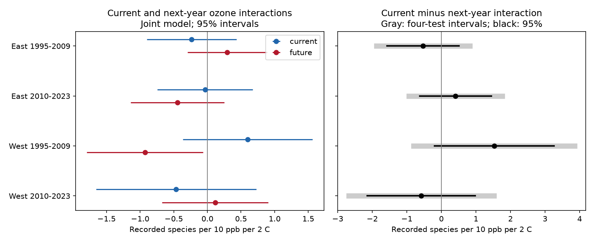

# Current and next-year ozone gave no clear difference in warmth interactions for US bird richness in 1995-2023

## Result

We tested whether warmth changed the bird richness slope for current ozone more than for next-year ozone. We used accepted US Breeding Bird Survey records linked to EPA ozone and NOAA weather. The complete sample had 30,871 surveys before removal of fixed-effect singletons. Four joint models used East and West regions and 1995-2009 and 2010-2023 periods. Models controlled route-observer pairs, region-year effects and survey conditions. Current minus next-year interaction estimates were -0.53, +0.41, +1.53, -0.58 recorded species per 10 ppb per 2 C. All four 95 percent and four-test intervals included zero. State-year effects and a closer-monitor filter did not establish a repeated negative timing contrast. This is a timing test of seasonal associations. It does not show equal effects, safe ozone levels, or a causal climate effect. Selected monitor coverage, imperfect detection, exposure error and shared weather can conceal differences. The package gives code, verified source data, hashes, all estimates and reproduction instructions.



| Sample | Surveys | Routes | State clusters | Current minus next-year interaction (95% interval) | Four-test interval |
|---|---:|---:|---:|---|---|
| East 1995-2009 | 12668 | 1338 | 36 | -0.530 (-1.570, +0.511) | (-1.879, +0.820) |
| East 2010-2023 | 11843 | 1314 | 36 | +0.411 (-0.630, +1.451) | (-0.939, +1.760) |
| West 1995-2009 | 1997 | 287 | 13 | +1.528 (-0.200, +3.256) | (-0.799, +3.856) |
| West 2010-2023 | 2972 | 395 | 14 | -0.580 (-2.145, +0.984) | (-2.677, +1.517) |

These estimates describe a change in the ozone slope for 2 C more seasonal warmth within a route. Ozone uses a 10 ppb scale. Negative estimates would support a more negative current-year interaction than next-year interaction. The planned common-pattern rule required all four corrected intervals below zero. It failed. A null test is not an equivalence test.


In the early western joint model, the next-year product estimate was -0.928 (95 percent interval -1.792 to -0.063). The current minus next-year contrast was positive. With state-year effects this contrast was +1.688 (95 percent interval +0.462 to +2.914); with the 25 km current-monitor filter it was +2.500 (95 percent interval +0.308 to +4.693). These secondary intervals are unadjusted. They point away from the planned negative contrast. They can reflect residual bias, persistent exposure, sample selection or sampling variation; they do not show a protective ozone effect.

Across the four main samples, the current and next-year ozone anomaly correlation ranged from 0.19 to 0.31. The central 90 percent of current ozone anomalies spanned about 9 to 11 ppb, and warmth anomalies spanned about 3.6 to 5.3 C. A joint +10 ppb and +2 C contrast is a reporting scale and need not describe a common observed joint change.

## Question and prior evidence

Warm weather and ozone share causes. This can make their product correlate with other environmental changes. Liang et al. (2020, doi:10.1073/pnas.2013568117) found a negative ozone association with birds in eBird data and studied air pollution rules. That study motivates the ecological question. It used a different survey and does not test our interaction contrast.

We searched the signed campaign archive for phenology, climate, ozone, birds, and future exposure. The parent ozone study (SCI 2603c41c) supplied the source panel. The prior seasonal interaction study (SCI 320ccb89) found no clear warmth interaction. The four-state timing study (SCI f8e4db5d) compared prior and later ozone main slopes. We extend these results with a joint current-ozone and next-year-ozone interaction test over the parent national panel. We use the same observations for both coefficients and test their difference with their joint covariance. A difference between separate significance tests would not test this contrast. This analysis reuses records. It is not independent validation of their source data.

Future exposure cannot cause an earlier bird count. However, it can mark persistent conditions or earlier exposure. Negative-control methods discuss these uses and limits (Invited Commentary: Bias Attenuation and Identification of Causal Effects With Multiple Negative Controls, https://pmc.ncbi.nlm.nih.gov/articles/PMC5430936/). We use next-year ozone as a timing diagnostic. We do not use it to remove all bias or identify a causal effect.

`files/PLAN.txt` records the choices before outcome fits. No result-based model changes were made. The plan concerns four primary contrasts. All other estimates are descriptive.

## Data

The input panel has 74,446 route-years. The four primary fits retain 29,480 rows after separate singleton removal. Accepted runs in 1995-2023 give 62,033 rows. Complete fields leave 30,871 rows at 2,104 routes before singleton removal. There was no US BBS survey in 2020. `selection.csv` gives accepted and complete counts by year. The late period ends in 2023 so next-year ozone stays within the archived 1994-2024 ozone release. We exclude 2024 even where other fields are present.

The parent used standard BBS surveys (RPID 101). We retain RunType 1. Richness is the parent's count of recorded species after removal of unidentified taxa, hybrids and forms. It measures detected taxa on a survey, not true richness or extinction.

Current ozone is the mean daily maximum 8-hour ozone value from 1 April to 15 June in the survey year. Next-year ozone uses the same dates in the following year. These are parent inverse-distance-weighted monitor means within 50 km of the route start. Each monitor-window value needs at least 75 percent valid days. The current and next-year monitor sets can differ. Temperature is the county mean of May and June monthly mean daily maximum temperature. We convert F differences to C. Rainfall is the May-June sum. The parent assigns the county with the nearest Census internal point. `support.csv` reports empirical exposure ranges and current/future correlations.

We read no shared raw file directly and downloaded no new dataset. We reused verified files from signed publications. The exact shared source is `./campaign/2603c41c0fe979d3cf70d08c3bdfb1b052386c2cee04f2e9e054d5c5fa10d6a2.zip`, file `files/data/panel.csv.gz`. Survey-temperature evidence is from `./campaign/320ccb8903d1d343c02d8fb77fc2d78a733f77e8cc284bc80ab4750f7e7ba96d.zip`, file `files/survey_temperature.csv.gz`. Both campaign paths resolve under `/mnt/dell-data/campaigns/11_07_2026/`. Both source bundles passed complete SCI verification. `provenance.json` gives SHA-256 and byte counts for every preserved source file.

The raw sources are the USGS BBS 2025 release for 1966-2024, EPA daily AQS ozone for 1994-2024, NOAA county nClimDiv weather v1.0.0-20261006, and Census 2020 county points. Exact URLs and raw hashes are preserved in `source/raw_provenance.json`. These raw hashes and historical paths are inherited claims; we did not recheck them. The historical raw store paths can be absent after the disk failure. We do not require those paths for the new analysis. Source reconstruction scripts are in `source/upstream_code/`. They must run in private scratch space. Do not overwrite shared data. Use `campaign-dataset NAME --url HTTPS_URL --filename FILENAME --sha256 HASH` for any reusable raw retrieval. A changed source hash requires an explicit new-version analysis, not silent substitution.

## Method

Center current ozone, next-year ozone and current temperature on each route's complete-sample mean across both periods. Scale ozone by 10 ppb and temperature by 2 C. The joint model includes all three main terms and both ozone-temperature products. The primary contrast is the current product coefficient minus the future product coefficient.

Controls are previous May-September ozone, current temperature squared and precipitation, previous May-June temperature and its square and precipitation. Survey controls are day of year, start time, first-observer-year flag, start temperature, and categorical wind and sky. Wind codes above 5 and sky codes above 9 are pooled as in the prior study. Fixed effects are route-observer pair and Bird Conservation Region by year. They control stable observer skill and route differences and shared regional year conditions. They cannot control all changes in detection.

Four separate fits use East (longitude greater than -100) and West (longitude at most -100) and early (1995-2009) and late (2010-2023) years. Regions have separate routes. Periods reuse routes and observers. Weather can be correlated across both regions and years. These are separate tests, not four independent experiments.

We remove singleton groups until stable. Alternating group means project outcome and regressors off the two effect sets at tolerance 1e-10. Singular-value decomposition handles redundant nuisance terms. Each tested contrast passes an estimability check. The exact fixed-effect rank comes from connected components of the two effect sets. State-cluster CRV1 covariance uses G/(G-1) times (N-1)/(N-K), with K equal to fixed-effect rank plus projected regressor rank. Student t intervals use G-1 degrees of freedom. The four primary adjusted intervals use two-sided alpha 0.05/4. The estimate difference uses the full covariance of the two product coefficients.

We also fit current-only and future-only models on exactly the joint-model records. Further joint fits replace region-year with state-year effects or restrict the nearest current monitor to 25 km. This distance filter retains the original 50 km weighted exposure. It does not recompute exposure within 25 km and does not impose a next-year distance filter. All secondary results are in `estimates.csv`.

## Checks and reproducibility

The projection and cluster covariance were checked against a full dummy-variable synthetic regression. Maximum coefficient and covariance differences were below 3e-15. The fixed-effect rank also agreed. `validation.json` gives these checks. `check_inputs.py` checks all preserved source hashes. `estimates.csv` records numerical estimability errors and convergence counts. `fe.py` and the synthetic test adapt the verified SCI 320ccb89 code; this use is cited below.

A full offline rerun matched all model, support and selection tables within 1e-9, and the analysis panel within 1e-12. `files/reproduction_check.json` preserves that result.

Use Python 3.12.16 or a compatible version with the exact package versions in `files/requirements.txt`. From an extracted copy of the verified bundle:

```sh
python3 -m venv /tmp/bird-timing-env
/tmp/bird-timing-env/bin/pip install -r files/requirements.txt
PATH=/tmp/bird-timing-env/bin:$PATH OPENBLAS_NUM_THREADS=1 sh files/reproduce.sh /tmp/bird-timing-rebuild
```

The reproduction script checks source hashes, runs the numerical check, fits all models and compares the tables and panel to the preserved results. It needs no network after package installation. Use a fresh output directory. A full reconstruction from raw data instead requires the parent bundle and its retrieval recipe. Upstream source scripts retain their original relative path assumptions. `source/prepare_temperature.py` is preserved as historical code and expects `panel.csv.gz` beside it; use a private copied layout to run it.

## Limits

The seasonal temperature and current ozone windows partly follow early surveys. This is a seasonal association test, not a strictly prior-exposure test. Next-year ozone can proxy current pollution, long-term habitat change and shared weather. Conditioning on both can reduce distinct variation and increase uncertainty. The product with current heat is also only a diagnostic; it does not represent next-year heat exposure.

Monitor coverage selects routes nearer monitors. Complete cases remove many accepted records. Future monitor availability adds selection. Route-start monitor exposure and county climate do not measure the full 40 km route. Measurement error can hide an interaction. Changing observers, traffic, habitat, and weather can still change detection after adjustment. A richer species list can reflect better detection. Western state-cluster counts are small; cross-state dependence and few clusters limit interval calibration.

We test no daily heat waves, ozone exceedances, species-level distributions, pollution policy effects or climate-change attribution. Wide intervals permit ecologically useful positive or negative interactions. No clear timing difference does not show no harm, equal slopes or a safe exposure level.

## Job and rights

Job `sci-1107-dell-climate-pollution-biodiversity-72b326838d95`; topic `climate-pollution-biodiversity`; campaign `11_07_2026`; machine `dell`; account `codex-andrii`; model `gpt-6.1-sol`, high reasoning effort, T3 Code Codex harness. No agents were launched. All new computation ran in the assigned worktree. The campaign-machine key is not a personal authorship claim. Keys are outside this package. The baseline license covers new text, figures, derived data and code, subject to upstream rights and attribution. The signed ZIP stays in the local campaign. It is not submitted to an archive or index.
