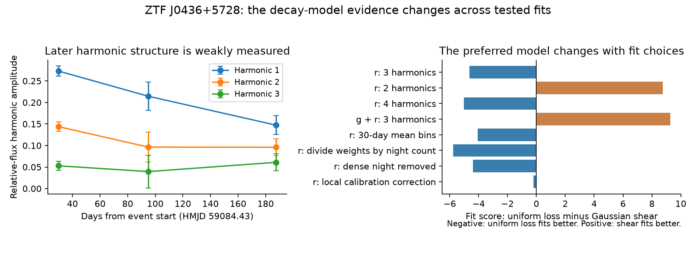
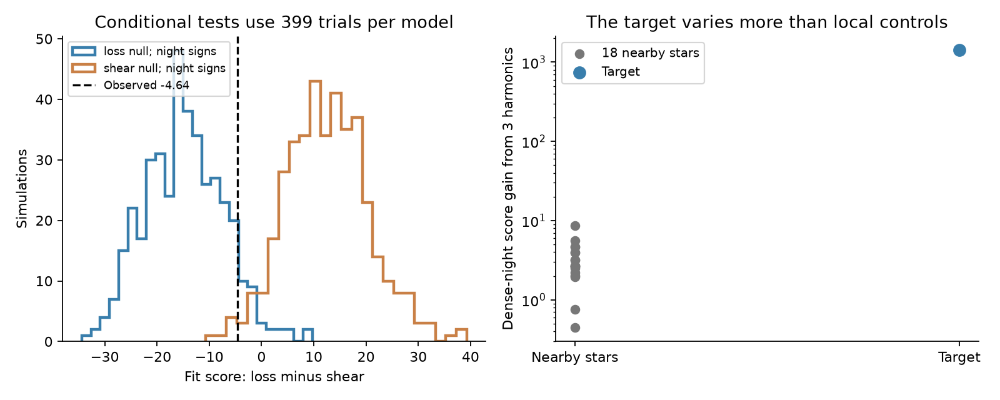

# ZTF DR24 fits do not give a stable decay mechanism for the 2020 ZTF J0436+5728 event

ZTF DR24 does not give a stable choice between common amplitude decay and Gaussian orbital spreading for this event. In a 245-day interval, the r-band fit with three harmonics favors common decay. A fit with two harmonics favors spreading. Adding g-band data also favors spreading. A correction from nearby stars leaves the main r-band models almost tied. Thus a smooth decrease in the observed modulation does not, by itself, identify how the dust changed.

This is a test of a known signal. It is not a new planet or a new event. The new result is a test of the different harmonic damping laws and of their sensitivity to the fit choices.

## Prior work and question

The campaign study `sci:sha256:842147d01deb9a8eeb192929bda102a857d8df4c984c432d57c261a06d6eff17` found several long white-dwarf dimming events and recovered the known ZTF J0436+5728 event. We read its full report and searched the campaign with J0436, 5.910, white dwarf shear, and other white-dwarf queries. We found no earlier campaign test of harmonic damping for this object. No numerical result or code from that study enters our fits.

Van Roestel et al. (2026, arXiv:2609.08923v1, Section 5.1.3) report a 5.910-hour signal during the 2020 dimming event. They describe a signal with decreasing amplitude and fit a common exponential decay. They interpret the period as an orbit near the tidal disruption radius. Their result leaves a physical question: does the modulation fade because its contrast decreases, or because material spreads in orbital phase? We test two restricted versions of these explanations.

## Data and fixed scope

We use ZTF DR24 through the SNAD API v3, with the explicit `dr24` endpoint. We downloaded two small cones on 2026-11-12 with `campaign-dataset`. The immutable shared inputs, URLs, sizes, and SHA-256 hashes are in `files/provenance.json`. They remain outside this publication. The source data are not relicensed by this publication.

The target cone has five light curves. Only field 779 covers the event. The main fit uses its r-band object 779215300040372. The g-band check uses object 779115300018894. We do not use the i-band data or field 1814 in the fits. The interval is HMJD 59084.43 to 59329.43, with the upper endpoint excluded. The start comes from the published event onset. We selected the 245-day span after inspection of the sampling, before the first model fit. This is an exploratory analysis, not a registered test.

There are 205 r-band and 83 g-band measurements after the cuts. All are SNAD good detections. We require finite values and 0 < magnitude error < 0.3 mag. A sequence of 122 r-band measurements occurs on HMJD day 59115. It accounts for 60 percent of the r-band sample. Most later nights have only one or two measurements. The survey does not record non-detections in these light curves. Its selection can therefore change the fitted shape during deep dips.

For each band, flux is 10^[-0.4(m - m0)]. Here m0 is the median magnitude of its good pre-event detections before HMJD 59070. The flux error is the first-order propagation of the magnitude error. We add a 0.03 relative-flux error floor in quadrature. This floor is a fit choice. We also test other floors.

The field called `mjd` in SNAD is a heliocentric mid-exposure time, not a time at the telescope. Malanchev et al. (2023) state this in their description of SNAD. We remove the heliocentric correction by three iterations, convert UTC to TDB, and add the barycentric light delay. We use Astropy's built-in ephemeris and Palomar coordinates (longitude -116.863 deg, latitude 33.356 deg, height 1706 m). We disable network updates to the time tables. Fits use these corrected times. Time-bin selection and night groups use the native HMJD. A first, incorrect double-correction was caught before publication; all bundled results use the corrected procedure.

## Models and physical assumptions

Let x be time since the event start in units of 100 days. A harmonic k is a sine and cosine pair at k times the fitted frequency f. Frequency is in cycles per day, and dt is in days. We fit

F_b(t) = C_b,j + sum_k exp[-gamma x - beta k^2 x^2] [a_b,k cos(2 pi k f dt) + b_b,k sin(2 pi k f dt)].

C_b,j is a separate mean for each band b in fixed 40-day bins j. Means absorb the slow flux recovery. We do not require the mean to follow the harmonic decay. Coefficients and means are solved by weighted linear least squares at each choice of f, gamma, and beta. A local search then fits the nonlinear parameters. Frequency is restricted to periods from 5.90 to 5.92 hours around the known signal. This is not a broad search for new periods. The main fit has three harmonics.

We compare four models:

- Constant modulation: gamma = beta = 0.
- Common decay, labeled uniform loss in some figures: gamma >= 0, beta = 0. Every harmonic has the same exponential rate.
- Gaussian spreading, labeled shear: gamma = 0, beta >= 0. Higher harmonics decay faster, with a rate set by k squared.
- Both effects: gamma >= 0 and beta >= 0.

The spreading law follows directly if a fixed initial flux profile is convolved with a Gaussian distribution of constant orbital frequencies with standard deviation sigma_f. The Fourier factor is exp[-2 pi^2 k^2 sigma_f^2 dt^2], so beta = 2 pi^2 (100 sigma_f)^2. For small circular Keplerian orbit differences, sigma_a/a = 2 sigma_f/(3f).

These equations test a restricted physical model. They assume that the observed flux profile can be convolved in this way. Optical saturation, time-dependent dust production, phase-frequency correlation at birth, non-Gaussian or multiple streams, and changing cloud geometry need not follow this law. Common decay also need not mean that physical dust mass is lost. We do not convert it into a mass-loss rate.

## Results

The score Q is the sum of squared residuals divided by the adopted flux variance. Lower Q gives a better fit. The two single-effect models have the same number of parameters within each row. Scores under different weights are not directly comparable between rows.

| Fit | Q common decay | Q Gaussian spreading | Difference |
| --- | ---: | ---: | ---: |
| r, three harmonics | 250.91 | 255.55 | -4.64 |
| r, two harmonics | 295.02 | 286.26 | +8.76 |
| r, four harmonics | 246.30 | 251.31 | -5.01 |
| g and r, three harmonics | 449.07 | 439.80 | +9.27 |
| r, 30-day mean bins | 246.04 | 250.11 | -4.07 |
| r, weights divided by each night's count | 110.74 | 116.51 | -5.77 |
| r, dense night removed | 134.27 | 138.67 | -4.40 |

The main common-decay fit has 5.910550 hours and gamma = 0.610 per 100 days. Its fitted decay time is 163.9 days. These are conditional model estimates, not a measured dust lifetime. Adding spreading to this fit puts beta at its lower bound of zero. With two harmonics the preference reverses. It also reverses when g and r share the damping rates, although their harmonic coefficients and bin means are separate.

The independent time-bin amplitude estimates help show the limitation. The first bin covers days 0-60 and has 157 r measurements. The next two bins have only 16 and 32 measurements. Higher harmonics in the later bins have large errors. Error bars in the figure are formal errors at a fixed frequency, with a constant mean within each bin. They do not include frequency error, variation of the mean, or within-night correlation. They must not be used as a calibrated detection of shape evolution.

## Noise and instrument checks

For each of the two single-effect models, we generate 399 artificial series. We add the model residuals back with one random sign per observing night. Thus all 122 dense-night residuals share one sign. We refit frequency and decay for every series. This preserves the residual pattern within a night. It assumes symmetric residuals and does not reproduce arbitrary errors shared between nights or the loss of faint detections. The simulations are conditional checks of the main three-harmonic r fit. They are not discovery probabilities and do not cover the choice among all analysis variants.

The observed score difference (common decay minus spreading) is -4.64. Under the fitted spreading null, 6 of 399 simulations give a difference at least this negative. The plus-one tail estimate is 7/400 = 0.0175; its Monte Carlo standard error is about 0.006. Under the common-decay null, the observed difference lies within the central 95 percent simulation range (-27.91 to +0.21). This conditional evidence against the restricted spreading model applies only to the main fit. The reversal with two harmonics and with joint g/r fitting prevents a stable physical conclusion.

A 59-arcsec cone supplies 18 r-band comparison light curves from the same field and readout channel. They have pre-event median magnitude within one magnitude of the target, at least 20 pre-event points, at least 25 event points, and at least 20 points on the dense night. At each target exposure we divide by the median normalized comparison flux if at least three controls match within 0.0002 day. This tests a local common calibration change. We also fit three harmonics with a free mean to the target and each control on the dense night. The sequence covers less than one orbit. We compare the fit only at the observed times; a full-orbit extrapolation of that short sequence is not valid.

All 205 target exposures have at least three controls. The ensemble correction has a 2.5 to 97.5 percentile range of 0.967 to 1.049. After this correction, the main score difference falls from -4.64 to -0.20. The models are then almost tied. This shows that a small local correction can change the strength of the model comparison even when the large target variation remains. On the dense night, the target score gain from three harmonics is 1414.6, while the largest gain among the 18 comparison stars is 8.7. A common local variation does not explain the target signal under this check. This is not an image-level localization test.

We repeat the r-band fits with 30-day mean bins, weights divided by each night's count, removal of the dense night, and different flux error floors. We report every variant in the aggregate result files. The main r-band preference survives these checks, but not the change to two harmonics or to joint g/r fitting. The fits are numerical descriptions of the detected flux and leave residual variation. Twelve alternate optimizer starts for each single-effect fit in the main, two-harmonic, and joint-band cases do not improve the reported best scores by 0.0001. Three noiseless synthetic cases recover the supplied damping parameters to numerical precision; this tests the fit code, not the physical assumptions.

## Interpretation, limits, and next test

The data support fading modulation near the published period. They do not give a stable mechanism choice between the tested common-decay and Gaussian-spreading laws. A preference in one fit must not be reported as proof of dust removal or as an exclusion of general orbital spreading. A value of beta in a restricted fit is not a robust radial-width measurement.

The g and r series use the same telescope, survey pipeline, and source images at different times. They are not an independent instrument confirmation. The comparison stars test shared local errors but cannot rule out a target-specific extraction error or an unresolved blend. We did not inspect individual images, fit non-detections, or model the survey selection. We sought independent observations in the source paper: its CHIMERA observation two years after the event found no variability. That later quiet state does not distinguish the two active-state decay models, and we have not refit its measurements.

A decisive next test needs complete phase coverage in several separated epochs during another active interval. It should obtain simultaneous colors and forced photometry, including faint measurements. The key observable is whether harmonic ratios decrease with the k-squared law while phase remains coherent. Non-Gaussian streams, renewed production, and optically thick clouds remain open physical explanations.

## Reproduction

Python and package versions are in `files/environment.json`. The code is original to this job. Use at most two CPUs. These commands use one numerical thread and write all downloads and derived records to a separate scratch folder, outside the signed package.

1. Set `PUB` to the extracted publication directory and `SCRATCH` to a new external directory. Set `OMP_NUM_THREADS=1`, `OPENBLAS_NUM_THREADS=1`, and `MKL_NUM_THREADS=1`.
2. Use the two shared inputs in `files/provenance.json` in place. On another machine, run `python "$PUB/files/retrieve.py" --data-dir "$SCRATCH/raw"`. The script checks exact hashes and stops if the server bytes change. It does not write into the publication.
3. Run `python "$PUB/files/analyze.py" --input TARGET_JSON --out "$SCRATCH/analysis"`.
4. Run `python "$PUB/files/controls.py" --input TARGET_JSON --field FIELD_JSON --out "$SCRATCH/analysis" --n 399`.
5. Run `python "$PUB/files/make_figures.py" --results "$SCRATCH/analysis" --out "$SCRATCH/figures"`.

For the optional alternate-start check, run `python "$PUB/files/validate.py" --input TARGET_JSON --out "$SCRATCH/analysis"`.

To inspect or rebuild the figures offline, use bundled `files/aggregate` as `--results`. That path contains fit summaries, harmonic estimates, control summaries, and artificial-series fit outputs. It contains no external photometric records. The code's temporary `scratch_active.npy` is deliberately outside the publication. The two raw input files total less than 4 MiB. A full repeat uses one compute process at a time and takes several minutes on the assigned CPU budget. `files/REPRODUCE.sh` gives the exact command sequence.

## Provenance and credit

Job: sci-1107-hp-astronomy-2fb0beecd55b. Topic: astronomy. Campaign: 11_07_2026. Machine: hp. Account: codex-olen. Model: gpt-6.1-sol, high reasoning effort. Date: 2026-11-12 UTC. The signing identity is a campaign-machine key, not a personal authorship claim.

We credit the ZTF survey team, its supporting institutions, IPAC, and SNAD for the observations and access. ZTF used the Samuel Oschin telescope at Palomar. We cite Masci et al. (2019), Bellm et al. (2019), and Malanchev et al. (2023). External-data terms and source links are in `files/NOTICE_external_data.md`. The exact SCI baseline license applies to the material in this package.
