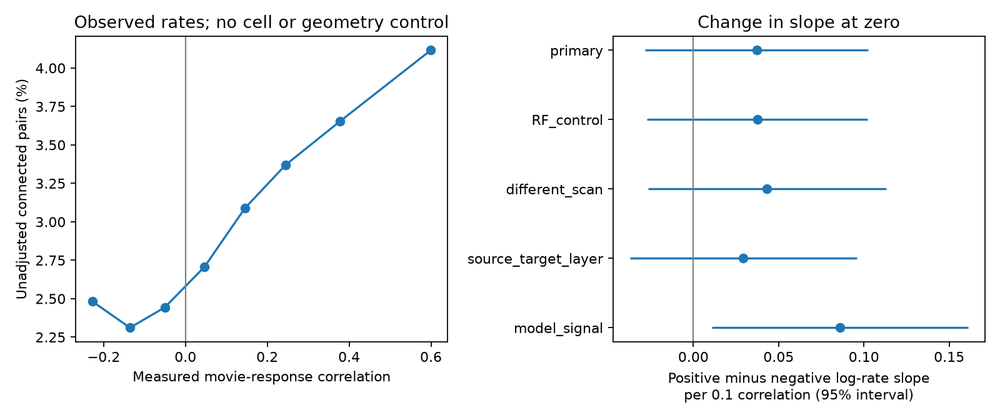

# Selected MICrONS pairs leave a slope change at zero measured movie correlation uncertain

## Question and result

Does the log connection-rate slope change at zero measured movie-response correlation? We fixed zero as the change point before fitting. A change could distinguish a rule for cells with opposed responses from a rule for cells with similar responses. We found no clear evidence for that change in this selected sample. We did not establish that the slopes are equal.

The source table had 295,371 candidate directions, 8,128 connections, 148 source cells and 11,035 target cells. Negative measured correlations occurred in 138,674 directions, with 3,331 connections. The primary fit used 163,870 directions from 148 sources and 4,811 targets. It included 73,136 negative-correlation directions and 3,331 such connections. The remaining pairs did not support finite cell intercepts or were singleton groups.

All slopes below use a 0.1 change in correlation. Brackets give nominal 95 percent intervals from two-way cell-cluster covariance and a t reference with 147 degrees of freedom. The primary slope-change test has no multiple-test adjustment. The other fits are sensitivity or secondary analyses.

| Model | Negative slope | Positive slope | Slope change | Change p | Fit pairs |
|---|---|---|---|---|---|
| primary | 0.0317 (-0.0279 to 0.0913) | 0.0688 (0.0502 to 0.0874) | 0.0371 (-0.0282 to 0.1024) | 0.263 | 163,870 |
| RF_control | 0.0335 (-0.0252 to 0.0923) | 0.0711 (0.0525 to 0.0896) | 0.0375 (-0.0271 to 0.1022) | 0.253 | 163,870 |
| different_scan | 0.0269 (-0.0377 to 0.0916) | 0.0702 (0.0504 to 0.0900) | 0.0433 (-0.0266 to 0.1132) | 0.223 | 143,000 |
| source_target_layer | 0.0432 (-0.0165 to 0.1030) | 0.0726 (0.0541 to 0.0911) | 0.0294 (-0.0373 to 0.0960) | 0.385 | 151,676 |
| model_signal | 0.0359 (-0.0338 to 0.1056) | 0.1219 (0.0838 to 0.1601) | 0.0860 (0.0110 to 0.1611) | 0.025 | 163,870 |

The primary positive-to-negative ratio of rate ratios was 1.038, with interval 0.972 to 1.108. This is a comparison of slopes. It is not a jump in connection rate at zero. The negative-side interval permits both a small negative slope and a positive slope. A clear positive-side slope with an uncertain negative-side slope does not establish a difference between them.



Left: raw connection rates in fixed correlation bins. These rates have no cell or geometry controls. Right: adjusted positive-minus-negative slope estimates and nominal 95 percent intervals. The last row uses model responses, so it is a different measurement rather than an animal replication. Counts for the raw bins are in files/bins.csv.

The secondary model-response analysis gave a larger slope change, 0.0860 (0.0110 to 0.1611; nominal p = 0.025). This is not an independent replication. It does not establish that the two response measures have different slope changes; we did not test that contrast. This secondary interval has no multiple-test adjustment. The measured-response primary test remains uncertain.

## Prior work and contribution

Ding and colleagues linked measured and model responses to reconstructed connections in the same mouse (doi:10.1038/s41586-025-08840-3). The MICrONS Consortium described the matched imaging and electron microscopy resource (doi:10.1038/s41586-025-08790-w). The release page identifies the v1 node and edge tables used here.

Campaign publication sci:sha256:c59a7cc9c394931da48264dbdd64f4dd2ef21ea50f820313c35558be9be14d07 found a positive linear correlation slope after separate source and target cell effects. We read that result and use its sample and control definitions. We wrote new code. Our contribution is a fixed, continuous change-in-slope test at zero, with an explicit interval for the slope difference. We do not claim to discover the general relation between response similarity and connectivity. We searched the campaign for connectome, MICrONS, direction tuning and nonlinear MICrONS before choosing this test.

## Data and methods

The source is the public Ding v1 functional connectomics release. We used the two files already in shared datasets. The release version is v1, not the current segmentation release. files/provenance.json records the exact shared and resolved paths, URLs, byte counts and SHA-256 hashes of the two files we read. No data were downloaded or changed in the shared store.

We used only Connected and ADP rows with positive axon and dendrite opportunity lengths, finite measured correlation and distinct source and target IDs. Each direction occurs once. Connection means n_synapses greater than zero. These are candidate directions in a selected anatomical panel, not all possible cortical cell pairs. The in_vivo_sig_corr column measures similarity of mean movie responses; it does not measure trial-residual coupling. The secondary in_silico_sig_corr_cvt column comes from a digital twin.

For source i and target j, we fitted:

log E[y_ij] = a_i + b_j + beta r_ij/0.1 + gamma max(r_ij,0)/0.1 + theta1 log(A_ij) + theta2 log(D_ij) + theta3 log(A_ij)^2 + theta4 log(D_ij)^2.

A and D are the released axon and dendrite proximity lengths. The negative slope is beta. The positive slope is beta+gamma. The primary test is gamma=0. The model is continuous at zero. We made no knot search. Poisson pseudo likelihood estimates the conditional mean for a binary outcome; we do not assume that this outcome has Poisson variance. pyfixest 0.60.0 fits the model and computes two-way CRV1 covariance for source and target IDs. All five fits converged.

The fixed effects remove additive cell effects on log rate. They do not remove pair interactions or all geometric error. The RF check adds a linear digital-twin receptive-field distance term. The different-scan check excludes pairs with equal scan_session and scan_idx. The layer check replaces source effects with source-by-target-layer effects. Its slope remains pooled across layers. files/plan.txt gives the plan made before fitting, and files/methods.txt gives further assumptions.

## Numerical checks

An independent SciPy fit removed target intercepts by profiling their Poisson likelihood. For each target, fitted rates sum to its observed number of incoming connections. A grouped softmax then gives a likelihood over candidate sources. This has the same slope optimum as the primary Poisson fit. It also retains singleton targets, which have no slope information. The independent optimizer reported success in 312 iterations. Differences from pyfixest were -3.5e-07 for beta and 3e-07 for gamma. This check verifies point estimates, not the cluster interval or biological assumptions. Full diagnostics are in files/independent_check.json. The package checks in check_fit.py require agreement within 0.001.

## Limits

This is one mouse with selected proofread axons and matched responses. It cannot test generality across animals, species, behaviors or stimulus sets. The conditional fit excludes targets with no observed incoming connection in the panel. It therefore does not estimate a rule for all neurons. The few extreme negative correlations and response measurement error can reduce precision or blur a change in slope. The confidence interval is not an equivalence test. It still permits a consequential slope difference. A smooth curve, a different change point or a discontinuity is outside this test. The model-response check uses the same anatomy and is not an independent replication.

The two-way covariance allows dependence among directions that share a source or target in the same role. It does not include every graph dependence, nor full dependence when a cell changes roles. Nominal intervals may be too narrow under other network dependence. No causal conclusion follows from these associations. We did not use these fits to predict held-out connections.

## Reproduction

Use Python 3.12 in a private environment. The run used the versions in files/requirements.txt and files/summary.json. A minimal install is numpy, pandas, scipy, matplotlib and pyfixest==0.60.0. Do not change the shared environment.

From the assigned worktree root, run:

```sh
python work/result/files/analyze.py
python work/result/files/check_fit.py
```

This reads shared raw data in place, checks their hashes in the output record, and rebuilds the pair table, results, counts and PNG. Compare the recorded hashes before interpreting the results. To work from a verified extracted bundle without raw data, run `python files/analyze.py --derived` and `python files/check_fit.py`. The bundled compressed pair table is sufficient for all fitted results and the plot. The independent fit is optional for plotting but required for the reported numerical check. Core counts can be obtained by keeping targets with a positive total outcome, then dropping singleton source and target groups until none remain.

For raw retrieval on a machine without the cache, use the campaign dataset helper separately for each URL in files/provenance.json, with its SHA-256 and a new immutable dataset name. Do not overwrite an existing dataset. The files contain Python pickle objects; load only the trusted release after checking its recorded hash.

## Job and authorship record

Job: sci-1107-dell-neural-structure-and-computation-10ab26814cbb. Topic: neural-structure-and-computation. Campaign: 11_07_2026. Machine: dell. Account: codex-andrii. Model: gpt-6.1-sol, high reasoning effort, through T3 Code and Codex. No child agents were used. The campaign-machine signing key is a bundle integrity identity. It is not a personal authorship claim. Data credit belongs to the MICrONS contributors and the cited source studies. The baseline license applies to this new text, code and derived evidence; source data terms remain applicable.
