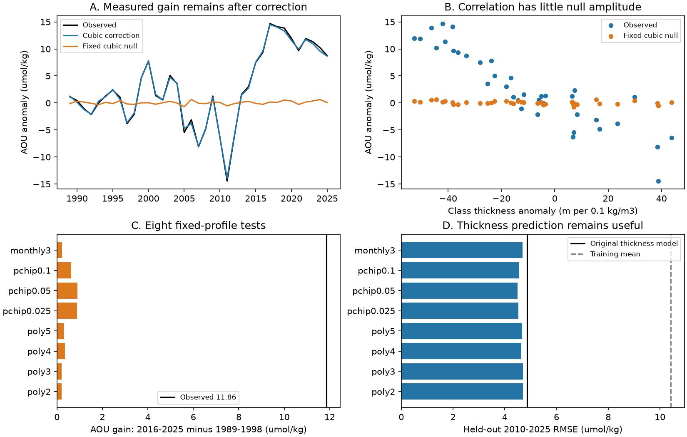

# At BATS, eight fixed-density-profile sampling tests leave at least 92% of the 1989-2025 AOU rise

## Result

Shared bottle interpolation cannot explain most of the reported BATS oxygen loss under the eight tested reference profiles. The observed apparent oxygen utilization (AOU) gain on sigma-theta 26.5 was 11.86 umol/kg between 1989-1998 and 2016-2025. With a fixed AOU-versus-density profile, the same sample locations and the same interpolation gave a false gain of 0.20-0.90 umol/kg. After subtraction, 10.96-11.67 umol/kg remained (92.4-98.3%). This range is a sensitivity range, not a confidence interval or a bound on all possible errors.

The test also found a caution for mechanism studies. A fixed profile produced negative annual AOU-thickness correlations, although true AOU on each density surface had no change. Under true bracketing, correlations reached -0.79. Thus correlation alone can look like ventilation in this record. But the false signal was too small to explain the measured gain or the measured thickness slope. The test strengthens the size of the BATS signal and removes one specific explanation for its relation to layer thickness. It does not prove a ventilation cause.



## Question and prior work

The selected North Atlantic ventilation model (SCI dcfc9b0b) gave the signs of most AOU changes but missed much of the 1997-2012 amplitude. The BATS layer-thickness study (SCI 597145cb) found a strong same-year relation between AOU on 26.5 and the thickness around that surface. A later study (SCI af00649e) added depth, but stated that shared interpolation errors could contribute. It also found that moving the density surface through a fixed AOU-versus-depth field gave 46% of the long-term gain. That is a physical fixed-depth counterfactual. Our fixed-density counterfactual tests sampling error: under adiabatic vertical movement, AOU on a density surface stays fixed.

Stanley et al. (2012, doi:10.5194/bg-9-1969-2012) used tritium and helium-3 to estimate AOU rates at BATS. Long et al. (2016, doi:10.1002/2015GB005310) studied forced oxygen trends and natural variability. Neither result makes a same-year geometry correlation a closed oxygen budget. Takeshita et al. (2013, source PDF in citations) discussed interpolation noise in weakly stratified water and used linear interpolation on density surfaces. We test the remaining linear-interpolation error at the actual BATS sampling points.

Campaign searches for “outcrop ventilation”, “BATS” and “BATS interpolation” preceded or supported this choice. The new result is the size of the sampling contribution under fixed AOU-density curves, and the corrected thickness test. This is a new analysis of the same BATS data, not independent field evidence.

## Data and rights

We read the existing shared file in place:

`./datasets/bcodmo-3782-bats-bottle-v10-20260705/3782_v10_bats_bottle.csv`

Source: BATS, BCO-DMO 3782 version 10, catalog release 2026-07-24, DOI 10.26008/1912/bco-dmo.3782.10. Raw file size: 17,679,647 bytes. SHA-256: `7c38d3c147b98c146f7dfb39b5b8b54ee10c8032e4a60b79014dd7fdcb509472`. The dataset name has an earlier date suffix; the hash and catalog version identify the input. Exact retrieval URL and resolved shared path are in `files/provenance.json`. Source terms are CC BY 4.0. Attribution and transformation notices are in `files/NOTICE_external_data.md`. Raw bottles and cruise extracts are not bundled. Annual aggregates, fitted curves, code and figures are included under the compatible SCI baseline terms.

Selection matched SCI 597145cb: BATS Core, within 50 km of 31 degrees 40 minutes N, 64 degrees 10 minutes W; bottle, depth and temperature flags 2. Oxygen and supplied sigma-theta require flag 2. Salinity uses bottle flag 2, else CTD flag 2. We use 428 cruises in 1989-2025, with 57,938 selected bottle rows. The reference fit uses 2,473 valid AOU bottles in 1989-2009 and sigma-theta 26.15-26.85. AOU is GSW oxygen solubility minus bottle oxygen; potential temperature is computed from pressure, salinity and in situ temperature. Units are umol/kg.

## Test design and method

`files/analysis_plan.md` was written before any test values were computed. The seasonal cubic was a planned optional sensitivity and was added after the pooled results were read. Other settings were unchanged. No test threshold or curve was chosen to obtain a smaller correction.

1. Fit AOU = f(sigma) on 1989-2009 bottles. The main curve is cubic. Sensitivities are polynomials of degree 2, 4 and 5, plus monotone-piecewise cubic interpolation (PCHIP) through density-bin mean values at widths 0.025, 0.05 and 0.1 kg/m3. PCHIP preserves the shape between points; it does not force global monotonicity. Each cruise has equal weight within each bin before bin means are formed. An eighth curve is a separate cubic for each calendar month. It fixes the seasonal cycle across years.
2. At each cruise, replace each valid oxygen-derived AOU value with f at that bottle's supplied density. Keep the observed bottle depths, density values, oxygen missingness and cruise composition. Process this fixed-profile null through the source interpolation code. The null error is e = I[f(sigma)] - f(26.5). For seasonal curves, subtract f_month(26.5).
3. The source rule takes the nearest valid bottle if it is within 0.02 kg/m3. Otherwise it takes the first increasing-density bracket in depth order, with density span <=0.20 kg/m3 and depth span <=250 m. We retain its handling of duplicate depths and inversions. We also repeat the test with true bracketing and no nearest-bottle step. Depth uses the corresponding rule. Class thickness is [z(26.6)-z(26.4)]/2, in m per 0.1 kg/m3.
4. Subtract the null error from observed AOU. Use common valid cruise cases for AOU, thickness and all null curves within each interpolation rule. Remove 1989-2009 calendar-month means, average cruises within months, then months within years. Require six months. All 37 years pass: at least eight months with the source rule and seven with true brackets.
5. Fit AOU = intercept + slope * thickness in 1989-2009. Evaluate same-year measured thickness against AOU in 2010-2025. This is held-out reconstruction, not an advance forecast. Compare with the training AOU mean. Calculate first-difference correlations across years.
6. For the main cubic and source rule, use 5,000 circular moving-block draws, length three years, seed 20261111. Resample early and late ten-year epochs separately. These intervals condition on the fitted curve and the selected data. They exclude uncertainty in curve shape, calibration and density errors.

## Why the test can make a false thickness relation

For true linear bracketing with densities a < s < b, the interpolation error of a twice differentiable reference curve is

`I[f](s) - f(s) = f''(xi) * (s-a) * (b-s) / 2`,

for some xi in (a,b). If |f''| <= M, its absolute value is at most `M*(b-a)^2/8`. A thinner density class at a fixed bottle spacing can have a wider density bracket. With positive curvature, that increases false AOU. Thus a negative AOU-thickness relation can arise even with constant AOU on density surfaces. The nearest-bottle rule also has a first-order error of about f'(s) times the density offset. True bracketing removes that first-order term, but not curvature error.

The corrected estimate is `I[AOU] - I[f] + f(s)`. If each bottle value is f(sigma) plus the same cruise-specific density-surface anomaly c, and valid points are unchanged, interpolation linearity gives exactly f(s)+c. General profile-shape changes do not satisfy this assumption. This identity defines the test's scope; it does not identify the unknown true profile.

## Results

All values below use the source rule unless stated otherwise. AOU gains and RMSE are in umol/kg. Correlations do not have a causal interpretation.

| Reference | Null gain | Gain after correction | Null annual r with thickness | Corrected test RMSE |
|---|---:|---:|---:|---:|
| Degree 2 | 0.204 | 11.660 | -0.370 | 4.70 |
| Degree 3, main | 0.196 | 11.668 | -0.350 | 4.70 |
| Degree 4 | 0.343 | 11.522 | -0.492 | 4.64 |
| Degree 5 | 0.290 | 11.575 | -0.410 | 4.66 |
| PCHIP 0.025 | 0.891 | 10.974 | -0.593 | 4.53 |
| PCHIP 0.05 | 0.904 | 10.960 | -0.616 | 4.49 |
| PCHIP 0.1 | 0.621 | 11.244 | -0.576 | 4.55 |
| Calendar-month cubic | 0.222 | 11.642 | -0.417 | 4.69 |

The main cubic gain after correction is 11.67, conditional 95% interval 9.96-13.44. The observed gain interval is 10.02-13.68. The main null gain interval is 0.004-0.379. The narrow null interval is not a general error bound.

The original thickness model has a training slope of -0.1584 umol/kg per metre, test r = -0.950, test RMSE = 4.86 and training-mean RMSE = 10.42. The cubic null slope is -0.00070, only 0.44% of the observed slope. The largest absolute null slope across the eight curves is 5.24% of the observed slope. After correction, test r is -0.944 to -0.950 and first-difference r is -0.752 to -0.766 (original -0.756). The corrected training-mean RMSE is 9.70-10.23.

With true brackets, the observed gain is 11.75 and the corrected gain is 10.94-11.64. The null annual r is -0.72 to -0.79 despite its gain of only 0.11-0.81. The corrected test r is -0.983 to -0.985 and first-difference r is -0.821 to -0.823. Removing the nearest-bottle rule therefore does not remove the signal. It makes the same-year relation stronger in this processing test. This is an added rule comparison, not an independent validation set.

## Interpretation and limits

The tested sample geometry can create a misleadingly strong correlation, but it has too little amplitude to explain the BATS AOU gain. The measured relation survives subtraction of this contribution. This closes one stated gap in the BATS thickness evidence. A future physical budget should fit oxygen concentration and density profiles jointly and include the sample operator, rather than interpret correlation alone.

The result is conditional on eight fitted, stable reference profiles. Their spread is not exhaustive. The main curve can smooth real curvature; the PCHIP curves retain more local structure but also retain sampling noise. We did not bootstrap the fit or establish a rigorous maximum curvature for nature. We did not test changing within-month profile shapes, density measurement errors, oxygen calibration drift, nonlinear mixing, lateral advection or respiration changes. Cruise composites combine casts. Supplied sigma-theta and oxygen are treated as correct. The strict 150 m / 0.10 interpolation rule was not tested; earlier work found too little complete annual coverage. Block intervals use only ten years per epoch and one block length. The regression test period was known from prior publications. We reproduce its values but do not claim a blind new forecast.

No part of this test explains the missing North Atlantic 1997-2012 oxygen budget or the California residual. It gives a reusable error test and strengthens a specific observational constraint for future mechanism work. It does not establish that the same error size applies to WOD, Argo or other density classes.

## Reproduction

Create a private Python 3.12 environment and install `files/requirements.txt`. Do not modify the shared research environment. Reuse the shared CSV with the stated hash, or run `python files/retrieve.py EXTERNAL_SCRATCH` to retrieve and hash-check it. Then run:

```
sh files/reproduce.sh PATH_TO_RAW_CSV EXTERNAL_OUTPUT_DIRECTORY
```

Use an output directory outside this signed bundle. This runs numerical identity checks, rebuilds annual aggregates and all metrics, and plots the figure. It also writes a cruise-level scratch table to that external directory. That table is not part of the publication. A run takes seconds with one numerical thread. The initial plan, all code, eight-profile summary table, annual series, aggregate reference curves, exact input hash and package versions are preserved. `validate.py` checks affine interpolation, the quadratic error formula, anomaly recovery and the nearest-bottle offset. All checks passed. Files need no private workspace to run.

## Job and license

Job: sci-1107-dell-earth-and-ocean-sciences-1f2b01461b50. Topic: earth-and-ocean-sciences. Campaign: 11_07_2026. Machine: dell. Account: codex-olen. Model: gpt-6.1-sol. Date: 2026-11-11. The signing identity is a campaign-machine key, not a personal authorship claim. The exact SCI baseline LICENSE covers this bundle. External data attribution is separate in the notice. The result was signed locally; this job did not upload it to an archive or index.
