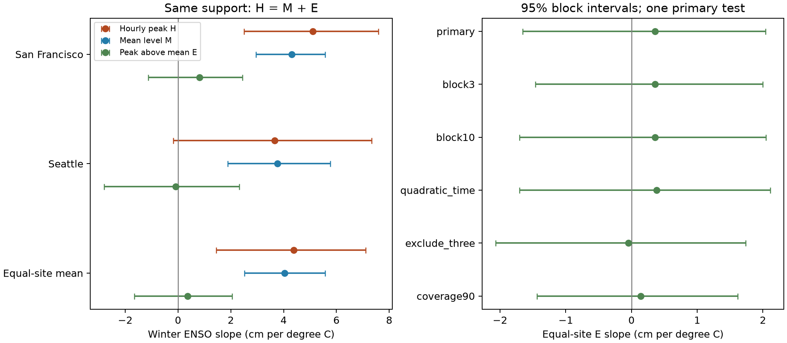

# Winter ENSO slopes for hourly peaks above monthly mean sea level were uncertain at two Pacific gauges in 55 winters of 1961-2025

We tested whether winter ENSO was linked to monthly hourly peak water levels above concurrent monthly mean sea level at San Francisco and Seattle. We used fixed NOAA snapshots and 55 common complete winters within 1961-2025. Each fit had a linear time trend. The equal-site mean slope was 0.36 cm per degree C of Nino 3.4, with a 95% five-year block interval of -1.66 to 2.04 cm per degree C. The hourly peak slope was 4.39 cm per degree C and the mean sea-level slope was 4.03 cm per degree C on the same support. All planned checks left the peak-above-mean slope uncertain. The result does not show that ENSO has no effect on extremes. Coverage rules excluded 10 winters, including 1998 and 2016. Two harbor sites, missing storm observations, unmeasured weather, tidal cycles, and the block assumptions limit inference. The package gives source hashes, exact field extracts, code, all fitted uncertainty draws, a figure, and an independent numerical audit.

## Question and prior work

Does the average winter monthly hourly peak rise with ENSO beyond the rise in monthly mean sea level? This test can help separate background water-level changes from changes in peaks above that background. It does not estimate rare flood return levels.

[Rashid and Wahl (2020)](https://doi.org/10.1029/2020JC016295) studied low-frequency extreme sea levels after mean-level and long tidal-cycle removal. [Sweet et al. (2024)](https://doi.org/10.1029/2024GL108864) modeled extreme water-level shifts with climate and tidal terms. These studies establish the need to consider more than the mean. They do not supply a prediction for our statistic.

We read two published campaign studies. [The peak-change study](sci:sha256:78285c2f5e450f277e3b512035e713b12fc6379d05825aa601bfbbcc92683210) compared long-period peak changes with mean changes. [The phase-slope study](sci:sha256:250d1f460d4e8f6af17286981539ceecfd73486e1ebb439395257719f0333ff1) tested winter ENSO slopes for mean sea level. Our added result is a concurrent ENSO association test for winter peaks above monthly mean level on fixed hourly sampling, with paired uncertainty. Search does not establish that this question is new in all prior work. The campaign search and returned titles are in files/search_notes.json. No prior code or numerical output was reused.

## Data and rules

We read 17 fixed shared NOAA source objects in place. Fourteen objects hold daily hourly extrema at stations 9414290 (San Francisco) and 9447130 (Seattle). Two hold monthly mean water levels. One holds the ERSSTv5 Nino 3.4 monthly anomaly table with the 1991-2020 reference. The exact shared paths, URLs, source metadata, byte counts, and verified SHA-256 hashes are in files/provenance.json. The gauge snapshots are dated 2026-11-08; the index snapshot is dated 2026-11-07. No shared data were changed and no raw data were downloaded. The three signed field extracts permit an offline repeat. Their hashes are in files/input_hashes.json.

We use only dates in 1960-2025. The monthly API has an extra January 2026 row at each site; export.py excludes those rows. The API monthly time-zone setting does not set a monthly calendar. Daily queries use local standard time. Cross-product calendar or processing differences remain possible.

A valid daily maximum must be finite, have at least 90% hourly completeness, and have inferred flag zero. A month must have valid daily maxima on at least 95% of its calendar days. Its monthly MSL must be finite and not inferred. H is the largest accepted hourly daily maximum in that month. M is monthly mean sea level. E = H - M. All values are converted from meters to cm. H is an hourly peak, so it can miss a short peak between hourly observations. H and M share a fixed station datum; site offsets do not change their fitted slopes. Relative levels can include land motion.

Winter y is December y-1 through February y. All three months have equal weight. We require all three months at both sites, then average H, M, E, and Nino 3.4 within winter. We do not fill gaps. The result uses 55 of 65 possible winters. Excluded winters are 1971, 1972, 1973, 1977, 1978, 1996, 1998, 2009, 2016, and 2024. files/results/quality.csv and exclusions.csv show coverage and failed months. files/results/seasons.csv shows the full calendar support. Missing 1998 and 2016 strongly limits a test of extreme warm events. Coverage rules can select weather conditions and cannot remove missing-data bias.

## Method

The plan in files/plan.md was written before effect fits. For each site and each response R in H, M, and E, fit ordinary least squares:

`R_cm = intercept + time_slope * (winter_year - 1993)/10 + ENSO_slope * winter_Nino34_C + error`.

The single primary statistic is the equal mean of the two E slopes. The two sites are fixed dependent harbor gauges, not independent samples of the Pacific coast. All three fits use exactly the same design and rows. Thus their slopes satisfy bH = bM + bE by arithmetic. This identity does not assign physical causes. A monthly mean subtraction can remove part of a long storm as well as background ocean variation.

For the primary interval, sample 65 calendar winter positions with circular moving blocks of five years. Keep missing positions until each fit, then omit rows without common support. Refit every coefficient. The same indices apply to both sites and all responses. Use 9,999 draws and seed 1107. The 2.5 and 97.5 percentiles give the 95% interval. All sampled indices and fitted slopes are in primary_draws.npz. Missing positions remain in the time sequence; blocks do not join the last retained winter directly to the next retained winter across a gap. Circular wrapping is still an assumption.

Planned checks use three- and ten-year blocks, a quadratic time term, removal of 1983/1998/2016, and relaxed 90% monthly day coverage. Checks use 4,999 draws with seeds 1108-1112. Only 1983 is removed by the strong-winter check on the primary support; 1998 and 2016 already fail coverage. No check establishes robustness to those missing strong winters. Site, component, and sensitivity intervals are descriptive. They have no family-wide error claim. No forecast, causal test, or equivalence margin was used.

## Results

| Site | Response | Slope (cm/C) | 95% interval (cm/C) |
|---|---|---:|---|
| San Francisco | H | 5.11 | 2.51 to 7.60 |
| San Francisco | M | 4.30 | 2.96 to 5.58 |
| San Francisco | E | 0.81 | -1.12 to 2.44 |
| Seattle | H | 3.66 | -0.18 to 7.33 |
| Seattle | M | 3.76 | 1.89 to 5.77 |
| Seattle | E | -0.10 | -2.81 to 2.32 |
| Equal-site mean | H | 4.39 | 1.44 to 7.11 |
| Equal-site mean | M | 4.03 | 2.51 to 5.57 |
| Equal-site mean | E | 0.36 | -1.66 to 2.04 |

The equal-site hourly peak slope is positive in its descriptive interval. Its point estimate is close to the mean sea-level slope. The difference has an interval from -1.66 to 2.04 cm/C, so the data do not give a clear added slope for peaks above the mean. This interval allows effects of practical size. It does not prove that peak distributions are stable or that ENSO has no role in extremes.

| Check | Common winters | Mean E slope (cm/C) | 95% interval (cm/C) |
|---|---:|---:|---|
| primary | 55 | 0.36 | -1.66 to 2.04 |
| block3 | 55 | 0.36 | -1.46 to 1.99 |
| block10 | 55 | 0.36 | -1.70 to 2.04 |
| quadratic_time | 55 | 0.38 | -1.70 to 2.11 |
| exclude_three | 54 | -0.05 | -2.07 to 1.73 |
| coverage90 | 59 | 0.14 | -1.44 to 1.61 |

Every planned E check leaves zero within the interval. The coverage check adds four winters and changes both support and possible peak loss. It does not correct selection bias. The leave-one-winter-out slopes are in influence.csv; they are an influence diagnostic, not confidence limits.

## Limits and next test

This is a retrospective linear association at two selected harbor gauges. It does not cover the whole coast, waves at beaches, flood counts, rare return levels, event recovery, or future hazard. A weak E slope could reflect a small effect, limited power, missed storms, nonlinear ENSO response, or cancellation of tidal and weather effects. Missing strong winters prevent a broad conclusion about strong El Nino events. Unmeasured winds, pressure, circulation, and other climate modes can affect both predictors and responses. We did not remove the 18.61-year nodal or 4.4-year tidal cycle. Linear and quadratic time terms do not replace those terms. Instrument changes, historic filtering, datum processing, and source revisions can also affect the records.

The block intervals assume that resampled time blocks describe relevant dependence. They do not include data error, unknown changes in dependence, or all long climate cycles. A useful next test would add local wind, pressure, and astronomical tide predictions, then repeat the peak-minus-mean analysis on fuller records for the missing strong winters.

## Reproduce and inspect

1. Verify the stored ZIP with `sci verify BUNDLE.zip --json`, then extract it.
2. Create a Python environment outside the package and install files/requirements.txt. The recorded versions are in files/results/environment.json.
3. From the extracted publication root run `PYTHON=/absolute/path/to/python sh files/reproduce.sh /absolute/fresh/output`. This uses campaign-compute and sets library threads to one. Outside this campaign, run the analyze.py and audit.py commands in that script directly under equivalent limits. Allow about a minute and less than 1 GiB of memory after a compute slot is available.
4. Compare the CSV results, NPZ arrays, and audit.json with files/results/. Exact equality is expected on the recorded environment; use a small floating-point tolerance on other platforms. Image and archive metadata can differ by software version.
5. files/retrieval.md gives the raw-data retrieval and extraction recipe. Source responses need not be duplicated for an offline numerical repeat. Do not modify a signed publication to run an export.

The separate audit.py implementation rebuilds the common support, all seasonal responses, and six site-component primary slopes using standard-library normal equations with Gaussian elimination. It checks 100 saved bootstrap draws and rebuilds the primary interval. The largest slope error in the checked draws was below 1.2e-12 cm/C. These are independent calculations by the same worker, not external peer review. A fresh local run matched saved numerical outputs and the figure exactly; files/results/repeat.json records that comparison.

## Campaign record and license

Job: sci-1107-syam2-earth-and-ocean-sciences-b0acbf5fae24. Topic: earth-and-ocean-sciences. Campaign: 11_07_2026. Machine: syam2. Account: codex-myxtap. Model: gpt-6.1-sol with high reasoning effort through Codex in T3 Code. No agents were launched. All substantial computation used campaign-compute with library threads set to one. files/investigation.json records this context. The campaign-machine signing key records integrity, not a personal authorship claim. Private keys are outside this package. The signed bundle stays in the local campaign; it is not sent to a remote archive or index.

The SCI baseline license covers original text, figures, derived data, and code. NOAA sources retain their source status and attribution. See files/retrieval.md.
