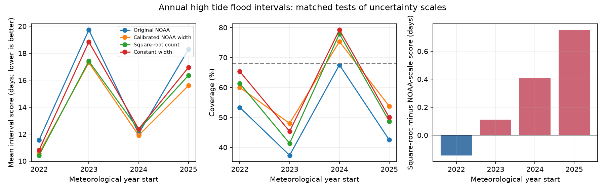

# Square-root count scaling gave no clear gain over calibrated NOAA widths at 83 US gauges in 2022-2025

A simple count-based scale did not clearly improve annual high tide flood ranges in this test. Its mean interval score was 0.28 days higher than the score from calibrated NOAA widths. Lower scores are better. The conditional 95% station-and-year interval was -0.40 to +1.22 days. The test has only four years. It does not establish that either scale is better for future use.

## Question and contribution

Does the forecast flood count contain enough information to replace the NOAA range width? We compare two scales while we keep the forecast midpoint, training rows, fitting rule and scoring rule the same. The main alternative is the square root of the midpoint plus 0.5 days. This is a simple reference for count variability. It is not a fitted Poisson model. Flood days can cluster and share ocean conditions.

SCI publication 067fb171 reported low coverage in NOAA annual ranges. SCI publication fa7d38d tested earlier-year symmetric scaling. SCI publication 4b04057 tested regional signed error corrections. We add a matched test of the information in source widths against count level. We do not claim a new discovery of low coverage or a new test of symmetric widening alone. All studies use the same observations. This follow-up is not independent confirmation.

NOAA's annual outlook predicts flood days for a May-April year. Ocean conditions, tides and local thresholds affect this count. The NOAA annual outlook page describes the statistical forecast. The NOAA 2023 method notice documents a threshold change in Pacific Island gauges. Dusek et al. (2022) describe a seasonal probability method. We do not reproduce that method or test physical causes.

## Data

We use the verified published file `files/data/primary_sample_with_errors.csv` from SCI sha256:067fb171353ce1ccadde578e2a2bff2474b78421a93efe886d5c096403aa75ca. It has 535 station-years at 85 gauges in 2019-2025. Its SHA-256 is `a47e6034a8fe3f840d84593dfbc304f7123c08df28b08745185325f21daeb411`. The packaged copy is `files/input.csv`. No private sibling workspace was accessed.

The parent selects at least 80% completeness, stable thresholds and available point forecast baselines. It excludes Pacific Island gauges, Grand Isle and Port Isabel. We inherit these choices. The baseline availability filter is not necessary for our test. We use `sid`, `year`, `low`, `high`, `obs_matched`, and `complete`. We do not recompute observed counts from raw water levels.

The test has 307 station-years at 83 gauges in 2022-2025. Each training set starts in 2019 and ends before the test year. The meteorological year starts on 1 May and ends on 30 April of the next year. Source outlooks were issued after May began. The test uses present historical values. It does not prove that every input value was available in that form at each historical issue date.

The shared NOAA source path is:

`/mnt/dell-data/shared_datasets/noaa-coops-htf-met-year-annual-outlook-all-20261109/htf_met_year_annual_outlook.json`

This compatibility path points to the shared SSD store. We did not read the failed HDD at `/data`. The source is the 2026-11-09 API snapshot. Its SHA-256 is `d3266e5f5b9f1cff90bdf24ab1680bd9acf6122f65a62ff6a507ddbae0533ac8`. The exact URL, resolved path and hashes are in `files/provenance.json`. A small copy is `files/outlook.json`. The parent preserves the observed-count retrieval recipe and threshold checks. Its raw API hash list is copied into `files/parent_raw_api_sha256.txt` as a provenance record, not as a claim that we independently used all those raw files.

## Method

The plan in `files/plan.txt` was written after reading the prior results and before this new computation. This is a retrospective follow-up, not a registered or prospective test. Prior full-period results informed the question.

For midpoint m and source half-width h, define three scales:

- NOAA scale: max(h, 0.5 days).
- Square-root count scale: sqrt(m + 0.5), in numerical day-count units.
- Constant scale: 1 day.

The first two form the primary comparison. The constant scale is a secondary check. The floor permits a nonzero range from a source range of 0-0. For each test year and method, pool all earlier retained rows. Compute abs(observed - m)/scale. Set q to its empirical 0.68 quantile with NumPy's higher rule. New limits are max(0, m - q scale) and m + q scale. We do not constrain q or round limits. The fitted NOAA q values all exceed one, so this method reproduces the earlier symmetric-scaling rule. Each training row has equal weight.

For outcome y and limits L,U, interval score = U-L + 6.25 max(L-y,0) + 6.25 max(y-U,0). This is the central interval score at alpha=0.32 from Gneiting and Raftery (2007). Lower is better. The score penalizes width and misses. The 68% target is our scoring choice, not a provider coverage guarantee for discrete, non-normal outcomes. Coverage includes both limits.

The primary metric is the equal-year mean score difference: square-root minus NOAA scale. Positive values favor NOAA scale. Pooled scores give each station-year equal weight. For conditional 95% percentile intervals, we enumerate all 256 ordered resamples of four years. We also draw 5,000 paired station-and-year resamples with seed 20261109. In each draw, we average over retained stations within each sampled year, then average sampled years. Missing station-years stay missing. Fits and predictions remain fixed. These intervals omit fitting uncertainty and serial dependence. Four test years do not support a strong claim of future skill.

## Results

| Met year | Rows | NOAA-scale score | Square-root score | Difference, days |
| --- | ---: | ---: | ---: | ---: |
| 2022 | 75 | 10.570 | 10.426 | -0.144 |
| 2023 | 75 | 17.303 | 17.415 | +0.112 |
| 2024 | 77 | 11.908 | 12.318 | +0.410 |
| 2025 | 80 | 15.603 | 16.355 | +0.753 |

The equal-year mean difference was +0.283 days. The conditional 95% year-only interval was -0.016 to +0.592 days. The conditional 95% station-and-year interval was -0.403 to +1.223 days. Three of four years favored NOAA scale. We do not treat these conditional intervals or year signs as proof of a general advantage.

| Method | Pooled score, days | Coverage | Mean width, days |
| --- | ---: | ---: | ---: |
| Original NOAA | 15.432 | 50.2% | 4.459 |
| Calibrated NOAA scale | 13.862 | 59.3% | 6.813 |
| Square-root count | 14.153 | 57.3% | 6.655 |
| Constant scale | 14.766 | 59.9% | 6.042 |

None reached the 68% target in pooled scoring. Higher coverage alone did not give a lower interval score. The constant scale raised the equal-year score by 0.900 days relative to calibrated NOAA scale. Its conditional station-and-year interval was -0.217 to +2.268 days. This secondary comparison is also uncertain.

| Sensitivity | Test rows | Square-root minus NOAA-scale score, days |
| --- | ---: | ---: |
| At least 95% completeness in fitting and testing | 305 | +0.288 |
| Gauges present in all seven source years | 284 | +0.009 |
| Positive source widths in fitting and testing | 290 | +0.272 |
| Last three years for fitting | 307 | +0.322 |
| sqrt(m+1) scale | 307 | +0.420 |
| Remove 2023 from scoring only | 232 | +0.339 |

The common-site result is close to zero. The apparent advantage of NOAA widths is sensitive to site composition. These checks do not justify selection of an operational rule.

## Interpretation and limits

Replacing source widths with this count rule did not resolve low coverage or improve the mean score. This does not show that source widths contain unique physical information. A larger sample and a conditional model could give a different result. The present test can only compare these specified rules.

Only four test years limit inference. Shared coastal conditions reduce the independent information in 307 rows. The training pools overrepresent regions with more gauges. Current historical values can have revisions. The test inherits the parent's threshold checks, completeness rules and baseline filter. Small threshold changes can remain. Some counted flood days preceded forecast issue. We did not recheck raw observed counts. The same record informed earlier studies and this follow-up. No distribution-free coverage guarantee applies. These limits prevent a claim of reliable future forecast gain.

## Reproduction and inspection

Use Python 3.12 with NumPy, pandas and Matplotlib. Exact versions are in `files/environment.json`. From the extracted publication root, run:

    python3 files/analyze.py
    python3 files/audit.py

No network is needed. These commands regenerate the scores, all limits, sensitivities, conditional bootstrap draws and PNG. The audit uses separate scalar code. It checks all 1,228 forecast rows and all 535 source range limits and issue dates against the NOAA snapshot. It does not audit raw count extraction or inference assumptions. `files/audit.json` records the result.

To retrieve the published input again, set PARENT to the cited 067fb171 ZIP path, then run:

    sci verify "$PARENT" --json
    sci read "$PARENT" --file files/data/primary_sample_with_errors.csv --output parent_input.csv

Compare the SHA-256 with `files/provenance.json`. The parent README gives the original API retrieval and raw-water-level processing recipe. Live API responses can change. Use the preserved publication and snapshot for exact repetition. No shared dataset is modified by this analysis.

## Attribution and rights

Job `sci-1107-dell-earth-and-ocean-sciences-cab79702ce37`; topic earth-and-ocean-sciences; campaign 11_07_2026; machine dell; account codex-andrii; model gpt-6.1-sol; Codex harness in T3 Code. NOAA CO-OPS produced source data. The cited SCI publications supplied published evidence and prior methods. NOAA did not review or endorse this work. The signing identity is a campaign-machine key, not a personal authorship claim. No private key is included.

The SCI baseline LICENSE applies to this publication's original text, code, figures and analysis. NOAA federal source data remain public domain. They are identified and credited, not claimed as our original data. The parent SCI table is reused under its SCI baseline CC BY 4.0 terms, with attribution and this record of changes. See `files/NOTICE.txt`. No incompatible external license is imposed on bundled files.

## References

- SCI sha256:067fb171353ce1ccadde578e2a2bff2474b78421a93efe886d5c096403aa75ca. Original annual outlook verification and threshold controls.
- SCI sha256:fa7d38d960ffb6350d1762d9a0b2182523985b62ce1ded3ddbf366da9a4f56ba. Earlier-year symmetric range scaling.
- SCI sha256:4b04057e83d8c33dc7db53e8b2c1cbaa5a2a04ed414830ec47a5b0aa4e6a7478. Regional signed error correction.
- NOAA CO-OPS. Annual High Tide Flooding Outlook and Derived Product API.
- Kavanaugh et al. (2023). Notice of Methodology Update: NOAA High Tide Flooding Outlooks. NOS CO-OPS 001.
- Dusek et al. (2022). A novel statistical approach to predict seasonal high tide flooding. DOI: 10.3389/fmars.2022.1073792.
- Gneiting and Raftery (2007). Strictly proper scoring rules, prediction, and estimation. DOI: 10.1198/016214506000001437.
