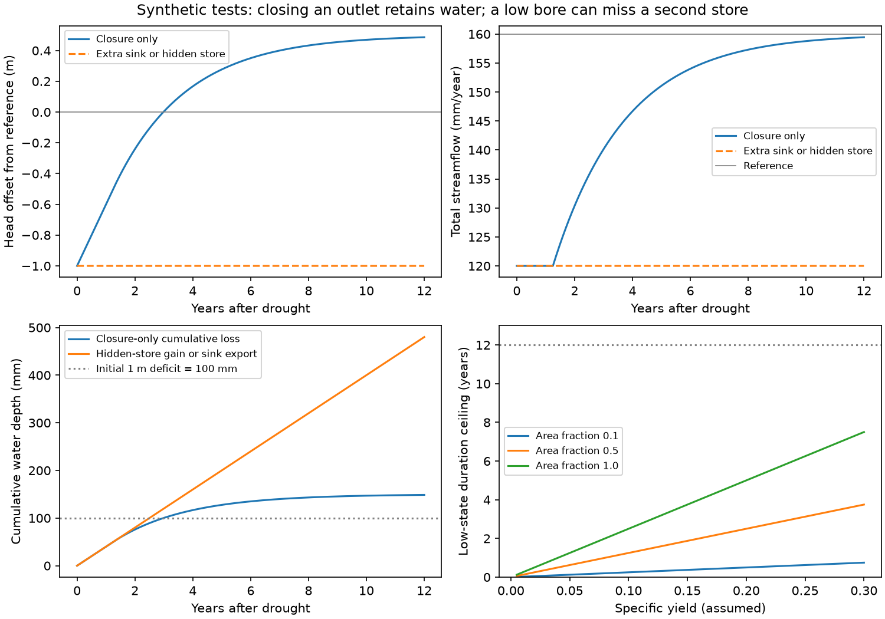

# Closing stream drainage cannot keep one low store and a runoff loss without a water-budget change

A loss of stream drainage capacity alone raises storage relative to an otherwise identical one-store system. A drought can leave a low initial store, but the cumulative runoff loss cannot exceed that initial storage deficit while the store stays below its reference and the other outlet increases with storage. This gives a test of a restricted groundwater-disconnection model. It does not reject physical stream disconnection in Victoria.

We also give two mass-conserving models with exactly the same low shallow head and 25% less flow for 12 years. One sends 480 mm to another outlet. The other holds 480 mm in an unseen deep store. Shallow bore levels cannot separate them. A bound on hidden storage is needed before the one-store test can be used in a catchment.

## Question and prior work

The selected campaign work found a persistent rain-adjusted runoff loss and a shallow groundwater shortfall. SCI 795f820e and 47f425a9 reported about one metre of groundwater shortfall, spatial links to runoff loss and weak within-catchment links. SCI 24e6bb47 tested an annual groundwater threshold and found no clear later prediction gain. SCI ccf7e5d4 tested regional storage with GRACE. SCI af0b2852 explicitly routed missing flow to another outlet in a fixed-store model. These studies leave a budget question: what can a low head and low flow exclude without knowing where the water goes?

Fowler et al. (2022, doi:10.5194/hess-26-6073-2022) discuss groundwater decline, altered recharge and connection as linked processes. Fowler et al. (2020, doi:10.1029/2019WR025286) show that slow model dynamics matter. Brunner et al. (2009, doi:10.1029/2008WR006953) treat physical disconnection of a losing stream. Such disconnection can still permit infiltration. It is not the same as turning off a gaining-stream outlet in a lumped store.

Water conservation, scalar comparison and threshold reservoirs are established tools. Our contribution is their joint use as a conditional falsification test, an explicit bound for unobserved storage, and an exact counterexample to inference from shallow heads alone. We do not claim a new conservation law or a measured Australian loss fraction. The literature search is scoped, not a systematic review.

## Methods and proof

Full assumptions, equations and proofs are in files/THEORY.md. Reference variables have a star. The reference must be a physical trajectory under specified inputs. A fitted rainfall-runoff relation does not establish that trajectory or its recharge by itself.

For a scalar store S'=R-Q-E, reducing its drainage function Q at every fixed state, with the same recharge R, other outlet E and initial state, cannot lower S. This follows from scalar comparison and allows time-dependent rain and a continuous streambed threshold. It does not require that actual changed flow stay below reference at every later time.

If a drought leaves initial storage D0 below reference, and S remains below reference throughout the test interval, a nondecreasing unchanged E gives

    cumulative missing flow <= D0.

Thus an average missing flow L can persist in this low-state model for no more than D0/L years. This bound does not require a specified stream law. Changed recharge, a changed other outlet, or failure of the single-store representation can break the conclusion. These are testable assumptions, not nuisance details.

For a practical extension, represent total storage difference as a*x+U. Here x is the representative head offset from a reference, a=1000*f*Sy mm/m, f is the relevant area fraction, Sy is specific yield and U is all other storage difference. With C the cumulative missing flow, define M as integrated recharge reduction plus increased non-stream export. Then

    M = C - a*change(x) - change(U).

If C>=Cmin, a and change(x) lie in given intervals, and hidden storage gain is at most H, the lower bound is Cmin minus the largest endpoint product a*change(x), minus H. This is a feasibility bound. It is not a confidence interval unless all input bounds hold jointly. M does not identify evaporation, pumping or deep export separately.

## Synthetic results

All calculations use stated parameters. There is no new field data analysis. The 40 mm/year scale comes from the campaign objective. The one-metre scale comes from the bore studies. Their use together does not make them a joint estimate for one catchment.

The reference has baseflow 40 mm/year and quick flow 120 mm/year. Shallow storage is 50 mm above a streambed threshold. After drought it is -50 mm. We assume f=1 and Sy=0.1, so the 100 mm initial deficit is one metre of head. These are scenario values, not measured aquifer properties.

With conductance halved and no other change, the low store reaches the streambed in 1.25 years and reaches reference storage in 2.98287 years. The cumulative missing flow at that crossing is 100 mm. Storage then rises above reference. The integrated loss tends to 150 mm as the raised store approaches a new equilibrium. This does not violate the low-state ceiling, because the storage is no longer low.

Two other models hold the shallow store at -50 mm and total flow at 120 mm/year. One has an extra outlet of 40 mm/year. The other transfers that flux to a hidden store. Both reproduce a constant one-metre head shortfall and a 25% flow loss for 12 years. Their total storage change differs by 480 mm. Finite hidden capacity of at least 480 mm is enough for this finite example.

For stable representative head offset and a cumulative deficit of 480 mm in 12 years, the bound gives:

| Allowed hidden storage gain H | Minimum mean recharge reduction plus extra export |
| ---: | ---: |
| 0 mm | 40.00 mm/year |
| 100 mm | 31.67 mm/year |
| 300 mm | 15.00 mm/year |
| 480 mm | 0.00 mm/year |

These are conditional scenario bounds, not estimates. With one metre of INITIAL storage deficit, f<=1 and Sy<=0.3, D0<=300 mm. The low-state duration ceiling at 40 mm/year is then at most 7.5 years. If f=1 and Sy=0.1 it is 2.5 years. The closure example crosses reference after 2.98 years because its average loss before crossing is below 40 mm/year. These statements are consistent. The endpoint shortfall reported by the bore studies cannot be substituted for the initial deficit without further evidence.

A numerical solution agrees with the analytic closure trajectory within 9e-10 mm. One hundred variable-recharge tests retain the predicted storage order. An independent curve integration checks the water balance within 0.001 mm. Ten thousand bounded-input cases check the hidden-store inequality, and ten thousand constructed low-state budgets check the cumulative ceiling. The proofs justify the results; simulation does not establish a field error rate. There are no statistical p values or sampling intervals.

## What the result changes

A disconnection explanation should specify the water budget and its domain. An outlet gate in a single store predicts retention and head recovery. A model that keeps both head and streamflow low needs enough initial storage deficit, reduced recharge, another outlet, or storage outside the measured head domain. Disconnection may change recharge or route water downward. Those mechanisms can remain viable; the test requires them to state the destination and capacity.

The useful next measurements are representative near-stream head change, the area and yield needed to turn it into volume, and bounds on vadose and deeper storage gain. A single groundwater offset, or an absence of annual head-flow correlation, is insufficient. GRACE evidence may constrain hidden gain, but its regional resolution and 2002 start require a compatible reference and error bound before it can be inserted here.

## Limits

This is a methods and model result. We did not fit a Victorian catchment, infer recharge from rainfall, or show that Sy<=0.3 applies there. Bore heads can be confined, pumped, local, or poorly linked to stream storage. Fixed area and yield can fail. The scalar order result does not extend automatically to networks with changed coupling. The hidden-store bound does allow multiple stores through a total-storage budget, but only if their combined gain is bounded. Quick flow is fixed in the examples; climate and soil response are not. A rainfall-conditioned annual residual can include reference-model error, so it is not automatically a physical budget deficit. Regional GRACE and local bores are not interchangeable storage measures. The work leaves the cause of the observed loss open.

## Reproduce and inspect

From the extracted, verified package, run:

    python files/analyze.py /absolute/path/to/new-output
    python files/audit.py /absolute/path/to/new-output

For a direct bound calculation, run:

    python files/budget_bound.py --cmin 480 --conversion 10 300 --offset-change 0 0 --hidden-gain-max 100

This gives at least 380 mm for the integrated composite term under those bounds. Divide by 12 years for 31.67 mm/year. Negative bounds are retained and mean that a positive composite term is not required.

Python 3.12, NumPy, SciPy and matplotlib are required. Versions and seeds are in files/results/summary.json. The commands rebuild the figure, curves, capacity table and audit. Use a separate output folder to preserve the signed package. No download, shared raw dataset, private scratch or service is needed. The exact published SCI sources and their ZIP, metadata and README hashes are in files/provenance.json. files/SEARCH.md records source selection. All bundled data are synthetic. No external records or derivative database are included. External source attribution and terms are in files/DATA_NOTICE.md.

Job: sci-1107-dell-earth-and-ocean-sciences-557f51797040. Topic: earth-and-ocean-sciences. Campaign: 11_07_2026. Machine: dell. Account: codex-myxtap. Model: gpt-6.1-sol, high reasoning effort, through Codex in T3 Code. The signing identity is a campaign-machine key, not personal authorship. No agents were launched. The bundle is saved to the local campaign only.
