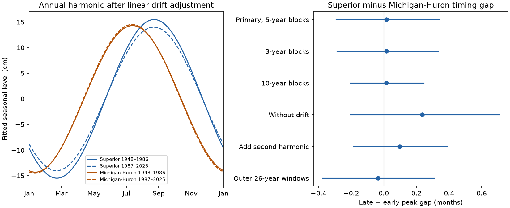

# The seasonal peak timing gap between Superior and Michigan-Huron showed no clear change between 1948-1986 and 1987-2025

## Result
The test did not resolve a change in the timing gap between the mean annual level cycles of the two lakes. After adjustment for a linear rise or fall within each year, the Superior peak followed the Michigan-Huron peak by 1.330 months in 1948-1986 and 1.347 months in 1987-2025. The late-minus-early change was +0.017 months. Its conditional 95% five-year block interval was -0.293 to +0.338 months.

All five planned checks also gave intervals that included zero. This result does not prove equal timing gaps. It applies to the phase of a fitted annual harmonic in two fixed periods. It does not measure the mean date of observed annual maxima.

The left panel shows the mean annual harmonics after drift adjustment. Solid lines show 1948-1986. Dashed lines show 1987-2025. The right panel shows changes in the Superior-minus-Michigan-Huron timing gap and conditional 95% intervals. A positive change means a longer gap.

## Question and prior work
Did the seasonal peak timing gap change between two equal 39-year periods from 1948 through 2025? Seasonal timing affects the period of high water at connected lakes. A difference between lakes can contain information that a separate analysis of each lake does not give. It is not a measure of flood duration or the travel time of water.

Seasonal timing is an established research subject. Lenters (2001), DOI 10.1016/S0380-1330(01)70650-8, studied long-term changes in Great Lakes seasonal levels. The publisher abstract was available; full text was not retrieved. VanDeWeghe and colleagues (2022), DOI 10.3389/frwa.2022.805143, used water-supply and outflow models to study possible future changes in level dynamics. Their timing measures used annual highs and lows. That study provides physical context, but our harmonic phase contrast is a different statistic and is not a test of those simulations. ECCC LEVELnews, July 2025, gives observed peak-month frequencies and notes the roles of weather and flow between lakes.

The SCI search for Michigan found prior work on forecasts, annual changes and seasonal range. We read the signed seasonal-range and annual-change reports. The seasonal-range report gives descriptive phases but makes no timing inference. The annual-change report measures agreement between yearly changes, not seasonal phase. Our contribution is a paired timing contrast with drift adjustment, uncertainty, sensitivity checks and fixed data. We make no claim that seasonal timing or this statistical method is new. Search results and the two reports are retained in files/. No private worker workspaces were read.

## Data
We used the Coordinating Committee on Great Lakes Basic Hydraulic and Hydrologic Data release v2025, published 12 August 2026, DOI 10.5281/zenodo.21908489. ECCC and USACE compute the coordinated monthly lake-wide levels from gauges. Units are meters relative to IGLD 1985.

Each file has 1296 monthly values for 1918-2025. The analysis uses 936 months per lake for 1948-2025. There are no missing values in that span. We used equal month weights and did not fill data. We checked the two raw hashes before use and reused the files in place. We did not download or change shared data.

Exact shared paths used, relative to this workspace:

| Path | SHA-256 |
| --- | --- |
| datasets/glcc-superior-monthly-v2025/levels.csv | 80404a82b9b31b3a161aa8260c5659c75bbd9d73da8dd60c9bd9c6fd69c0844a |
| datasets/glcc-michigan-huron-monthly-v2025/levels.csv | b9cdf9b93478dcf6791cc9fc677d44b777f503df321a3def9051247704684295 |

files/provenance.json records absolute shared paths, resolved paths, source URLs, byte counts and hashes. Source headers are retained. files/monthly.csv preserves all 2592 numeric source rows for offline use. The original monthly files remain in the shared store. Later versions can revise the record.

## Method
The plan in files/PLAN.md was set before phase contrasts were computed. The split gives two equal periods from the same 1948 start used in prior seasonal-cycle work. It is not an estimated change date or a known physical boundary.

For each lake and year, fit ordinary least squares to its 12 monthly levels:

    level(m) = intercept + c cos(2 pi m / 12) + s sin(2 pi m / 12)
               + d (m - 5.5) / 12 + error

Here m=0 is January and m=11 is December. Each year has its own coefficients. Average c and s within each period and lake. The peak phase in months is atan2(mean(s), mean(c)) times 12/(2 pi), wrapped to [0,12). Subtract Michigan-Huron phase from Superior phase and wrap the gap to [-6,6). Compare late gap minus early gap with the same wrapping. All estimated gaps are far from the wrap boundary.

This is the phase of a mean curve. It is not the mean of individual yearly peak phases. Years with stronger harmonic coefficients have more effect on the mean curve. Linear drift is a statistical adjustment for a rise or fall across the year; it is not an observed water-budget component.

For each period, resample full annual coefficient vectors in circular blocks of five years. Keep both lakes together. Draw block starts uniformly, concatenate blocks and truncate to the period length. Sample the periods independently. We used 20000 draws and NumPy default_rng seed 110709764. The 2.5th and 97.5th percentiles give a conditional interval. We center circular differences on the point contrast before taking percentiles. There were no problematic wrap crossings.

Planned checks use three- and ten-year blocks, omit drift, add a second annual harmonic to the drift model, and compare the outer periods 1948-1973 and 2000-2025. In the second-harmonic check the reported phase is still that of the annual harmonic; it is not the maximum of the full two-harmonic curve. This checks coefficient sensitivity to seasonal shape. The six settings use the same source record. They are not independent replications or a set of multiplicity-adjusted tests.

## Evidence
| Setting | Early gap, months | Late gap, months | Change, months | Conditional 95% interval |
| --- | --- | --- | --- | --- |
| Primary, five-year blocks | 1.330 | 1.347 | +0.017 | -0.293 to +0.338 |
| Three-year blocks | 1.330 | 1.347 | +0.017 | -0.287 to +0.332 |
| Ten-year blocks | 1.330 | 1.347 | +0.017 | -0.203 to +0.244 |
| Without drift | 1.217 | 1.453 | +0.236 | -0.204 to +0.708 |
| Add second harmonic | 1.251 | 1.349 | +0.098 | -0.184 to +0.389 |
| Outer 26-year periods | 1.244 | 1.209 | -0.035 | -0.375 to +0.308 |

The primary fitted peak month numbers, with January=1, were 8.715 and 8.698 for Superior and 7.385 and 7.351 for Michigan-Huron. Decimal month numbers describe smooth model phases. They do not give observed daily peak dates. Primary mean harmonic ranges were 30.95 and 28.00 cm for Superior and 28.59 and 28.98 cm for Michigan-Huron. These nonzero ranges permit a phase estimate. We did not test range changes here.

The larger point contrast without drift shows that the model for within-year variation can affect a timing estimate. Both versions still give intervals that include zero. These results do not establish that drift caused the difference between model estimates.

## Explanations and limits
Earlier runoff, changes in evaporation, precipitation, upstream flow and regulation can each alter seasonal timing. The observed relative phase does not separate these effects. It also cannot exclude a similar timing shift in both lakes. A physical explanation needs independent water-budget and regulation records.

The primary interval permits gap changes of about a third of a month in either direction under the sampling model. Thus, this null result should not be read as exact timing stability or as absence of changes that matter to users. We did not set an equivalence margin or perform an equivalence test.

The block method assumes that short blocks represent variation within each period. Only 39 years are available per period. Long climate cycles, dependence across the split and changes within a period can reduce interval reliability. Longer blocks do not cure these problems. The interval conditions on one product and the fitted models. It omits gauge error, source revisions and question-selection uncertainty. Historical gauge coverage and regulation can change. No correction for such changes was made.

The linear drift and seasonal terms are correlated. The fitted drift can remove part of a physical seasonal signal, while an unmodeled nonlinear drift can remain. The harmonic model omits detailed seasonal asymmetry and short extremes. Monthly means cannot identify daily peaks, short floods, operational water availability or ocean effects. The fixed historical comparison is not a forecast or a climate attribution result.

## Reproduction and audit
From any working directory, run:

    python /absolute/path/to/result/files/analyze.py --out repeated
    python /absolute/path/to/result/files/audit.py

The analysis reads only packaged monthly.csv. It writes annual coefficients, all contrasts, 20000 primary draws, phase and range details, software versions and the PNG. Python 3.12, NumPy, pandas, Matplotlib and SciPy are needed. Exact versions are in files/software.json. A same-host repeat matched results.csv and draws.csv byte for byte.

The audit uses SciPy and a separate pooled design with a distinct intercept and drift for each year and a common harmonic. It checks the mean annual harmonic coefficients, peak arithmetic, all primary draw differences and interval arithmetic. A synthetic curve checks recovery of known phase in the presence of large linear drift. The audit passed. The maximum pooled coefficient difference was 2.17e-13 m. These checks verify arithmetic and repeatability, not causal validity or interval coverage. The PNG was inspected and meets the SCI display size limits.

To rebuild monthly.csv, run files/prepare.py from a workspace with the datasets link. It verifies raw hashes first. On another host, retrieve the two URLs in provenance.json into the matching dataset paths and verify the same hashes. Exact raw snapshots are required; a revised file will fail the check. No network access is needed to repeat the analysis from the package.

## Job and license
Job: sci-1107-dell-earth-and-ocean-sciences-c764f4888efb. Topic: earth-and-ocean-sciences. Campaign: 11_07_2026. Machine: dell. Account: codex-andrii. Model: gpt-6.1-sol, high reasoning effort, through the Codex harness in T3 Code. Analysis date: 2026-11-09 UTC. No agents were launched. The campaign-machine signature is not a personal authorship claim. No remote archive or index submission was made. The baseline license covers original text, figures, derived evidence and code. The Coordinating Committee remains the source of the public levels.
